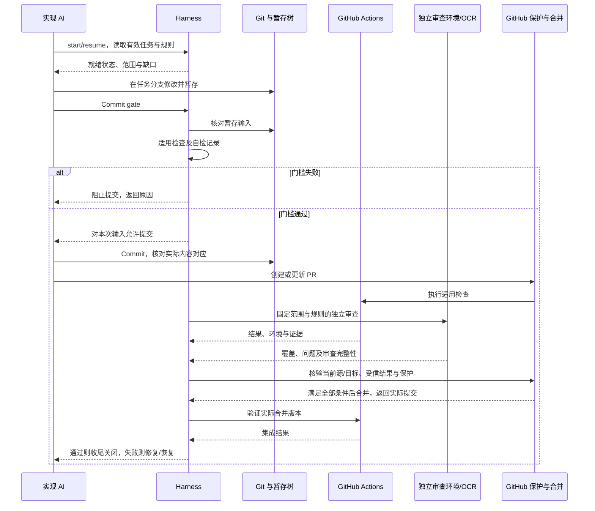

# Harness 任务执行与恢复方案

> 实施状态同步（2026-10-19）：用户已授权开始接入。当前用 Python 标准库与 PowerShell 建立本地文档/派生检查、环境检查、审查冻结和记录核验子集，已初始化本地 Git；六操作完整状态机、远程、hooks/CI/保护尚未部署。实际命令见 [接入指南](../../../workflow/SDD与CodeReview接入指南.md)，以下完整设计及此前阶段说明不等于全部已实现。

日期：2026-10-18（Asia/Shanghai）。修订：草案 1。状态：轻量 Harness 方向已确认，本文细节待审阅；尚无可执行工具、任务数据库或远程仓库。

用户已明确仓库属于其个人 GitHub 账户、可见性为公开；组织账户和 Pro 不作为建设前提。本记录不表示仓库已创建、保护已配置或授予任意公开发布权限。

范围补充：用户明确引擎架构、依赖与第三方库将在另一份项目技术文档中讨论。Harness 读取该文档的有效版本、确认范围与命令契约，不承担重新选型；其调度、证据和阻断机制可先独立建设并验证，实际项目构建/GPU 检查接入前如实标记未就绪。

依据：[总体工作流](AI开发工作流讨论稿.md)、[AI 任务规则](../../../standards/AI任务执行规则.md)、[提交与合并门槛](提交与合并门槛落地方案.md)、[CI 资源约束](../../../standards/CI资源与费用约束.md)、[OCR 评估](../../../research/OpenCodeReview适用性评估.md)。

## 1. 职责与第一版边界

Harness 是把已确认流程变成可执行门槛的薄控制层：检查任务就绪、冻结输入、选择检查、执行并保存结果、判断状态和恢复。OpenSpec 管理变更资料，Git 管理源码，Actions 调度 CI，OCR 候选承担独立审查；不把所有能力重新实现进 Harness。

第一版建议本地命令行加共享检查实现，不先建设网页平台、长期驻留多 Agent 调度器或复杂分布式任务系统。实现语言建议优先 Python 3，PowerShell 负责必要的 Windows/VS 环境入口；这是待确认选择，不引入实现代码或额外依赖。

AI 负责设计与修改，受信检查入口负责验证规则；实施者写“通过”不产生批准。每个检查器能证明什么、无法证明什么都应明确。

## 2. 六个统一操作

操作名是职责标识，不是已存在命令。

| 操作 | 输入与职责 | 输出 |
| --- | --- | --- |
| start / resume | 核对任务、授权基线、工作区与所需环境 | 就绪状态、有效记录与下一步 |
| plan-checks | 按受信影响规则识别直接与间接消费者 | 必需检查集合、不适用依据、资源需求 |
| verify | 在对应受控输入上执行本地/CI/硬件检查 | 真实结果、环境、诊断与证据索引 |
| review | 准备变更与依据，接收独立审查结果 | 覆盖信息、问题及版本绑定结论 |
| gate | 判断本次提交或合并是否满足所有前提 | allow/block、逐项依据与缺口 |
| integrate / close | 验证实际合并版本，同步资料与收尾 | 集成结果、关闭记录或恢复动作 |

各操作可重复调用，但不无条件重复外部副作用；网络响应丢失后先查询实际 PR/检查/合并状态，再决定重试。预算与并发沿用 CI 资源方案。

## 3. 任务状态

建议主流程为：draft → ready → implementing → verifying → reviewing → merge_ready → merged_pending_validation → done。

| 转换 | 条件 |
| --- | --- |
| draft → ready | 目标、范围、验收和适用已确认方案完整；缺项列出具体问题，不笼统要求所有文档重批 |
| implementing → verifying | 有可定位变更，已生成适用检查计划 |
| verifying → reviewing | 本次必需验证通过，或按可独立检查的分段开展审查；未验证项仍禁止进入 merge_ready |
| reviewing → merge_ready | 必需验证有效，独立审查完成，阻塞与必须修复项清零，基线及平台条件满足 |
| merge_ready → merged_pending_validation | 核对源/目标状态后实际合并成功并记录合并提交；请求成功但未确认合并不能推进 |
| merged_pending_validation → done | 实际主分支集成验收通过，适用文档/归档收尾完成 |

等待用户决定记为 waiting_decision，外部环境/预算使必需步骤不可执行记为 blocked，保留原阶段与具体恢复条件。用户明确暂停才进入 paused；取消记为 cancelled。没有自动将超时转为通过的路径。

失败后回到相应修改/验证阶段，保留之前运行；不要删除失败历史。上述是项目任务状态，不改变聊天工具自身的状态语义。

## 4. 输入与证据绑定

每次 gate 至少核对以下信息：

- task_id、change_id 与需求/方案的有效修订或内容标识、确认范围。
- 仓库身份、源基线、目标基线；Commit gate 使用父提交与暂存树，PR gate 使用精确审查/集成范围。
- 检查规则与工具配置标识、适用检查集合、实际工具链和硬件能力。
- 每项运行的 ID、状态、原始输出/附件标识、执行者及可核验来源；Review 增加覆盖范围、模型/规则与问题处理记录。

源码、规则、模型、目标或环境变化时按实际影响判断哪些结论失效。复用必须说明理由；不能只因文件存在、内容含“passed”或同一分支名就采信。

初期可以用小型 JSON 记录与追加事件索引保存状态，但普通项目文件只是记录载体，不是信任根。远程批准由受信身份/平台状态核验，不能从 PR 分支提交的 review.json 自行生成合格检查。哈希用于核对内容，不证明是谁执行、是否真实执行。

证据与被审对象分离，生成报告不无意义地改变源码身份、引起无限复审；实际涉及规则/代码变动仍应重判。实现记录文件的原子发布、并发写入与 schema 版本迁移在工具方案中落实。

## 5. 调用关系与关键时序

图 HARNESS-SEQ-01：候选职责时序，未承诺独立审查环境已可调用。

图中同意提交与实际 commit 之间仍需防输入变化：hook/执行器核对指纹，变化则重检。合并前同样防源/目标变化；具体平台并发与条件更新方式在接入时验证，不用本地图保证原子性。

## 6. 失败恢复

| 情况 | 恢复策略 |
| --- | --- |
| AI 会话中断 | resume 读取任务记录并核对实际工作区、分支与远程状态，不从聊天总结猜测 |
| 构建/测试失败 | 保留输入与结果，定位代码或环境，修改后重验受影响集合 |
| OCR 部分失败、预算耗尽 | 记录不完整并阻止所需审查门槛；恢复时核对可复用文件与规则，不用退出 0 放行 |
| PR 更新/目标推进 | 重新生成差异与集成检查需求，旧证据按影响判断 |
| 合并响应丢失 | 查询 PR 与实际提交，不盲目重复合并或收尾 |
| 合并后失败 | 停止依赖该结果的任务，按已确认恢复策略修复/revert，通过后再关闭 |

对未完成外部动作记录 pending 和可查询标识；没有查到成功不能填成功。重试、进程和文件清理遵循已有预算/副作用边界。

## 7. 基础建设的实际完成条件

按顺序完成最小闭环：

1. 建立工作流自身运行环境、规则/任务入口与受控检查用例；从另行确认的项目技术文档接收 VS/C++ 构建与测试契约。工具链的实际标准开关由对应技术任务核验，不阻止先验证 Harness 本身的状态/失败机制。
2. 建立 Git、明确个人公开远程的实际地址与发布范围；接入任务记录和 Commit gate。
3. 接入 Actions、受信结果和主分支保护，验证失败检查确实阻止合并。
4. 固定 OCR 版本/规则，完成受控样本试审，提供独立审查执行环境与门槛适配器。
5. 首批渲染任务前建立受控 GPU 检查，覆盖对应真实能力；没有 GPU 的本地工具任务按不适用依据处理。
6. 以一个真实小变更跑通提交、PR、审查、合并、集成与收尾，再模拟失败/新提交/中断恢复。

脚本能运行、负向用例能阻止、版本变化能使旧证据失效、恢复后与实际仓库一致，才可称 Harness 对相应能力已启用。未建好的环节不能放占位绿色检查。总体架构、具体工具版本、远程与身份仍按各自决策落实，不因本文已画图就视为完成。

本轮仅编写方案、核对项目文档及本地链接；没有创建远程仓库、安装框架、调用 OCR/模型或启动 CI。

## 8. Codex / Cline 多 Agent 运行建议

日期：2026-10-18。状态：用户询问运行方式，本节为建议，不代表已授权启动 Agent、创建聊天或改动客户端配置。当前能力以本次读取的官方说明为依据，实际客户端版本与账号可用性实施前验证。

后续明确决定：用户要求“不要多个 worktree”，本项目使用单一本地工作区，取消下述来源材料涉及的多工作区运行建议。角色可以有独立上下文，但开发、测试、审查按冻结输入顺序交接，不并行写入。

### 工具能力与协作区别

[OpenAI Docs：Subagents](https://learn.chatgpt.com/docs/agent-configuration/subagents) 说明 Codex 可由主 Agent 分派子任务、收集结果，子 Agent 使用各自上下文并增加 token 消耗。不要把当前聊天中直接改角色称呼当作独立审查，也不要假设新上下文自动获得独立文件权限。

[OpenAI Docs：worktrees](https://learn.chatgpt.com/docs/environments/git-worktrees) 是已调查的产品能力来源；按用户最新决定，本项目不采用多个 worktree，也不据该来源自动创建工作区。子 Agent 的独立上下文不等于独立文件系统。

[Cline Subagents](https://docs.cline.bot/features/subagents) 当前说明支持 CLI/Desktop，VS Code 与 JetBrains 扩展不使用该能力；[Agent Teams 官方源码文档](https://github.com/cline/cline/blob/main/docs/cli/agent-teams.mdx) 也明确 VS Code 扩展不适用。因此不能承诺用户已有的 VS Code Cline 安装直接支持 /team 自动协作，先核对实际版本。

Codex 与 Cline 是两套执行入口。当前未验证共同任务队列、消息互通或统一会话控制；多个聊天不会仅因打开同一个仓库就自动形成可靠团队。跨工具自动化需经过 Harness 适配，不依赖用户长期手工转发所有结果。

### 第一版角色安排

| 角色 | 建议职责与执行形式 | 边界 |
| --- | --- | --- |
| 协调/方案 | 主聊天读取基线、设计、拆分、分配、汇总 | 不自行批准需求/架构改变，不绕过 gate |
| 开发 | 一个聚焦任务的 Codex 或 Cline 执行上下文 | 在分配工作区实现和补充测试，不顺带改其他任务 |
| 独立审查 | 新上下文或完成试用的 OCR，读取固定差异与依据 | 报告问题、核查测试有效性；不直接修改被审代码或自放行 |
| 验证执行 | Harness、CTest、Actions、受控 GPU 程序 | 产生真实结果，不需要为每次运行单独维持一个测试聊天 |

架构设计和测试设计是按阶段分配的职责，不要求常驻“架构 Agent”“测试 Agent”各一个。测试复杂、失败难定位时可临时分配测试调查任务；实际验收由运行结果支持。设计审查同样需要有效独立检查，不能省略用户对关键方案的确认。

采用串行开发与交接：同一时间只有一个写入执行者。开发冻结本轮代码后，再测试和独立审查；需要修复时归还写入权，修复后重新冻结并核验。只读调查可在稳定输入上按预算并行，但不得与正在变化的源码混用；发现源码变化必须重新确认输入。资源总量计入子 Agent 与 OCR 的内部并发，不能只数聊天窗口。

### 写入隔离与交接

- 单一本地工作区内，修改源码、切分支、暂存、提交等操作串行，只由当前写入执行者操作；其他聊天/Agent 等待交接，不创建额外 worktree。
- Harness 需要记录当前写入执行者、任务和工作区状态，并在统一操作入口检查；锁与记录不能约束绕过入口的其他 GUI 操作，实际剩余权限边界需如实说明。公共接口变化先统一契约再顺序实施。
- Review/验证固定源码提交或受控快照，测试新实现时不能误用 main 或其他分支的二进制。审查只读通过实际权限/执行器约束，提示词不作为强制隔离。
- 构建/运行产物使用配置与任务明确的目录，防止复用错误二进制；GPU 按既有规则串行。验证期间不改受验源码，任务拥有的输出与资源明确，不复制用户全部本机凭据。
- 协调者提交任务包：任务 ID、源/目标版本、已确认依据、允许改动范围、工作目录、验收、依赖及预算；执行者回传提交/补丁、实际检查、未解决项和下一步。
- 基础建设先验证单工具调度；Cline 可作为辅助调查或独立第二上下文，但不要求每项任务跨两个产品搬运。需要长期无人值守时，再验证所选 CLI/SDK 的任务与结果接口，不能靠自动点击聊天窗口替代可靠调度。

本节没有启动任何子 Agent、新聊天或多工具执行环境，也没有安装 Cline CLI、创建 worktree 或修改用户级配置。
