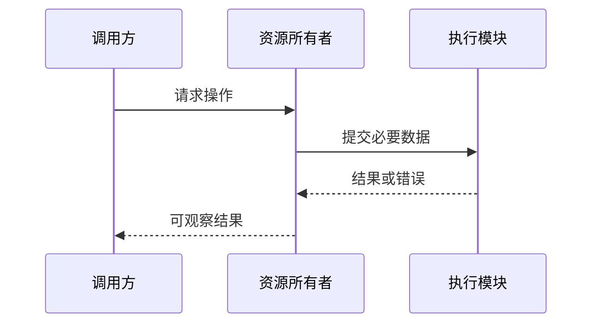

# 总体架构模板

> 用途：定义全局边界和约束，不以罗列 ECS、Jobs、RHI 等术语代替设计。已确定、待验证和暂缓的决策分开。

> 组织参考：[arc42](https://arc42.org/overview/) 的系统边界、模块分解和运行视图；图示参考 [C4](https://c4model.com/diagrams) 的分层表达。下述章节为本项目重新组织，不是对原模板的全文翻译。Mermaid 是拟采用的图示载体，不要求机械补齐 C4 全部层级。

## 元信息（必填）

- 文档 ID / 修订 / 状态：<填写；默认草案>
- 创建及更新日期：<实际日期>
- 需求依据与适用阶段：<链接及版本>
- 关联 ADR / 确认记录：<链接；未确认写无>

## 图目录与选用依据（必填）

按 [架构与设计图规范](../../../standards/架构与设计图规范.md) 选择图种。系统边界、模块依赖及阶段关键运行时序是总体架构最低要求；核心类型、状态、数据流和部署图按触发条件增加。

| 图 ID | 类型/标题 | 对应设计问题 | 状态 | 图所在章节/引用 |
| --- | --- | --- | --- | --- |
| <图 ID> | <图种> | <要解释的问题> | <拟议/已确认设计/已核验实现> | <位置> |

## 架构目标与约束（必填）

<需求如何驱动架构；独立运行、编辑器边界、可观察性及阶段范围。>

## 模块与依赖（必填）

### 系统边界图（必填）

<画出引擎、编辑器、独立调用程序与外部输入/输出；标明进程或程序边界和外部依赖。不要把所有模块压在一张图里。>

### 模块关系图（必填）

<画出各模块的实际依赖方向，必要时对子模块展开；运行时数据流与静态代码依赖分开画。图中的模块名称必须与下表一致。>

以下仅为标注方式示例，不是已选定的引擎架构：

每张图必须说明箭头含义、范围与状态（拟议/已确认/已实现）。禁止用无标注的双向箭头隐藏职责不清或循环依赖。

| 模块 | 职责及不负责的内容 | 对外能力 | 允许依赖/禁止依赖 | 所有的数据与资源 | 代码位置/契约引用 |
| --- | --- | --- | --- | --- | --- |
| <模块> | <责任边界> | <接口职责> | <目标与原因> | <归属> | <引用或待建设> |

<至少明确 Runtime 与 Editor、平台和图形后端的边界。C4 的 container 表达运行/部署单元，不将每个 C++ 模块直接冒充一个 container。>

## 主流程与数据流（必填）

<以时序图或流程图展示启动、单帧执行、场景/资源加载和关闭等关键链路；覆盖哪些链路由阶段目标决定。关键链路不能只列函数名，需要标出参与模块、输入输出和失败传播。>

### 关键运行时序图（必填）

以下仅为时序表达示例，正式实例替换为实际模块和事件：

<涉及 CPU/GPU 时另画提交与完成的时序，明确等待条件、在途资源与释放点；不能将 CPU 提交返回当作 GPU 执行完成。>

## 所有权、生命周期与同步（必填）

| 数据/资源类别 | 所有者 | 使用者 | 释放条件 | 线程/GPU 同步规则 |
| --- | --- | --- | --- | --- |
| <类别> | <责任方> | <调用方> | <可判定条件> | <规则> |

## 模块内部设计（按复杂度展开）

### 核心类型关系图（按影响填写）

<涉及重要接口、持有/借用关系或复杂类型协作时画类图；数据导向模块可使用数据布局及处理关系图。仅列关键类型和成员，不把类图变成所有头文件的复制品。足够复杂的模块拆成独立设计文档并引用。>

### 状态与生命周期图（按影响填写）

<多阶段加载、失效、在途使用和延迟释放等协议复杂时使用状态图，标注事件、条件、失败与终止路径。与上面的所有权表和时序图互相对应。>

### 数据与渲染阶段关系（按影响填写）

<导入、数据转换、渲染阶段与资源读写关系需要时用数据流图说明；仅表达已经选择的设计，不借图预定 Render Graph 等尚未确定的技术。>

## 契约与演进（按影响填写）

<场景/资产格式与版本，资源标识，错误传播，平台能力检测，扩展位置，允许与禁止的耦合。>

## 运行诊断与验证（必填）

<架构边界如何检查；最小纵向链路如何验证；日志、截图与性能入口。>

## 运行与构建部署视图（按影响填写）

<程序、库、资产工具与验证执行器如何构建和运行；目标设备、第三方依赖、进程边界及运行配置。图仅在能澄清关系时增加。>

## 决策状态、风险与迁移（必填）

| 决策 | 已确定/待验证/暂缓 | 依据/ADR | 验证或重审条件 |
| --- | --- | --- | --- |
| <事项> | <状态> | <引用> | <条件> |

<已有代码如何迁移；尚无代码则明确说明。>

## 本次差异与用户确认事项（必填）

<旧边界到新边界的变化、影响、AI 审查结论与需要确认的具体项。>

## 图文一致性检查（必填）

<逐项检查图中的模块是否有职责说明、关系是否有方向与含义、时序参与者是否对应静态模块，以及代码变化后哪些图需要同步更新。图不替代接口契约。>
