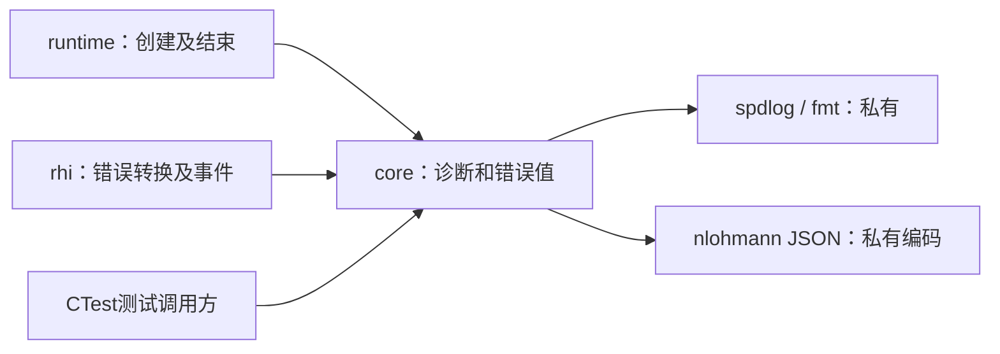
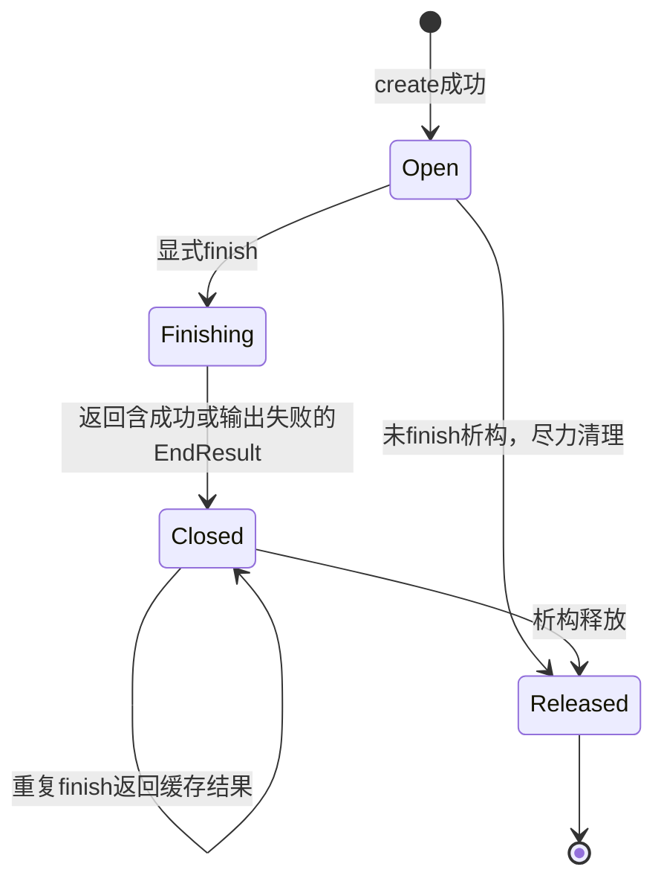

# core 模块：P0 最小技术方案

修订：3，2026-11-04。状态：基础职责、spdlog薄封装方向已确认；下列接口、错误返回、同步策略及预算为architect建议，尚未实现或整体获批。用户已要求开始方案准备，不等于批准具体接口或引擎编码。

## 1. 范围与依据

目录为engine/core/include/core与engine/core/src，公开头不增加ar层。P0只提供错误值、诊断会话、事件和运行摘要；不依赖Vulkan，不做业务能力判定、Jobs、反射、CPU分配器、全局服务查找或事件总线。

依据：[总体架构](../../总体架构与技术路线.md)实际确认范围、[日志ADR](../../adr/0004-诊断日志采用spdlog.md)、[生命周期规范](../../standards/C++类型接口与资源生命周期规范.md)及[错误与日志规范](../../standards/错误异常断言与日志规范.md)已确认部分。当前变更为[P0 proposal](../../../openspec/changes/bootstrap-engine-p0/proposal.md)和[P0 design](../../../openspec/changes/bootstrap-engine-p0/design.md)；行为、字段与数值预算以proposal为唯一编辑源，本页只解释模块设计，不重复完整契约。

## 2. 职责、调用方与构建依赖

图CORE-DEP-01：候选静态依赖；箭头为左侧依赖右侧，rhi只借用诊断会话。无引擎实现。

ar_core静态目标显式列源；spdlog、fmt配置与受控依赖保持一致，JSON只用于编码，不进入公开头。公开头拟为Error.h和Diagnostics.h，要求独立可包含；DiagnosticSession只以不透明类型和工厂出现，私有实现不进入公开头；不为每个数据结构拆一个类/虚接口，不造完整日志框架。运行时Vulkan原始错误由rhi转换为通用origin，不让core包含Vulkan头。

## 3. 候选公开接口和数据

以下是语义级接口草案，名称不代表已发布函数。所有调用都是P0 owner线程的同步操作。

| 类型/操作 | 输入输出和所有权 | 失败与失效 |
| --- | --- | --- |
| Error | 拥有ErrorCategory、ErrorStage、message及可选origin{domain,code}；可按值返回/保存 | 禁止仅保存指向临时消息的string_view；core不解释VkResult |
| DiagnosticConfig | 输出根、run_id、过滤和有限配额；create时复制需要持有的值 | 路径/ID/配额外部输入始终校验；已有运行目录不得覆盖 |
| DiagnosticSession::create | 推荐expected<unique_ptr<DiagnosticSession>,Error>，稳定地址、唯一所有权 | 文件未建立完整即失败，释放已打开资源；runtime不得继续初始化rhi |
| emit | 候选expected<void,Error>；输入Event按调用期借用，编码/写入在返回前完成，不保留引用 | 级别过滤发生在昂贵格式化前；超限/输出失败返回原因并置sticky输出失败，结束后为invalid_state |
| enabled(level) | 只读级别过滤，调用方先检查再构造昂贵message | emit不能消除调用方已经完成的格式化成本；不据此承诺未来所有日志零开销 |
| finish | 输入RunSummaryInput（含已编码capability_json）；返回拥有值数据的EndResult，显式flush并写摘要 | 同时保留primary_error、diagnostic_errors及cleanup_errors；再次调用返回既有结果，无重复写入 |
| destructor | 释放本会话拥有的文件/后端对象 | 不抛异常、不结束进程；未finish只尽力stderr提示，不伪造完整成功摘要 |

### 候选错误与结果类型

`ErrorCategory` 固定为 `invalid_arguments / invalid_state / loader_unavailable / loader_symbol_missing / api_version_unsupported / api_variant_unsupported / requested_api_unsupported / initialization_failed / query_failed / device_not_found / cleanup_failed / output_failed / internal_error`（13 值）；`ErrorStage` 固定为 `validation / loader / instance / enumeration / capability / cleanup / output / summary`。`invalid_state` 表示会话已结束或生命周期不允许该操作，调用方应停止使用该会话；参数本身不合法仍用 `invalid_arguments`。`Error.origin.domain` 取 `os / vulkan / filesystem / internal`，`code` 为有符号整数（Vulkan 保留原始 VkResult）。错误类别和阶段由负责模块赋值，测试按枚举而非自由文本断言。

`ResultKind` 取 `success / invalid_arguments / initialization_failed / unsupported / output_failed`；它由调用方/业务层给出，core 只保存，不据此判断产品资格。`EndResult` 字段为 `result`、`primary_result`、`primary_error`、`diagnostic_errors`、`cleanup_errors`、`diagnostics_complete`、`resources_released`、`residual_resources`；`cleanup_errors` 与 `diagnostic_errors` 分开，任一失败不得覆盖 `primary_error`。`RunSummaryInput` 由 runtime 填写通用结束字段和已编码 `capability_json`（optional UTF-8 JSON对象文本，缺省为nullopt）；core 不包含 rhi 类型、不解释 capability 内容，只做JSON语法/顶层object校验、嵌入编码与落盘，不解释能力语义。

推荐std::expected仅覆盖本轮P0的可预期失败；第三方异常在能够收敛的边界转换，不在全项目禁异常或将所有函数标noexcept。工具链支持expected只证明可用，不代表错误规范1—7节已经批准。

RunSummary记录构建/运行身份和结束结果；具体能力表由rhi产生、runtime编码为capability_json后交给core写入，core不根据device版本决定产品支持。Error.origin的domain=vulkan时code保留原始有符号值；错误类别/阶段使用上面的固定枚举，禁止自由字符串或层层只记录“失败”。

## 4. 所有权与生命周期

runtime独占DiagnosticSession，先建立诊断再创建rhi。rhi只借用，不销毁、不长期跨会话缓存引用；rhi关闭/回滚完成之后才finish诊断。P0会话不复制、不移动，unique_ptr转移不移动被指向对象。启动失败后返回的Error/部分报告拥有数据，不指向已关闭日志或Vulkan对象。

图CORE-LIFE-01：候选状态关系，open之前创建失败不产生可调用会话；析构兜底路径不视为完整结束。

日志先flush，后写/关闭summary。flush失败应包含在待写摘要的diagnostic_errors；summary自身失败只能可靠地经返回值和最低限度stderr报告，不能再承诺把错误记录到已经失败的文件。只有调用方处理EndResult，才知道结束输出是否完整。

## 5. 线程、开销与失败策略

P0单owner线程使用，禁止并发emit/finish，不启动日志线程，不让全局spdlog registry持有会话。未来worker/Validation回调需专门并发方案，在接入前补齐；本页不声称当前单线程接口可直接从任意Vulkan回调使用。

文本/JSONL使用同一事件数据，序号来自会话；JSON使用正式编码器处理中文/引号/换行，不手拼。诊断是有界低频I/O，数值配额及策略只引用[P0契约](../../../openspec/changes/bootstrap-engine-p0/proposal.md)。不逐帧/逐对象写完整状态，不为日志等待GPU、回读或全局flush。P0没有GPU资源，GPU完成同步不适用。

必需sink任何write/flush失败即置diagnostics_complete=false，EndResult.result=output_failed，保持primary_result及primary_error独立；stderr最低限度输出不再调用本日志器，避免递归。诊断次级错误按固定sink/类别聚合首次原因及计数，不无界追加。配额耗尽停止损坏sink且只提示一次，不对未落盘关键证据说“采样丢弃正常”。同步写盘可能阻塞，父集成测试超时限制运行时间，不承诺硬实时写盘延迟。

低内存/强杀/系统磁盘阻塞不保证摘要完整。对普通可恢复写失败做真实文件测试和内部sink故障测试，不扩展公共插件sink接口以方便测试。

## 6. 可验证结果及实施顺序

验收用例与断言引用[P0 test-plan](../../../openspec/changes/bootstrap-engine-p0/test-plan.md)，不在模块入口再维护测试计数。重点是正常结束、打开失败、JSON转义、配额、重复finish、晚到事件和真实摘要写失败；不是只测试字段能打印。

实现顺序建议：Error和值数据→会话建立/文件所有权→事件编码/过滤/预算→finish及次级失败→两配置测试→接rhi借用调用。core不先扩成全功能基础库。rhi/runtime集成后再核对本接口是否足够，不允许为了临时调用另建竞争日志通道。

候选取舍：expected便于显式处理原因，代价是调用方传播/收敛需清晰；同步会话便于观察生命周期，代价是I/O占用owner线程；显式finish使关闭失败可见，代价是调用方不能仅靠析构获得完整验收结果。替代方案是项目状态结构或异步日志，但需要相应错误/队列协议，不与推荐并行建设。

## 7. 当前交接及待复核

首批实现已完成：`engine/core/include/core/{Error,BuildInfo,Diagnostics}.h` 公开头、`engine/core/src/{Error,Diagnostics}.cpp` 与 `ar_core` 静态库，Debug/RelWithDebInfo 两配置 CTest 覆盖 normal-close、open-failed、json-escaping、quota、quota-cumulative、flush-failure、summary-truncated、repeat-finish、late-event、report-unwritable、public-headers、build-identity。接口签名、ErrorCategory/ErrorStage、cleanup_errors、重复finish及RunSummaryInput已按用户2026-11-04授权收口；`invalid_state` 在 2026-11-04 复审后新增为独立类别（生命周期违规与参数非法分离）。日志预算数值与 finish 细节按 proposal 候选实现，日志预算、配额与摘要回退行为已有用例覆盖；独立审查不等于用户批准。下一步进入 rhi/runtime 纵切（2.3/2.1），并补齐 device-*/cleanup-* 用例。静态库/动态CRT已是既有确认，不在本页重复等待。

## 三项复核后的摘要边界（2026-11-04，候选）

RunSummaryInput.capability_json固定为std::optional<std::string>，规范及失败行为以[P0契约](../../../openspec/changes/bootstrap-engine-p0/proposal.md)“本轮三项复核修订”为准。summary固定capability为object或null；禁止将JSON文本当字符串再次编码。core只做语法及顶层类型校验，runtime负责Vulkan语义。非法JSON、非object或runtime编码失败记summary/output_failed，保留主错误，diagnostic_errors记录失败，尽力输出capability:null；不填空对象冒充查询成功。EndResult另携带resources_released/residual_resources，core只保存runtime给出的清理事实。

## MF-01摘要输入承接（候选）

RunSummaryInput新增optional<Error> capability_encoding_error，并显式携带cleanup_errors、resources_released/residual_resources及编入身份。完整字段和输出映射仅维护于P0 proposal。编码失败传nullopt JSON及summary/output_failed原Error，core完整合并到diagnostic_errors；无产物双空不增加失败。双字段有值时保留原Error并追加summary/internal_error，result=output_failed、diagnostics_complete=false、capability:null，主业务结果不变。resources_released=true与残留非空、或编入身份与会话固定身份不一致，同样按summary/internal_error及output_failed拒绝，不自行删改资源事实或伪造身份。资源事实同名写入摘要；诊断错误不在重复finish时重复合并。
