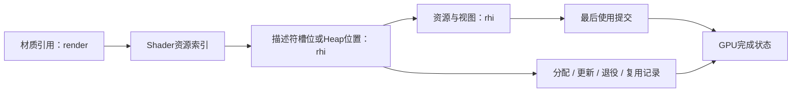
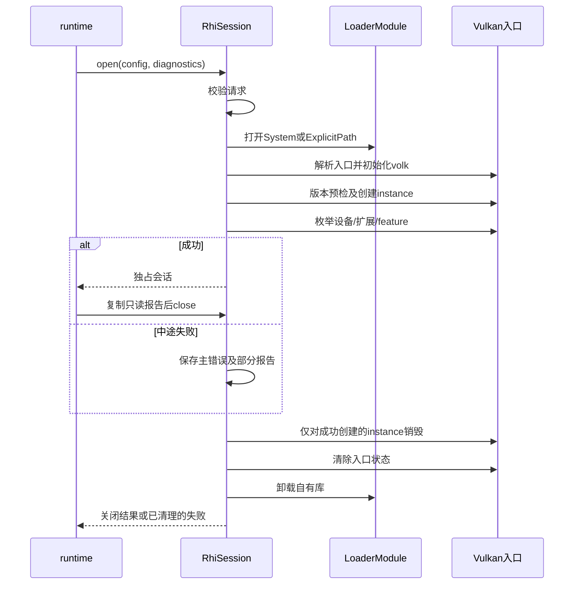

# rhi 模块

## P1a 逻辑设备与 Validation

`RhiSession::open` 通过 `QueryConfig::createGraphicsDevice` 显式启用逻辑设备。查询模式仍只做 P0 能力探测。创建设备要求请求与物理设备的 Vulkan API 均至少为 1.3，并要求 `dynamicRendering`、`synchronization2` 和至少一个可用 graphics 队列。默认按枚举顺序选择第一个符合条件的设备，指定索引时只检查该设备。首个可用 graphics 队列族内创建一个队列，只启用本切片需要的两项核心特性。surface、present 与 swapchain 的能力选择在呈现切片接入。

Debug 创建设备时，instance 启用 `VK_LAYER_KHRONOS_validation` 和 `VK_EXT_debug_utils`。缺少层、扩展或 messenger 入口时启动失败，错误保留可用的 Vulkan 返回码。Messenger 将警告和错误分别写到 core 的 `rhi.validation.warning`、`rhi.validation.error` 事件。回调在当前串行 Vulkan 调用中执行，不调用 Vulkan，返回 `VK_FALSE`。其他构建配置不主动启用 Validation。

会话独占 volk 的进程级派发表及 loader、instance、messenger 和 device。队列随 device 销毁。释放顺序是 device、messenger、instance、volk、loader。重复关闭复用原结果，部分初始化失败走同一释放路径。公开设备信息包含队列族索引、Validation 启用状态及按需获得的 Heap 限制，在会话关闭后不可取。调用方保持诊断会话存活直到 RHI 关闭。

### Vulkan 1.4 与 Descriptor Heap

图形设备按请求的 API 版本选卡。loader 和设备预检比较 variant、主版本与次版本，补丁号保留在报告中。1.3 保持既有必需特性；显式请求 1.4 时记录 Maintenance 5/6、Dynamic Rendering Local Read、Host Image Copy 的支持状态，等对应调用方接入时才启用其功能。

`QueryConfig::enableDescriptorHeap` 要求创建 Vulkan 1.4 图形设备。检查所选设备上的 `VK_EXT_descriptor_heap`、`descriptorHeap`、Buffer Device Address 及扩展依赖。成功时设备实际启用 Heap 特性，核对写入及绑定的设备入口，并在会话内返回两类 Heap 的对齐、最大大小和最小保留区。缺能力按错误返回，调用方可单独请求 1.3 路径。缺失设备入口时走同一回滚顺序。

设备启用验收止于上述检查。P2 用 VMA 管理 Buffer/Image 分配与回收。资源路径就绪后，P5 以 VMA 分配带设备地址的 Heap buffer，按查询到的大小、对齐和保留区写入描述符，绑定后让 Shader 读写已知数据并验证读回。优先复用 set/binding 映射，与 Descriptor Set 路径对照；在途引用完成前保留其槽位和内存。规范见 [Descriptor Heap](https://docs.vulkan.org/refpages/latest/refpages/source/VK_EXT_descriptor_heap.html)。

## GPU与Bindless调试方案（2026-11-06）

用户在讨论GPU/Bindless问题定位后要求记录，并明确沿既定总体架构推进。本节记录后续资源/绑定阶段的长期设计方向。P0查询与诊断的已有实现按对应任务记录，下面GPU工具接入和验证尚待后续切片实施。字段、配额及工具版本在该切片定义。

| 定位层次 | rhi职责与证据 | 覆盖边界 |
| --- | --- | --- |
| CPU资源与槽位 | 检查句柄generation、容量、初始化及资源状态，提供资源/视图/槽位映射查询 | 已提交Shader持有的旧索引还需GPU在途保护 |
| 生命周期 | 关联槽位分配、更新、退役、复用与最后一次使用的提交完成状态 | 只有相关GPU工作完成才可复用；CPU引用失效不等于GPU完成 |
| API及同步 | 接入适用的Validation与Synchronization Validation，对象命名和命令区域标记关联到资源及pass | 实际捕获范围随锁定版本验证；无错误消息不能证明画面正确 |
| Shader动态访问 | 按需启用GPU-Assisted Validation，检测其支持范围内的动态描述符访问问题 | 索引合法但指向错误业务资源，仍需映射及画面对照 |
| 抓帧及新特性 | 为RenderDoc/按需Nsight提供可识别对象和pass；记录驱动、层、工具、Shader与绑定模式 | Set/Heap的检查、捕获及重放能力分别实测 |

图RHI-DEBUG-01为后续候选追踪关系，箭头表示证据关联，具体ID/schema留对应切片确定。

复现时先缩小到固定场景、相机、少量资源及有限帧，再对照实际索引、绑定内容、状态转换和完成值。CPU generation与GPU槽位退役共同保证安全。资源仍在途时覆盖同一合法槽位可能造成贴错纹理，诊断必须保留映射和使用关系，不能仅依赖越界检查。

正常运行保留低开销状态检查及必要统计。GPU-AV、详细槽位追踪、抓帧和GPU回读由显式诊断配置按范围启用，正式性能测试记录其开关及开销。禁止为日常日志引入逐帧waitIdle或无界输出，正常资源安全由生命周期协议保证。

Heap阶段额外核对描述符大小、步长、对齐、写入范围及可见性。工具能力登记实际版本、启用设置、验证场景、结果和缺口，支持/未运行/不支持分别记录。官方GPU-AV文档说明其通过Shader插桩和GPU资源检查覆盖运行时访问，并具有性能开销和使用限制。[官方GPU-AV文档](https://github.com/KhronosGroup/Vulkan-ValidationLayers/blob/main/docs/gpu_validation.md)

资源切片先验证上传与回读、在途销毁及句柄失效，Set Bindless切片再验证索引/初始化/多帧更新/槽位复用，Heap切片用相同语义验证布局与输出。相关行为与验收由未来change的proposal承载，本节作为长期方案输入。

P0技术方案修订：3，2026-11-04。模块职责与 P0 查询范围已确认。下文说明接口设计与关闭边界，具体实现进度见文末。

状态：图形底层模块目录与职责已确认；2026-11-06 完成 rhi 基础切片与收口（公开头 `LoaderSource.h`/`Capabilities.h`/`RhiSession.h`，loader/instance 所有权、枚举、报告与幂等 close，两配置各 30/30 用例，含 fixture 加载器驱动的负向用例、进程隔离与 `report()` 关闭后计数验证），详见文末实现状态。不额外叠加通用后端层，不强制虚接口。

- 目录：engine/rhi/include/rhi、engine/rhi/src/vulkan；公开头不增加 ar 路径层。
- 当前范围：P0 的 Vulkan 能力查询所需底层能力；窗口、交换链、绘制与 Shader 管线属于后续任务，不能混入 P0 验收。
- 依据与方案：[总体架构](../../总体架构与技术路线.md)、[P0 proposal](../../../openspec/changes/bootstrap-engine-p0/proposal.md)、[P0 design](../../../openspec/changes/bootstrap-engine-p0/design.md)。Vulkan/VMA 等决定引用有效 ADR，不从选型推定同步与接口设计已经批准。
- 在途变更及设备限制：[模块与变更索引](../../workflow/模块与变更索引.md)、[项目总任务](../../../TASK.md)。SDK、离线 Shader 成功不代替设备 Vulkan 1.4 或 Heap 验收。

资源所有权、同步和关键时序随实际方案按 [模块模板](../模块设计模板.md) 补充，不以空图表示架构已经完成。

## 已确认边界与未完成项

2026-10-23确认来源见[总体架构确认记录](../../总体架构与技术路线.md#2026-10-23-架构确认记录)A1、A4、A5。render表达算法与资源使用意图；rhi负责GPU资源、同步、命令、提交与绑定，不承担PBR或GI算法。CPU释放请求与最后GPU使用完成分开；描述符槽位不得提前复用。Set/Heap具体机制与工具覆盖分别验证。

正常运行的安全约束不依赖详细日志；诊断按需有界，性能测量记录有效配置。具体句柄、barrier、完成标识、在途更新及设备失败处理仍待模块方案；尚无实现或性能结果。未来追踪能力按实际需要设计，不预建空接口。以上不扩大P0。

## 2026-10-24新增决定

来源与主契约见[总体架构B1—B3](../../总体架构与技术路线.md#2026-10-24-gpu-driven并行录制与dynamic-rendering确认记录)。支持worker并行录制并保留串行参考，按帧上下文、worker和所需队列族隔离命令池与临时区；具体任务和同步机制待定。帧配置数值以[总体架构主契约](../../总体架构与技术路线.md#并行录制与帧资源)为准，本入口不另维护默认数值。

自有图形pass采用Dynamic Rendering方向；rhi负责Vulkan调用与实际同步，不将逻辑pass绑定为VkRenderPass对象。查询/启用feature，核验管线附件兼容及secondary继承上下文；第三方backend按实际支持处理。GPU Driven中的间接参数访问与资源回收仍受依赖和完成条件约束。以上尚未实施，不扩展P0。

## 句柄、视图与绑定边界

2026-10-26补记来源与主契约见[总体架构C5](../../总体架构与技术路线.md#2026-10-26-tick生命周期graphshader与绑定确认补记)：CPU类型化槽位/generation句柄、资源、视图、绑定引用及Set/Heap后端位置分开。两条绑定共享语义，可采用不同GPU编码；具体位宽、映射层和在途更新策略待验证。

停止新引用后仍需处理未提交命令及在途工作，完成后再复用槽位和释放资源；CPU失效检查不能保护旧GPU索引。C3确认render内Graph编排、rhi执行；更细的提交协调及完成/回收所有权见R1待确认建议。AssetId和材质详细设计延期，无实现通过结论。

2026-10-27的R1职责细化及R4长期数值单源规则均为architect建议，待用户确认，见[待确认建议](../../总体架构与技术路线.md#2026-10-27-待确认的职责澄清建议)。具体Vulkan同步原语仍待设计；本入口引用B节数值以减少重复，不产生新批准。

2026-11-03 P0修订：先不建设独立ArProbe；模块静态库由CTest公共入口集成测试调用，P1再接独立渲染程序。公共入口、阶段范围和验收方式见 [P0 方案](../../../openspec/changes/bootstrap-engine-p0/design.md)。

## P0 最小加载与查询技术方案

### 职责及公开边界

只做OS库加载、Vulkan入口初始化、instance创建、物理设备及能力枚举和查询快照。不创建逻辑device、队列、surface或GPU分配；VMA仅做受控依赖联编。具体能力字段、版本谓词、查询次数和错误事实以[P0 proposal](../../../openspec/changes/bootstrap-engine-p0/proposal.md)为唯一源。

公开头拟为LoaderSource.h、Capabilities.h、RhiSession.h，放在include/rhi。签名只使用标准库、core项目类型和rhi值数据，不公开volk、OS句柄或VkInstance。普通函数/值类型足够，不新增通用后端虚接口。命名空间沿项目现行规范确定，下表省略命名空间，不构成全局名称约定。

| 候选类型/签名 | 输入、输出和借用 | 失败处理 |
| --- | --- | --- |
| LoaderSource | 既有System/ExplicitPath值配置；路径由配置拥有，open复制必要数据 | ExplicitPath只允许明确路径，不从环境变量悄悄覆盖；不创建CLI |
| QueryConfig | LoaderSource、requested_api、DeviceSelection；不含inspect/require-product/development策略 | 请求校验先于OS加载；profile仍限P0查询，不携带渲染算法参数，不做产品资格判断 |
| DeviceSelection | FirstEnumerated或ExplicitIndex{index} | 不评分、不静默换设备；越界invalid_arguments；无设备device_not_found |
| QueryFailure | core::Error主错误、cleanup_errors及拥有数据的部分CapabilityReport | 已取得资源在返回前回滚；清理失败也保留，不返回半初始化会话或借用错误字符串 |
| RhiSession::open(const QueryConfig&, core::DiagnosticSession&) | 推荐expected<unique_ptr<RhiSession>,QueryFailure>；诊断借用须持续到会话销毁后 | open失败返回已清理的QueryFailure；不判断产品资格，模式由runtime决定 |
| report() const | 候选const CapabilityReport&，只读借用；运行期间不被后台修改 | 只允许在成功open且未close时访问；需要跨close保存时调用方复制快照 |
| close() | 返回CloseResult{closed,resources_released,residual_resources,errors}；幂等，重复调用返回缓存结果；停止访问并释放实际取得的资源 | 清理事件保留顺序，cleanup错误不得覆盖此前查询主错误；析构只作不抛异常的兜底 |

这些类型名及签名用于明确候选接口，不要求按表机械生成代码。`DeviceSelection`固定为`FirstEnumerated`或`ExplicitIndex{index}`：前者取`vkEnumeratePhysicalDevices`顺序第一个，不评分、不跳过；后者在枚举后校验，越界返回`invalid_arguments`且不自动选另一设备。没有设备返回`initialization_failed/device_not_found`，报告`device_api=null`，不静默换设备。选中设备API低于1.4不是`open`失败；报告照实写，由runtime按`inspect`/`require-product`/`development`判定。`CapabilityReport`返回值语义和引用有效期必须在公开头注明。

### 内部所有权和执行顺序

RhiSession不可复制/不可移动，unique_ptr移动不改变其地址。公开头只声明不透明RhiSession，`LoaderModule`、instance、volk入口状态及`CloseResult`缓存均在`src/vulkan`的Impl中，不进入公共签名。它独占LoaderModule、instance及入口状态；借用的DiagnosticSession由runtime拥有，不能注册到全局服务。OS加载句柄不会因volk custom初始化转移所有权。`close()`第一次执行销毁instance→清理volk→卸库，之后仅返回缓存的`CloseResult`；`report()`在close后失效。

图RHI-P0-SEQ-01：拟议加载与清理顺序。箭头为调用；未显示的查询事实按契约填入值快照。

库未打开不得卸载无效句柄，instance未成功不得destroy；实例创建后的枚举失败仍走同一清理路径。关闭期间不再产生新的查询调用；诊断保持有效直到最后一条清理事件处理完成。不存在GPU工作，因此P0不使用GPU fence/waitIdle完成资源回收；不提前设计未来提交系统。

### 线程、fixture、构建和验收

同一owner线程运行，整个P0测试序列不重叠使用volk全局状态。fixture动态库在测试支持目标构建，测试仅通过公开LoaderSource装载；不把fixture解析函数指针作为新公共注入API。不存在路径测试必须实际走OS加载，API fixture与System查询来源分开标记。

ar_rhi的公共头需要core错误/诊断类型时通过PUBLIC依赖表达；volk/Vulkan-Headers/VMA实现细节留在私有编译单元。固定版本的初始化/重置API在正式构建中核验，不把网页示例当已联编证据。

实施顺序：配置和值数据→实际OS加载→入口初始化/instance→枚举和部分报告→统一回滚→runtime集成。验证直接引用[P0测试计划](../../../openspec/changes/bootstrap-engine-p0/test-plan.md)的loader失败、枚举失败、版本/variant、回滚和System查询，不另写一套负向矩阵。明确签名、设备选择及错误值映射后交用户审阅，再交实现者；未运行真实查询或GPU测试。

## 三项复核后的关闭边界（2026-11-04，候选）

report保留const引用及open前置条件，不新增optional包装；close后禁止访问rhi借用，跨close先复制。runtime自有快照不受该失效影响。

closed表示API已终止，resources_released表示本会话资源已释放；后者false时residual_resources必须逐项报告retained/unknown。完整规则唯一源为[P0契约](../../../openspec/changes/bootstrap-engine-p0/proposal.md)“本轮三项复核修订”。不是把vkDestroyInstance的void返回当作可失败结果；实际OS卸载失败与项目清理前置条件不成立分开记录。无法安全释放实例/入口时禁止继续卸库。

重复close只返回缓存；已close析构不重试，残留采用不再释放的隔离状态，不能让LoaderModule成员析构隐式重试。未显式close时析构仅执行一次同样清理。残留状态禁止再次打开rhi会话，进程退出收尾；P0不做自动恢复状态机。

## MF-02隔离检查承接（候选）

open在本轮OS加载前检查隔离；拒绝使用initialization_failed、stage=cleanup/category=cleanup_failed，origin=internal/1表示quarantined_process。stage指先前cleanup故障来源，并非本轮执行cleanup。无新会话、无close，加载/volk初始化/instance创建计数0；本次resources_released=true、空残留/空cleanup_errors，既有隔离不清除。空清理是正常分支，不作故障注入。精确事实以P0 proposal为准。

## 2026-11-05 实现状态（rhi 基础切片）

已落盘并两配置验证（Debug/RelWithDebInfo 各 28/28 CTest，`/std:c++23preview`、`/MDd`|`/MD`、0 warning）。

- 公开头：`engine/rhi/include/rhi/LoaderSource.h`（System / ExplicitPath）、`Capabilities.h`（报告值数据，无 Vulkan/volk 类型）、`RhiSession.h`（`QueryConfig`、`open`、`report`、`close`）。三个头各自独立编译（public-headers 用例）。
- 共同加载路径：`LoadLibraryW` → `GetProcAddress("vkGetInstanceProcAddr")` → `volkInitializeCustom` → global 入口检查 → `vkCreateInstance` → `volkLoadInstance`。加载失败 `loader_unavailable/Loader`（origin=os），入口缺失 `loader_symbol_missing/Loader`。
- 版本与 variant：loader 版本用 `vkEnumerateInstanceVersion`（缺符号时按 1.0）；loader 低于请求版本 → `api_version_unsupported/Instance` 且 `instance_create.status=not_attempted`；非零 variant → `api_variant_unsupported/Instance`。
- 枚举：`VK_INCOMPLETE` 最多 3 次循环后 `query_failed/Enumeration`；无设备 `device_not_found/Enumeration` 且保留部分报告；`ExplicitDeviceIndex` 越界 `invalid_arguments/Enumeration`，不换设备；`FirstEnumerated` 取枚举顺序第一台。
- 报告：loader/device API、`api_variants`、`instance_create`、实例/设备扩展查询状态与列表、`capability_source`、`variant_supported`、`effective_api`、`judgments{api_version_supported,required_capabilities_supported}`、`product_target_supported`、`device_name`/`driver_version`、`descriptor_heap`（编译期存在 `VK_EXT_descriptor_heap` 时读 feature，否则 `not_queried`）、`renderer_runtime_validated` 恒 false、`result`/`errors`。
- 判定顺序：先由 loader/device variant 决定 `variant_supported`，再算 `api_version_supported`——否则 variant 仍为 unknown 时会把真实支持的设备判成不支持。
- close：首次销毁 instance → `volkFinalize` → `FreeLibrary`，记录 `residual_resources`（instance/os_module）与 `cleanup_failed/Cleanup`；重复 close 返回缓存；析构只在未 close 时执行一次同样清理且不抛异常。
- fixture 加载器：`tests/support/rhi_fixture/FixtureLoader.cpp` 编成 `ar_rhi_fixture.dll`，只导出 `vkGetInstanceProcAddr`，按 `AR_RHI_FIXTURE_SPEC`（`loader=`、`loader-variant=`、`device=`、`create=`、`devices=`、`enumerate=`、`instance-ext=`、`device-ext=`、`destroy=`、`heap=`）回答入口点。测试经 `ExplicitLoaderPath` 指向该 DLL，路径由可执行文件目录推出，不写死绝对路径。**它不是产品加载器**，只用于负向与边界用例。
- rhi 级必需用例（18 个）：`rhi-request-validation`、`rhi-loader-unavailable`、`rhi-loader-symbol-missing`、`rhi-device-none`、`rhi-device-index-out-of-range`、`rhi-api-version-unsupported`、`rhi-api-variant-unsupported`、`rhi-instance-incompatible`、`rhi-instance-init-failed`、`rhi-extension-query-failed`、`rhi-device-extension-query-failed`、`rhi-enumeration-incomplete`、`rhi-device-version-insufficient`、`rhi-descriptor-heap-present`、`rhi-cleanup-instance-retained`、`rhi-repeat-close`、`rhi-report-after-close`、`rhi-quarantine-reopen`。另有隐藏用例 `[.][rhi-system]`（真实系统加载器与本机 GPU）与 `[.][rhi-quarantine-child]`（quarantine-reopen 的专用子进程），不作为必需 CTest。
- 进程隔离：close 后若仍有残留资源，置进程级 quarantine 标志；此后 `open()` 在**任何加载之前**拒绝，返回 `initialization_failed` + `primary_error{stage=cleanup, category=cleanup_failed, origin={internal,1}}`，`instance_create.status=not_attempted`、空 `cleanup_errors`，load/volk/instance 计数均为 0。是否解除隔离由进程生命周期决定，诊断会话正常结束不解除；`rhi-quarantine-reopen` 用独立的子进程验证，避免标志污染同进程其它用例。
- `report()` 生命周期：只在成功 open 且未 close 时允许调用；跨 close 使用须先复制快照（用例 `rhi-report-after-close` 验证关闭前复制仍可读）。关闭后再次调用属于违反前置条件，测试钩子计数该调用而**不**解引用已销毁的快照，因此不以未定义行为充当"失效"证据。
- `Impl::closed` 终止标志：首次 close 置位后，重复 close 直接返回缓存，析构不再重试清理（2026-11-06 修复的缺陷，此前会导致重复 close 重跑清理、显式 close 后析构再清理一次）。

已知差异与剩余项（2.3 已按 proposal 收口，以下为仍需 runtime 或后续批次处理的部分）：

- `QueryConfig` 增加 `requiredDeviceExtensions`（用于 `required_capabilities_supported` 判定）；这是公开候选接口之外的新增字段，需要用户确认后固化。
- 报告不含 `mode`/`requirement_profile`/`schema_version`/`run_id`/`build_id`：这些由 runtime 在编码 `capability_json` 时补齐，rhi 只报告事实。
- `report()` 契约要求 close 后失效；当前实现返回冻结快照并以计数记录违规调用，正式语义随 runtime 自有快照收口（2.1），届时 rhi 侧改为只保留"关闭前复制"这一支持用法。
- 未实现：`capability_json` 编码（属 runtime）；`vkDestroyInstance` 失败不可观测（void 返回，只能报告卸库失败）；`cleanup-empty` 的 runtime 语义（无 instance 的会话）留待 2.1。
- 真实系统查询在本机（RTX 4060 Laptop，device API 1.3）为：`api_version_supported=false`、`product_target_supported=false`、`descriptor_heap=unsupported`。
