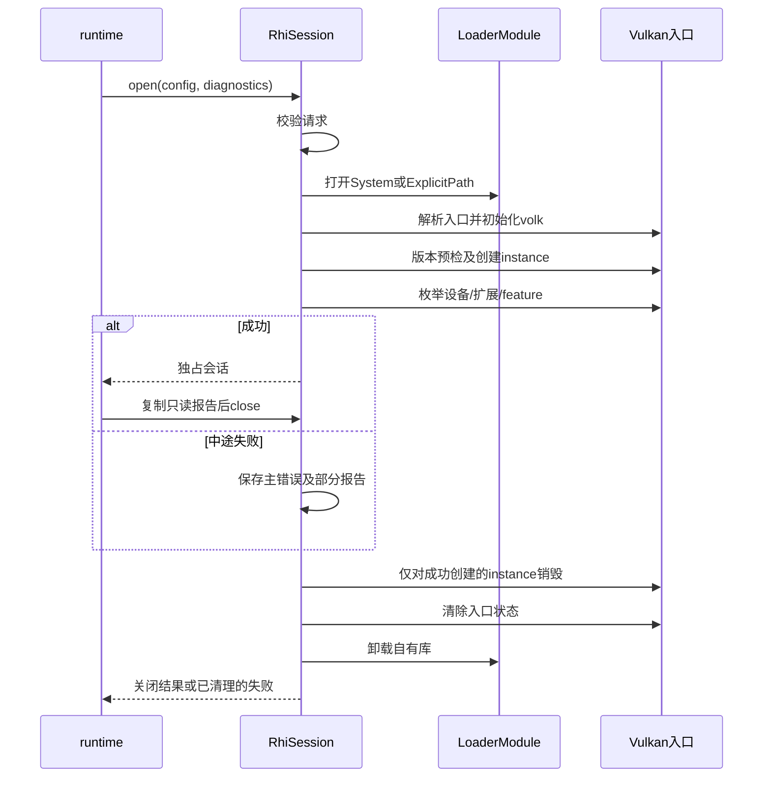

# rhi 模块

P0技术方案修订：3，2026-11-04。下列P0接口细化是候选，未实施、未获逐项确认；历史已确认边界继续有效。

状态：图形底层模块目录与职责已确认；尚无引擎实现。本轮确认直接在rhi内实现薄Vulkan封装，不额外叠加通用后端层，不强制虚接口；具体接口与同步策略尚未确定。

- 目录：engine/rhi/include/rhi、engine/rhi/src/vulkan；公开头不增加 ar 路径层。
- 当前范围：P0 的 Vulkan 能力查询所需底层能力；窗口、交换链、绘制与 Shader 管线属于后续任务，不能混入 P0 验收。
- 依据与方案：[总体架构](../../总体架构与技术路线.md)、[P0 proposal](../../../openspec/changes/bootstrap-engine-p0/proposal.md)、[P0 design](../../../openspec/changes/bootstrap-engine-p0/design.md)。Vulkan/VMA 等决定引用有效 ADR，不从选型推定同步与接口设计已经批准。
- 在途变更及设备限制：[模块与变更索引](../../workflow/模块与变更索引.md)、[当前状态](../../workflow/当前决策与待办清单.md)。SDK、离线 Shader 成功不代替设备 Vulkan 1.4 或 Heap 验收。

资源所有权、同步和关键时序随实际方案按 [模块模板](../模块设计模板.md) 补充，不以空图表示架构已经完成。

## 已确认边界与未完成项

2026-10-23确认来源见[总体架构确认记录](../../总体架构与技术路线.md#2026-10-23-架构确认记录)A1、A4、A5。render表达算法与资源使用意图；rhi负责GPU资源、同步、命令、提交与绑定，不承担PBR或GI算法。CPU释放请求与最后GPU使用完成分开；描述符槽位不得提前复用。Set/Heap具体机制与工具覆盖分别验证。

正常运行的安全约束不依赖详细日志；诊断按需有界，性能测量记录有效配置。具体句柄、barrier、完成标识、在途更新及设备失败处理仍待模块方案；尚无实现或性能结果。未来追踪能力按实际需要设计，不预建空接口。以上不扩大P0。

## 2026-10-24新增决定

来源与主契约见[总体架构B1—B3](../../总体架构与技术路线.md#2026-10-24-gpu-driven并行录制与dynamic-rendering确认记录)。支持worker并行录制并保留串行参考，按帧上下文、worker和所需队列族隔离命令池与临时区；具体任务和同步机制待定。帧配置数值以[总体架构主契约](../../总体架构与技术路线.md#并行录制与帧资源)为准，本入口不另维护默认数值。

自有图形pass采用Dynamic Rendering方向；rhi负责Vulkan调用与实际同步，不将逻辑pass绑定为VkRenderPass对象。查询/启用feature，核验管线附件兼容及secondary继承上下文；第三方backend按实际支持处理。GPU Driven中的间接参数访问与资源回收仍受依赖和完成条件约束。以上尚未实施，不扩展P0。

## 句柄、视图与绑定边界

2026-10-26补记来源与主契约见[总体架构C5](../../总体架构与技术路线.md#2026-10-26-tick生命周期graphshader与绑定确认补记)：CPU类型化槽位/generation句柄、资源、视图、绑定引用及Set/Heap后端位置分开。两条绑定共享语义，可采用不同GPU编码；具体位宽、映射层和在途更新策略待验证。

停止新引用后仍需处理未提交命令及在途工作，完成后再复用槽位和释放资源；CPU失效检查不能保护旧GPU索引。C3确认render内Graph编排、rhi执行；更细的提交协调及完成/回收所有权见R1待确认建议。AssetId和材质详细设计延期，无实现通过结论。

2026-10-27的R1职责细化及R4长期数值单源规则均为architect建议，待用户确认，见[待确认建议](../../总体架构与技术路线.md#2026-10-27-待确认的职责澄清建议)。具体Vulkan同步原语仍待设计；本入口引用B节数值以减少重复，不产生新批准。

2026-11-03 P0修订：先不建设独立ArProbe；模块静态库由CTest公共入口集成测试调用，P1再接独立渲染程序。当前[P0方案](../../../openspec/changes/bootstrap-engine-p0/design.md)已同步候选承接方式；不以旧Probe命令作为实施要求，core接口及替代测试细节仍待用户确认。

## P0 最小加载与查询技术方案（候选）

### 职责及公开边界

只做OS库加载、Vulkan入口初始化、instance创建、物理设备及能力枚举和查询快照。不创建逻辑device、队列、surface或GPU分配；VMA仅做受控依赖联编。具体能力字段、版本谓词、查询次数和错误事实以[P0 proposal](../../../openspec/changes/bootstrap-engine-p0/proposal.md)为唯一源。

公开头拟为LoaderSource.h、Capabilities.h、RhiSession.h，放在include/rhi。签名只使用标准库、core项目类型和rhi值数据，不公开volk、OS句柄或VkInstance。普通函数/值类型足够，不新增通用后端虚接口。命名空间沿项目现行规范确定，下表省略命名空间，不构成全局名称约定。

| 候选类型/签名 | 输入、输出和借用 | 失败处理 |
| --- | --- | --- |
| LoaderSource | 既有System/ExplicitPath值配置；路径由配置拥有，open复制必要数据 | ExplicitPath只允许明确路径，不从环境变量悄悄覆盖；不创建CLI |
| QueryConfig | LoaderSource、requested_api、DeviceSelection；不含inspect/require-product/development策略 | 请求校验先于OS加载；profile仍限P0查询，不携带渲染算法参数，不做产品资格判断 |
| DeviceSelection | FirstEnumerated或ExplicitIndex{index} | 不评分、不静默换设备；越界invalid_arguments；无设备device_not_found |
| QueryFailure | core::Error主错误、cleanup_errors及拥有数据的部分CapabilityReport | 已取得资源在返回前回滚；清理失败也保留，不返回半初始化会话或借用错误字符串 |
| RhiSession::open(const QueryConfig&, core::DiagnosticSession&) | 推荐expected<unique_ptr<RhiSession>,QueryFailure>；诊断借用须持续到会话销毁后 | open失败返回已清理的QueryFailure；不判断产品资格，模式由runtime决定 |
| report() const | 候选const CapabilityReport&，只读借用；运行期间不被后台修改 | 只允许在成功open且未close时访问；需要跨close保存时调用方复制快照 |
| close() | 返回CloseResult{closed,resources_released,residual_resources,errors}；幂等，重复调用返回缓存结果；停止访问并释放实际取得的资源 | 清理事件保留顺序，cleanup错误不得覆盖此前查询主错误；析构只作不抛异常的兜底 |

这些类型名及签名用于明确候选接口，不要求按表机械生成代码。`DeviceSelection`固定为`FirstEnumerated`或`ExplicitIndex{index}`：前者取`vkEnumeratePhysicalDevices`顺序第一个，不评分、不跳过；后者在枚举后校验，越界返回`invalid_arguments`且不自动选另一设备。没有设备返回`initialization_failed/device_not_found`，报告`device_api=null`，不静默换设备。选中设备API低于1.4不是`open`失败；报告照实写，由runtime按`inspect`/`require-product`/`development`判定。`CapabilityReport`返回值语义和引用有效期必须在公开头注明。

### 内部所有权和执行顺序

RhiSession不可复制/不可移动，unique_ptr移动不改变其地址。公开头只声明不透明RhiSession，`LoaderModule`、instance、volk入口状态及`CloseResult`缓存均在`src/vulkan`的Impl中，不进入公共签名。它独占LoaderModule、instance及入口状态；借用的DiagnosticSession由runtime拥有，不能注册到全局服务。OS加载句柄不会因volk custom初始化转移所有权。`close()`第一次执行销毁instance→清理volk→卸库，之后仅返回缓存的`CloseResult`；`report()`在close后失效。

图RHI-P0-SEQ-01：拟议加载与清理顺序。箭头为调用；未显示的查询事实按契约填入值快照。

库未打开不得卸载无效句柄，instance未成功不得destroy；实例创建后的枚举失败仍走同一清理路径。关闭期间不再产生新的查询调用；诊断保持有效直到最后一条清理事件处理完成。不存在GPU工作，因此P0不使用GPU fence/waitIdle完成资源回收；不提前设计未来提交系统。

### 线程、fixture、构建和验收

同一owner线程运行，整个P0测试序列不重叠使用volk全局状态。fixture动态库在测试支持目标构建，测试仅通过公开LoaderSource装载；不把fixture解析函数指针作为新公共注入API。不存在路径测试必须实际走OS加载，API fixture与System查询来源分开标记。

ar_rhi的公共头需要core错误/诊断类型时通过PUBLIC依赖表达；volk/Vulkan-Headers/VMA实现细节留在私有编译单元。固定版本的初始化/重置API在正式构建中核验，不把网页示例当已联编证据。

实施顺序：配置和值数据→实际OS加载→入口初始化/instance→枚举和部分报告→统一回滚→runtime集成。验证直接引用[P0测试计划](../../../openspec/changes/bootstrap-engine-p0/test-plan.md)的loader失败、枚举失败、版本/variant、回滚和System查询，不另写一套负向矩阵。明确签名、设备选择及错误值映射后交用户审阅，再交实现者；未运行真实查询或GPU测试。

## 三项复核后的关闭边界（2026-11-04，候选）

report保留const引用及open前置条件，不新增optional包装；close后禁止访问rhi借用，跨close先复制。runtime自有快照不受该失效影响。

closed表示API已终止，resources_released表示本会话资源已释放；后者false时residual_resources必须逐项报告retained/unknown。完整规则唯一源为[P0契约](../../../openspec/changes/bootstrap-engine-p0/proposal.md)“本轮三项复核修订”。不是把vkDestroyInstance的void返回当作可失败结果；实际OS卸载失败与项目清理前置条件不成立分开记录。无法安全释放实例/入口时禁止继续卸库。

重复close只返回缓存；已close析构不重试，残留采用不再释放的隔离状态，不能让LoaderModule成员析构隐式重试。未显式close时析构仅执行一次同样清理。残留状态禁止再次打开rhi会话，进程退出收尾；P0不做自动恢复状态机。

## MF-02隔离检查承接（候选）

open在本轮OS加载前检查隔离；拒绝使用initialization_failed、stage=cleanup/category=cleanup_failed，origin=internal/1表示quarantined_process。stage指先前cleanup故障来源，并非本轮执行cleanup。无新会话、无close，加载/volk初始化/instance创建计数0；本次resources_released=true、空残留/空cleanup_errors，既有隔离不清除。空清理是正常分支，不作故障注入。精确事实以P0 proposal为准。
