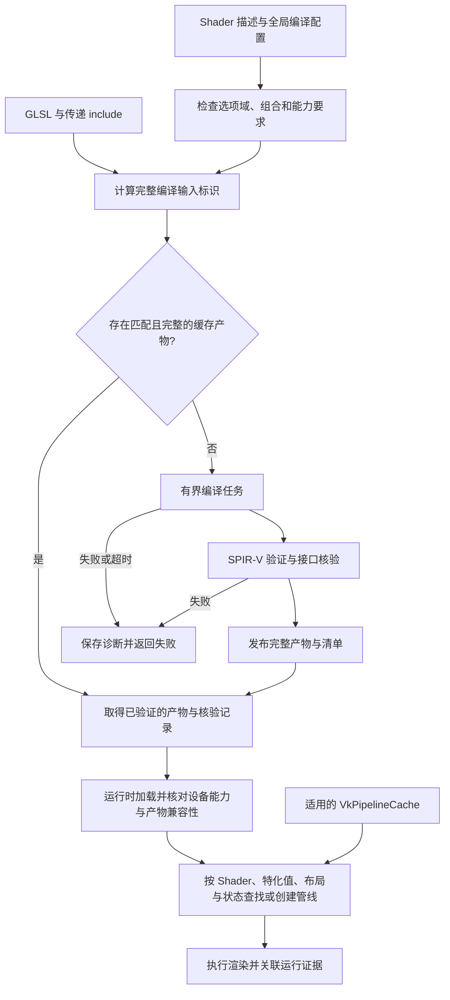
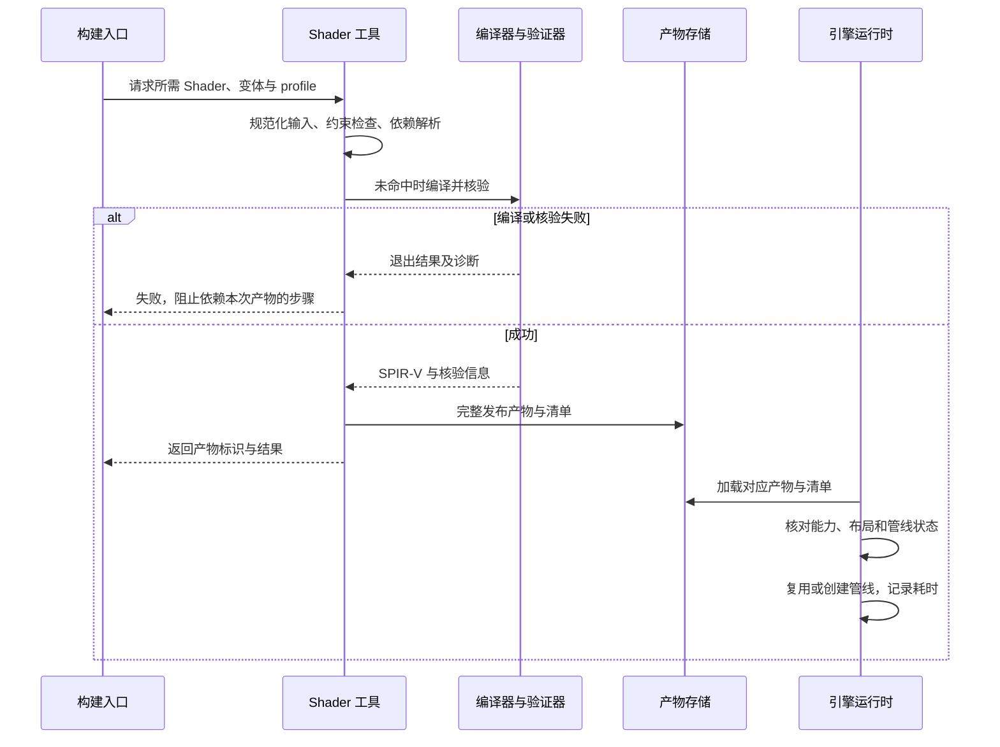

# Shader 编译与 CPU/GPU 数据契约规范

文档 ID：SHADER-001。修订：草案 2。日期：2026-10-19（Asia/Shanghai）。

状态：部分确认。GLSL → SPIR-V 和主视图 Reverse-Z 已单独确认；glslc、spirv-val、spirv-dis 工具选型已确认，见 [ADR-0007](../adr/0007-基础构建与第三方依赖选型.md)。具体版本、目标、布局及完整编译工作方式仍为草案。

后续确认：数学库使用 GLM，当前数学、坐标、深度与颜色议题按 Flower 实际实现采用，详见 [数学、坐标与颜色规范](数学坐标与颜色规范.md)。第 5 节原待定项以该专项规范的后续决定为准；这不把本稿宏/变体与缓存等其他草案整体升级为已确认。

依据：[Shader 选型 ADR](../adr/0002-Shader采用GLSL与SPIR-V.md)、[Reverse-Z ADR](../adr/0003-主视图采用Reverse-Z.md) 和当前双资源绑定路径需求。这里不实现编译管线，也不选择数学库或反射库。

## 1. 建议的编译基线

- 自有 Shader 建议使用 GLSL 460，GLSL 源码与项目固定的面向 Vulkan 编译配置一起维护。
- 采用 glslc 编译为 SPIR-V，配合 SPIRV-Tools 的 spirv-val 验证、spirv-dis 反汇编检查；建议首版作为离线工具接入。工具版本与 Vulkan/SPIR-V target 必须匹配并显式记录。
- 不使用编译器随安装变化的默认目标作为兼容性承诺；编译能力不等于设备已启用对应 feature。
- 第一版优先构建期编译，运行时加载可追溯产物。后续热重载需单独设计，不能因为工具可运行就立即变成本期必备功能。

上述工具名称已选定；GLSL 460、具体工具版本、目标环境和构建期编译工作方式仍按本稿建议落实，不能从工具可用推导完整编译流程已通过。

## 2. 可追溯产物与变体

每个 Shader 产物必须能追溯到源码及 include 内容、阶段、入口点、编译器版本、编译目标、宏、优化/调试选项及输出内容标识。

变体有稳定标识，避免散布无法追踪的宏组合。缓存键覆盖真正影响编译产物的输入，包括传递 include；不能只按主文件时间戳判断命中。

管线选择和运行时 specialization 的实际值单独记录；是否参与某种缓存键按该缓存职责决定，不把所有运行参数机械塞入源码编译键。

编译失败保留完整诊断和源码定位。旧产物仅在明确策略允许时保留使用并报告降级，不得输出“新 Shader 成功”却实际加载旧文件。

## 3. CPU 与 Shader 的布局契约

用于传输的结构与业务对象分开，不直接将包含指针、容器、虚表或平台相关布局的 C++ 对象当作 GPU 数据。

对每种共享结构明确字段类型、偏移、大小、对齐、数组/矩阵 stride 和矩阵布局。不得假设 C++ bool、枚举、vec3 或数学库类型的内存布局天然与 GLSL 相同。

建议作为初始保守约定：UBO 使用 std140，SSBO 使用 std430；Push Constants 显式定义接口布局并核验实际偏移。其他布局按所用 Vulkan 版本、适用规则、feature 和编译选项分析，不把“更紧凑”作为未经验证的替换理由。

校验建议组合：

- C++ 对适用传输结构使用 sizeof、alignof、offsetof 等编译期检查，offsetof 仅用于语言规则允许的类型。
- 从实际编译的 SPIR-V 获取/核对字段 offset、array/matrix stride、资源声明及必要 stage interface；具体反射工具待选。
- 代表性结构使用已知输入做适用的 GPU 数值/读回验证，不能只保证两份手写字段表彼此一致。

反射接口一致不证明矩阵变换、索引和算法本身正确。

## 4. 资源绑定契约

Descriptor Set Bindless 与 Descriptor Heap 两条路径保持已确认的场景、材质和主要渲染语义；路径专用的 Shader 声明、索引或接口变化必须可定位且分别验证。

Descriptor Set 路径按实际 descriptor set/binding、类型、数量和 stage 使用核对；Descriptor Heap 路径按其扩展与编译工具实际支持单独建原型，不能把传统 set/binding 规则直接冒充它的完整契约。

资源索引的类型、有效范围、缺失资源行为和生命周期有明确约定，遵守已确认资源所有权。任何允许在途更新的条件仍需同步方案证明，编译和反射不能替代。

Push Constants 范围、阶段和设备限制必须核验。不同 shader stage 的接口变化需检查调用管线是否仍匹配，不依赖自动分配恰好得到相同位置。

## 5. Reverse-Z 与数学数据

Shader 与 CPU 使用一致的主视图 Reverse-Z 定义，包含投影、清除、比较、深度读取与重建；阴影等其他深度用途逐项声明。

手性、轴、单位、矩阵乘法和存储、Y 翻转、纹理坐标、颜色与曝光仍需后续数学/颜色约定。本稿只要求接口一致，不先把这些未确认值写成默认事实。

主视图验证应覆盖已知近远位置、遮挡、深度重建及必要调试输出，不能仅记录状态开关。

## 6. 编译、检查与运行证据

建议链路：

```text
固定源码和变体输入
→ 固定编译器及目标生成 SPIR-V
→ spirv-val 验证目标环境
→ 布局/资源与管线接口核验
→ 最小场景与适用数值/图像检查
→ 运行摘要关联诊断与产物标识
```

检查器缺失、布局不符、阶段接口不符或目标能力不足时报告具体状态，不能仅凭管线创建成功判定验收通过。Debug 与优化构建分别记录实际选项，保留能定位问题的日志和必要反汇编/反射附件。

本稿不强制每次只改注释都跑 GPU 回归；根据输入变化和有效缓存选择检查范围。实际 GPU 断言、printf/readback 等重诊断按需要启用，记录开销，不能掺入正式性能基线。

## 7. 待确认与实施边界

本轮建议：GLSL 460、glslc 离线编译、spirv-val、可追溯变体缓存、明确布局与绑定、编译产物和实际数据的组合核验。版本与库集成实施前固定。

反射库、数学库、数据代码生成、运行时编译/热重载、缓存存储和 Descriptor Heap 所需新工具支持留在相应技术方案；不因本稿就自动引入。

参考：[glslc 手册](https://github.com/google/shaderc/blob/main/glslc/README.asciidoc)、[SPIRV-Tools](https://github.com/KhronosGroup/SPIRV-Tools)、[Khronos Shader Memory Layout](https://docs.vulkan.org/guide/latest/shader_memory_layout.html)。本次未安装或运行这些工具，未报告实际 Shader 校验通过。

## 8. Shader 宏与变体管理（Flower 调研后的补充草案）

依据 [Flower 源码调研](../research/Flower-Shader编译与宏机制调研.md)，借鉴其 C++ 编译请求到 `-D` 宏及同文件多变体的组织思路；不照搬缓存键、运行时弹窗重试和编译目标。

### 8.1 编译请求与宏分类

统一描述源码、stage、入口点、编译 profile 和宏集合，而不是让每个 Pass 自行拼进程命令。名称与接口实现仍待技术方案。

| 类别 | 建议表达 | 使用边界 |
| --- | --- | --- |
| 阶段宏 | 由 stage 自动注入且恰好一个 | 业务方不能任意伪造阶段 |
| Pass 选择 | 明确且互斥的 Pass 标识或枚举映射宏 | 仅用于声明的同文件多 Pass |
| 布尔功能 | `AR_FEATURE_X=0/1` | 用 `#if` 判断值，不用 `#ifdef` 判断真假 |
| 有限数值/模式 | 有类型和合法域的整数或枚举 | 编译时结构/算法差异，限制组合 |
| 当前运行数据 | GPU 参数而非新宏 | 曝光、时间、相机等一般不因数值改变重编译 |

`AR_` 前缀用于项目自有编译宏；第三方 Shader 按其契约保留名称。存在型宏如采用，必须与 0/1 值宏区分，不允许同一名称同时有两套语义。

### 8.2 规范化、约束与变体规模

- 宏名和值来自受控描述，不允许插入任意 shell/命令片段；字符串等扩展类型如需支持，定义编码、转义和合法域后再加入。
- 同一名称的冲突定义必须报错，不能依靠命令行顺序覆盖。规范化后的宏按确定顺序编码，用同一份结果生成编译参数、缓存键与诊断清单。
- 多阶段或多 Pass 共享文件时，应检查合法组合，必要时在 GLSL 中用 `#error` 拒绝非法组合；不能默认所有组合都只有一个 main。
- 只枚举需要支持的变体，声明互斥、依赖和能力条件；不要无限笛卡尔积编译所有开关。
- specialization 与宏是不同阶段的机制，选择需考虑实际工具与管线行为；运行特化值记录在适用的管线身份中，不混淆源码编译产物。

### 8.3 缓存、诊断与失败

延续第 2 节完整输入标识，增加规范化宏及变体声明版本；路径归一化与标识方式保证项目内引用明确，不把随机器变化的绝对路径/编译时随机种子当作完整可复现缓存契约。

缓存命中核验配置、输入与产物，记录命中/失效原因；缺失、过期或不完整产物不能仅因文件存在被使用。产物发布方式应防止并发编译或中断留下半文件，具体方案另定。

AI/CI 编译必须无须弹窗、具有运行预算、捕获退出状态与实际输出，返回可定位错误。不无限重试；修改源码/宏/环境后触发新的明确编译请求。

诊断至少可关联 variant_id、源码与依赖标识、stage/入口、规范宏列表、编译 profile、目标、工具版本、缓存状态、耗时、退出结果及输出 hash，按最终日志 schema 落实。

### 8.4 共享头与布局

可以评估类似 Flower 的 C++/GLSL 共享字段声明，以减少双份维护；共享声明不是布局证明，仍执行第 3 节的 offset、stride、类型及适用 GPU 验证。

共享内容限制为确需跨语言的数据契约和常量，避免把场景业务、归档、无关库头和宏污染带入 Shader。具体共享头、生成器或反射方案留给技术设计。

### 8.5 最小验证用例

后续实施时验证：相同宏不同插入顺序产生一致编译身份；0/1 布尔分支正确；非法宏组合被拒绝；include 或编译选项变化使相应缓存失效；失败/超时不弹窗且能定位；两条绑定路径的变体分离并核对其能力条件。

这些是检查要求草案，不表示当前已运行任何 Shader 用例。构建期离线入口的建议不因本次调研变成自动运行时热重载要求。

## 9. 其他公开实现的补充建议（待确认）

对照 [Filament、O3DE、Godot 与 Khronos 的公开方案](../research/Shader编译与变体公开方案对照.md)，建议编译请求具备明确选项域与有限变体清单，新增宏时说明组合规模、接口影响及验证范围。载体格式留待技术方案，不自动引入材质 DSL 或新的 Shader 源语言。

源码到 SPIR-V 的编译产物缓存、引擎 VkPipeline 对象复用和驱动 VkPipelineCache 是不同职责。SPIR-V 已存在不表示管线创建没有开销；分别记录编译/创建耗时、触发阶段与关联标识，已知管线可在场景准备时创建。管线身份包含实际相关状态与特化值，不直接 hash 含指针和 padding 的原始创建结构内存。

第一版优先统一请求、离线编译与验证、完整输入缓存及可定位诊断。后台特化、ubershader、共享缓存和完整热重载按实测需要另行评估，本节不将它们变成当前必须实现的能力。

## 10. 参数分类与文件组织建议（待确认）

| 参数或差异 | 建议机制 | 判定理由 |
| --- | --- | --- |
| Shader stage | 编译请求字段，必要时派生阶段宏 | 编译系统负责验证；不让调用方任意覆盖 |
| 不同资源绑定路径、声明或算法结构 | 已声明的编译宏与变体 | 可能改变接口或所需扩展，需各自编译和验证 |
| 算法内少量、稳定的常量选择 | 可评估 specialization constant | 不要求预处理改变源码；实际支持、限制与收益需验证 |
| 时间、相机、曝光、材质数值等运行数据 | 按更新粒度设计的 GPU 参数 | 不因普通值变化产生编译任务或管线变体 |
| Reverse-Z 主视图约定 | 已确认深度契约与对应管线状态 | 不作为 AI 可任意切换的通用功能开关；阴影等单独定义 |

特化常量不是通用运行参数；值参与对应管线身份，修改可能需要创建新管线。参考 [Khronos 特化常量示例](https://docs.vulkan.org/samples/latest/samples/performance/specialization_constants/README.html)。第一版不强制使用特化常量，也不把采样数等尚未设计的参数提前规定为特化值。

建议默认一个 stage 使用一个入口源码，共用算法放 include；同一文件多 stage/多 Pass 可以在共享关系清楚时采用，不能为了模仿 Flower 强制合并。若使用阶段宏，名称采用项目 `AR_` 前缀，且与请求 stage 一致。是否为所有源码注入阶段宏由工具方案统一决定。

GLSL 首版入口建议统一为 `main`，请求仍记录入口字段以便核验；不得假设任意入口名都能由选定 GLSL 工具直接支持。需要改变入口策略时按真实工具能力验证。

## 11. Shader 描述的最小示例（说明性模板）

以下 JSON 仅展示信息结构；不是已选定文件格式，也没有对应解析器。示例名、路径、profile 名和宏名不是已批准模块或资产。`options` 为逻辑枚举，编译工具统一映射到宏值，禁止业务方再维护一份映射。

```json
{
  "schema_version": 1,
  "shader_id": "example.compute",
  "source": "shaders/example.comp",
  "stage": "compute",
  "entry": "main",
  "compile_profiles": ["debug", "optimized"],
  "options": {
    "AR_EXAMPLE_MODE": {
      "type": "enum",
      "values": {"mode_a": 0, "mode_b": 1}
    }
  },
  "variants": [
    {"id": "mode_a", "options": {"AR_EXAMPLE_MODE": "mode_a"}},
    {"id": "mode_b", "options": {"AR_EXAMPLE_MODE": "mode_b"}}
  ]
}
```

描述层还应能够表达组合约束与能力条件；本例省略其语法，不能将省略解释为不需要检查。全局 profile 单处定义工具版本、语言/目标、优化与调试选项，具体内容实施前固定，不在各个 Shader 中复制。

调用方使用逻辑 Shader ID 与声明的选项选择；Stage、工具参数及宏编码由描述与编译系统负责。编译结果至少关联 SPIR-V、依赖/配置清单和布局/绑定核验结果。具体文件组织与 schema 在技术方案中一次确定，避免配置、C++ 和 Shader 各自维护不同事实。

## 12. 编译与运行边界图（建议）

图 SHADER-FLOW-01：展示建议的数据依赖与失败路径，不决定具体类或目录。



图 SHADER-SEQ-01：展示首次构建/加载的建议时序。缓存命中跳过编译但仍检查产物和核验记录有效性；新的校验规则版本需要重验，不能复用旧“通过”结论。



图中的职责为候选模块边界，不要求不同进程；构建工具可启动编译器子进程。发布完整性、超时/取消、并发写入和设备生命周期仍须技术方案落实。

## 13. AI 修改 Shader 的交付约束建议（待确认）

- 修改前定位所属 Pass、引用的 include、受影响变体及 CPU/GPU 数据契约；不能只编译单个主文件就宣称所有影响已验证。
- 新增宏时同步选项域与必要组合，说明为何不能使用已有运行参数；变体规模由实际合法组合计算，超出方案预算时记录原因并按基线变更边界处理。预算数值留待方案，不凭空规定。
- 改动共享 include、布局或编译 profile 时，由依赖关系选择受影响检查；影响分析不可靠时扩大到相关变体集合并说明。
- 新增失败必须有明确诊断；禁止静默回用旧产物、删除失败变体、关闭检查或偷偷改图像基准来获得通过。
- 交付关联变体/产物标识、编译与核验结果，以及变更适用的运行数值/图像证据。纯注释等变化按实际影响检查，不强制每次执行全量 GPU 回归。

本轮新增第 10—13 节为可审阅建议，未部署描述解析器、编译器、缓存或检查任务；用户“继续”表示继续讨论与完善文档，不据此将全稿标为已确认。
