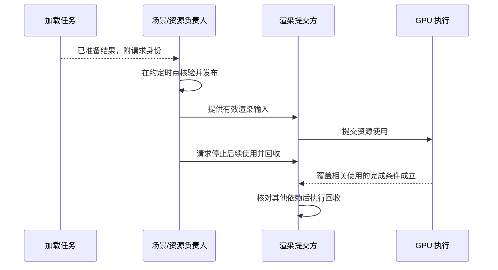

# 并发、线程约束与 GPU 同步规范

文档 ID：CONCURRENCY-001。修订：草案 1。日期：2026-10-18（Asia/Shanghai）。

状态：待用户确认。本轮继续讨论不视为已批准本稿或上一份错误与日志草案。本文定义安全约束，不选择线程池、Jobs、Render Graph、队列数量、帧数或同步原语实现。

依据：已确认的 [资源生命周期规范](C++类型接口与资源生命周期规范.md)、[VMA 选型](../adr/0001-Vulkan内存分配采用VMA.md) 与 [AI 任务执行规则](AI任务执行规则.md)。已有所有权和销毁规则继续有效，本稿补充并发下的执行条件。

## 1. 线程与数据访问

### THREAD-01：共享对象必须有访问契约

公开接口或跨线程对象必须说明：在哪些线程/阶段可访问，谁可以写，读写能否并行，是否需要调用方同步，以及调用是否可能等待。

默认不假定类型线程安全。`const`、shared_ptr、只读接口名称和 VMA 的内部锁，都不能单独证明整个对象或资源访问安全。

技术方案应给出适用的访问表：

| 对象/数据 | 修改责任方 | 允许读取方 | 提交/发布时点 | 同步或隔离机制 | 失效条件 |
| --- | --- | --- | --- | --- | --- |
| <实际对象> | <线程/任务/阶段> | <范围> | <时点> | <契约> | <场景/资源/帧变化> |

表格是方案模板，不预设实际线程角色。

### THREAD-02：共享可变数据最小化

优先由明确责任方管理修改，通过不可变结果、快照、受控命令或经设计的同步发布给其他使用者。需要共享写入时，必须明确互斥、原子协议或其他安全机制。

编辑器、后台加载与渲染不能无协议地同时修改场景树、材质、资源表或在途数据。发布边界由架构/模块方案选择；不凭“通常一帧内会完成”推断安全。

## 2. 异步任务、取消与退出

### TASK-01：后台任务有负责人

- 每项异步操作必须有可定位的所有者、输入有效期、完成/失败反馈以及关闭时处理方式。
- 不创建无人跟踪的 detached 任务访问场景、设备或临时对象。借用与回调捕获遵守已确认生命周期契约。
- 并发度、队列或输入量必须有合理边界或背压机制，不按资产数量无限创建线程或累积任务。
- 工作线程产生的结果在约定边界发布；不得绕开场景/渲染数据的修改责任方直接写入共享状态。

### TASK-02：取消不等于任务已经停止

取消请求之后，必须明确何时真正不再访问输入与设备。晚到结果需要检查所属场景、请求或版本，不能覆盖已经切换的新状态。

退出/重建的设计必须说明：停止接收新工作、取消或完成已有工作、收集结果、等待相关 GPU 使用、回收资源与销毁上下文之间的依赖。不要求所有系统采用同一顺序，但必须满足各对象的有效期。

等待中的工作线程、满队列生产者、回调与主线程之间不得形成无法解除的循环。超时后不得在尚有使用者时假装资源已可释放。

## 3. 锁、原子与等待

### SYNC-01：同步关系可解释

- 多把锁需要明确获取顺序；不得在持有共享锁时无说明地调用未知或可重入回调。
- 阻塞 I/O、任务等待、GPU 等待和日志写入可能参与死锁；持锁跨这些操作需有明确设计与审查依据。
- 原子变量不自动保护周围普通数据。自定义 lock-free、memory order 或发布协议需解释正确性，不凭“性能更好”直接采用。
- 不用 sleep、重复轮询或“多等几帧”代替同步正确性。轮询若是设计的一部分，应有运行预算、等待条件和故障处理。

## 4. Vulkan 主机线程约束

### VK-HOST-01：按对象和调用检查外部同步

Vulkan 的多线程使用遵守所用版本中每个对象与函数的外部同步要求。不能从“Vulkan 支持多线程”推导出同一对象可以任意并发访问。

例如 command pool 的并发使用需要外部同步；按线程/任务分配独立池或对共享池访问串行化，是待方案选择的实现办法。队列、命令缓冲、描述符等也必须按实际调用及启用 feature 分析。

对象所属线程、分配/记录/提交/重置责任及复用条件，在方案中明确。不直接规定所有工作放到单独渲染线程，也不提前强制多线程录制。

### VMA-THREAD-01：区分 allocator 与 allocation

VMA 某些 allocator 调用的内部同步，不代表同一 allocation 的所有操作安全，也不保证 GPU 使用与 CPU 访问同步。

使用外部同步配置时，责任移交给引擎必须明确。映射、读写、释放和查询等对同一 allocation 的访问，需依具体 VMA 文档和资源协议处理。

## 5. GPU 数据依赖与多帧在途

### GPU-SYNC-01：执行顺序与内存访问分别分析

- 必须分析生产者/消费者、访问阶段、访问类型、相关资源范围及必要布局转换。
- 队列提交先后、CPU 锁或函数调用顺序，不能单独替代所需的 GPU 内存依赖。
- 同步范围必须足以保证正确性；排查时可以暂时放宽，正式方案需说明范围和成本，不未经测量就堆叠全局等待。
- 若存在跨队列或队列族使用，按实际共享模式与操作分析执行依赖、内存可见性及适用的所有权转移。

### GPU-SYNC-02：在途数据不得过早覆盖

每帧上传区、描述符、命令缓冲和其他可复用对象，必须等对应使用结束后才能覆盖、重置或回收。帧索引绕回不等于完成，交换链图像索引也不自动等同于帧上下文索引。

绑定方案允许某些更新行为时，仍需满足其实际 feature、flag、描述符使用与同步规则，不把 Bindless 作为任意修改在途资源的许可。

### GPU-SYNC-03：CPU 映射不消除同步要求

映射成功只说明得到适用的主机访问地址，不证明 GPU 已停止访问。同样，host-coherent 或非 coherent 内存的 cache 处理，不能替代执行与使用期同步。

上传/读回方案须明确 CPU/GPU 访问时点、适用的 flush/invalidate、完成条件和数据读取边界；具体采用何种缓冲与内存配置由技术方案决定。

### GPU-SYNC-04：等待与销毁覆盖真实使用者

延迟回收须覆盖全部相关工作和对象依赖。普通提交完成条件不能未经论证就推导为呈现系统或其他外部使用也已完成；交换链相关对象的复用和销毁另核对相应规则。

设备丢失、提交失败等异常下，不能继续等待永远不会出现的正常完成信号，也不能伪造完成状态。异常处理与安全停止方案需要结合实际 API 和资源状态明确，不在本稿承诺自动恢复。

## 6. 时序表达示例

下面只表达一种发布与回收关系，不确定本项目线程划分或同步 API。虚线消息表示结果/事件，不代表具体 Vulkan 原语。

真实方案还必须覆盖取消、晚到结果、未提交命令、多个使用者和失败路径；不得用本图的简化顺序代替实际证明。

## 7. 检查与本轮边界

Review 重点核对线程访问契约、锁/等待依赖、异步捕获、取消、晚到结果、池与队列并发、在途数据覆盖及资源销毁。适用测试覆盖场景切换、重复加载、resize、取消与退出；同步验证与性能运行分开记录。

没有验证层错误不等于不存在全部同步问题。CPU 并发工具、设备验证与代码审查各有边界，选择实际工具链支持的检查，不声称已有全覆盖。

本轮建议确认上述责任与约束，不批准具体任务系统、原子协议、队列分配、帧数、barrier 自动生成器、fence/timeline 使用策略或资源流送实现。

## 8. 官方参考

- [Khronos：Vulkan Threading](https://docs.vulkan.org/guide/latest/threading.html)
- [Khronos：Vulkan Synchronization](https://docs.vulkan.org/guide/latest/synchronization.html)
- [VMA：Thread safety 与不承担的同步职责](https://gpuopen-librariesandsdks.github.io/VulkanMemoryAllocator/html/general_considerations.html)

当前仅完成文档编写与结构检查，未运行 Mermaid 渲染、CPU 并发测试或实际 GPU 验证。
