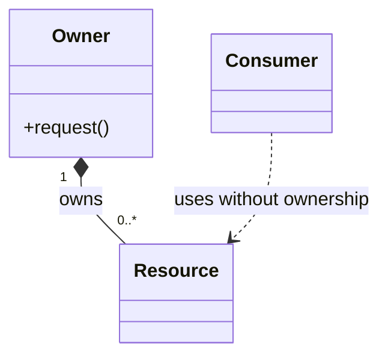

# 架构与设计图规范

状态：草案。定义文档图示的选择、位置和维护方式，尚未启用自动渲染或一致性检查。

## 1. 分层组织

图随其解释的设计放置，不单独维护一套脱离文档的“图片架构”。

| 层次 | 文档位置 | 主要回答 |
| --- | --- | --- |
| 全局 | 总体架构 | 系统边界是什么，模块如何划分和协作 |
| 模块 | 总体架构中的模块章节；足够复杂时独立成模块设计文档并引用 | 模块内部有哪些核心类型、数据和生命周期 |
| 单次变更 | 技术方案 | 本次改变了什么，如何运行，影响哪些既有关系 |

每张图的主版本只维护一处，其他文档引用对应图 ID 和文档版本。变化只影响局部时，不重新复制全套全局图。

## 2. 图种选择与最低要求

| 图 | 回答的问题 | 放在哪里 | 使用条件 |
| --- | --- | --- | --- |
| 系统边界图 | 引擎与编辑器、调用方、资产工具和外部系统如何连接 | 总体架构 | 总体架构必需 |
| 模块/组件依赖图 | 谁负责什么，谁在代码层面依赖谁 | 总体架构及必要模块设计 | 总体架构必需；模块拆分变化时更新 |
| 时序图 | 谁先调用谁，何时返回、等待、完成或失败 | 总体架构关键链路、模块设计、技术方案 | 总体架构至少覆盖阶段关键链路；跨模块、异步或同步行为复杂时必需 |
| 类/核心类型关系图 | 类型、接口、持有、借用和实现关系是什么 | 模块设计或技术方案 | 存在容易误解的类型关系、所有权或接口边界时必需 |
| 状态图 | 对象或资源有哪些状态，允许如何转换 | 模块设计或技术方案 | 多阶段加载、异步操作、失效与延迟释放等状态协议复杂时必需 |
| 数据流/处理流程图 | 数据经过哪些步骤，产生哪些输出与依赖 | 总体架构或技术方案 | 导入、渲染阶段、数据转换等仅靠调用图难以解释时使用 |
| 部署/执行环境图 | 哪个程序运行在哪个设备或进程，如何交互 | 总体架构或开发指南 | 多程序、不同设备或独立验证执行器关系复杂时使用 |
| 数据模型/格式关系图 | 场景、资产引用和存储结构如何关联 | 模块设计或技术方案 | 持久化关系复杂时使用；不强制将文件格式画成关系数据库 |

必需是按触发条件判断，不是所有任务都画全部图。一个简单局部函数修改可以不新增图；重要模块设计不能只用一张没有关系说明的方框图交差。

## 3. 每张图的说明信息

图旁至少写明：

- 图 ID 与标题，例如 `ARCH-DEP-01`；所属文档修订提供版本依据。
- 用途、范围和状态：拟议、已确认设计或已核验实现。确认设计不等于代码已经实现。
- 图例与箭头含义；第三方模块、外部进程、CPU 线程和 GPU 队列按需区分。
- 相关需求、模块或接口契约的引用，以及为了可读性省略了什么。

箭头表达静态依赖、数据流、调用、所有权和时间顺序时，分别说明，不在同一张图里使用同一符号表达多种未标注语义。

## 4. 类图与核心类型图

只展示决定接口、所有权和协作的核心类型与必要成员，不要求把每个类、私有字段和辅助函数画出来。

- 继承/接口实现、组合持有、非拥有引用、临时使用分别标注；必要时说明数量关系。
- UML 组合符号不能独自证明 C++ 的真实所有权，必须与契约表、代码和销毁条件一致。
- 采用结构体、数组、句柄和批处理的数据导向模块，可画核心数据布局与处理关系，不为类图强行设计继承树。
- 真实存在的类型使用代码名称；尚未实现的拟议类型明确标记，不捏造代码位置。

以下仅演示标注方式，不确定本项目的资源架构或 API：

图旁进一步说明：`Owner` 对 `Resource` 具有释放责任；`Consumer` 不拥有资源，合法访问期与失效行为需要契约说明。这里没有规定使用裸指针、智能指针还是句柄。

## 5. 时序、状态与 GPU 专项要求

时序图应覆盖相关的成功和关键失败路径，按需要使用分支、循环或并行片段。区分同步调用返回、异步完成事件和等待；异步系统的图只表达真实保证的先后关系，不假装存在全局顺序。

状态图的边标明事件及必要条件，说明失败、取消、重试和终止行为。不要把状态名当作同步机制；状态转换需要什么线程安全保障仍须写入技术方案。

对于影响 GPU 资源安全的设计，图与文字共同明确：

- CPU 记录、提交、GPU 使用和完成通知分别发生在哪里。
- 哪个同步原语或完成条件支撑等待与资源复用；不提前选定具体 Vulkan 策略。
- 多帧在途时，描述符、上传数据及相关对象可以修改和释放的条件。
- 若存在跨队列行为，说明队列间依赖；相关可见性、布局或所有权要求在契约中补充。
- CPU 请求销毁与实际安全销毁的区别，退出、重建、取消等路径如何处理。

流程图或状态图不能代替精确的 Vulkan 同步分析与设备验证。

## 6. 编写、审查与维护

优先使用 Markdown 内嵌 Mermaid，源文本随文档版本维护。图很大或需要多处引用时，可使用独立源文件；导出 SVG/PNG 作为派生物，注明源文件，不能只更新图片。

AI 设计审查必须检查：

1. 按触发条件需要的图是否齐全，图是否真正回答设计问题。
2. 图、职责表、接口契约和技术方案是否一致；实现后核对代码。
3. 模块名称、调用关系、状态转换和所有权是否准确，错误路径是否遗漏。
4. 每个新增关系是否违反既有架构边界。
5. 图的变更是否影响用户已确认的设计。只改布局或配色不需要重新确认，改变依赖、生命周期或关键流程则更新文档差异并按工作流确认。

后续在基础建设阶段固定 Mermaid 渲染环境，加入语法检查及可读性验证。语法通过不能证明图与代码一致，关系正确性仍需审查。当前只完成 Markdown 源文档检查，不宣称已通过渲染器验证。

## 7. 参考

- [C4：代码级图按需展示，避免不必要的过细设计](https://c4model.com/diagrams/code)
- [Mermaid 类图](https://mermaid.js.org/syntax/classDiagram.html)
- [Mermaid 时序图](https://mermaid.js.org/syntax/sequenceDiagram.html)
- [Mermaid 状态图](https://mermaid.js.org/syntax/stateDiagram.html)
