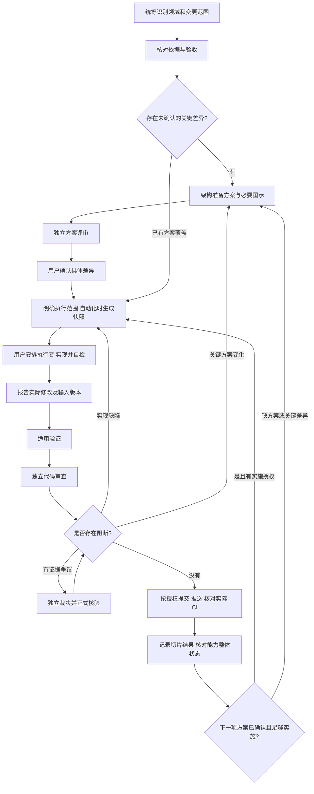

# 文档体系与确认机制

更新：2026-10-22。用户在讨论按模块分类后明确要求“文档以及整个流程也要确定下来”，本次确定文档组织、任务身份及角色交接方式，不批准引擎架构、P0 关键取舍或新增付费权限。[旧稿](../archive/2026-10-19/discussions/文档体系与确认机制-旧稿.md) 仅供追溯。

## 分层与命名

| 层级 | 位置与身份 | 内容与维护责任 |
| --- | --- | --- |
| 产品和总体架构 | 根需求、总体架构、ADR | 用户决定范围和关键选择，架构角色维护方案与确认记录 |
| 模块长期设计 | docs/modules/<module>/README.md | 模块职责、依赖、稳定契约、必要图示及实现边界；架构角色维护 |
| 一次能力变更 | openspec/changes/<change-id>/ | 本次目标、差异、方案、验收和步骤；角色按直接任务说明协作 |
| 变更内步骤 | <change-id> 的 tasks.md 编号，如 1.1 | 可观察的实施与检查步骤，不单独复制一套需求文档 |
| 可选自动化快照 | .ar-workflow/agents/<id>/task.md | 工具按需冻结角色、目标、输入、依据、路径和交接；不作为人工修改审批 |

- 模块使用稳定的小写英文名，与已确认模块名一致。构建、工作流可作为工作领域分类，但不因此变成引擎运行模块。
- 新 change-id 建议 `<主责模块或领域>-<动作>-<能力>`，使用小写连字符，例如 `rhi-create-vulkan-device`；这是命名示例，不是已批准的开发任务。
- 跨模块变更仍只有一个 change-id，指定一个主责领域并列出受影响模块，避免每个模块各建重复需求；能独立验收的目标才拆成有依赖关系的多个 change。
- 已有 bootstrap-engine-p0 等 ID 保留，不为统一前缀改名，以免破坏证据、缓存和交接引用。模块名不自动决定 C++ namespace、target、DLL 或提交 scope。
- 步骤完整身份为 `<change-id>/tasks.md#编号`；手工执行引用具体任务与范围即可，采用自动化记录时另有 assignment-id。聊天标题只方便识别，不作为任务身份或权限依据。
- 模块与变更通过 [分类索引](模块与变更索引.md) 关联；索引是人工维护导航，不是新的状态数据库或自动放行依据。

模块入口及模板见 [模块文档](../modules/README.md)。本次只建立已确认 core/rhi/runtime 的职责入口，不提前设计或建立未确认模块。

## 单一来源

- 产品目标与阶段范围维护于根目录需求；技术决定维护于 ADR；适用规范维护于 standards。完整目录与确认范围见 [文档索引](../README.md)。
- 当前部署事实只更新 [当前清单](当前决策与待办清单.md)，操作只更新 [接入指南](SDD与CodeReview接入指南.md)，历史讨论不再重复维护现状。
- 某次变更的行为与验收只编辑 `proposal.md`，工具规格通过 `derive` 派生；`design.md` 说明实现，`test-plan.md` 映射检查，`tasks.md` 保存任务。
- 需求、用户确认、独立审查、运行结果是不同事实；文件存在、任务勾选和 OpenSpec validate 不替代验收。

长期模块文档说明持续有效的职责、契约与已验收事实；未实施建议单列并链接当前 change。变更 design 只描述本次实现差异，不复制第二份完整接口契约。审查发现两者冲突时核对确认依据，由架构角色修订正确来源，不靠文件更新时间决定批准。

新能力在现有 context.json 的 documents 中引用实际模块入口及相关规范，并声明适用范围和确认依据；在 write_paths 中列出本次确需修改的路径。主责模块信息写在 proposal 的“影响与验收依据”和分类索引，不发明工具尚不支持的 JSON 字段。

## 直接指令与可选自动化快照

2026-10-30 用户明确取消“先领写包才能修改”的要求。目标、范围和验收已明确时直接执行，不要求用户回统筹申请 task.md、writer 包或领取回执。普通修复无需再补一套规划材料。各对话仍自行核对当前源码、在途写入和实际确认范围；技术方案批准、修改授权及快照登记分别处理。

2026-11-03 用户进一步取消强制 writer 权限登记、领取/释放和流程 gate，由用户安排单人写入。执行者核对文件后直接工作，报告实际差异、检查及未完成项即可。SDK、冻结导出和结构化导入仅为可选工具；旧记录不限制手工任务，不改写历史结果，也不接管运行中进程。Review 可直接读取明确版本的本次方案/差异，不要求先取得全量自动化验证或冻结包。

## 方案驱动与切片提交（2026-11-04已确认）

用户确认的判断顺序是“已有技术方案就按方案开发；没有方案先准备方案”，而不是每完成一片就固定返回架构。方案必须在本次适用范围内已获确认且足够实施，实施授权也须覆盖本次工作；草案存在或评审者同意不产生用户批准。

| 实际情况 | 下一步 |
| --- | --- |
| 已确认方案覆盖本批目标、边界及验收，已有实施授权 | 开发直接实现并同步测试；不重复申请普通实现细节，不重写一套方案 |
| 缺方案，或行为/跨模块接口、所有权、失败策略、验收存在影响实施的关键缺口 | 向架构交具体问题和证据，准备方案或差异；关键取舍由用户确认后实施受影响部分 |
| 开发或审查发现普通实现/测试缺陷 | 开发修复并补受影响检查/复审，无需默认回架构 |
| 缺陷揭示原方案无法成立或必须改变关键契约 | 架构核对根因与具体差异，再按用户决定修订；其他已明确的独立工作可继续 |
| 当前切片收口，下一项仍有足够且已确认的方案与授权 | 继续开发下一项；只有下一项缺方案才进入方案准备 |

“足够实施”要求能确定行为、模块/接口边界、资源所有者和生命周期、失败处理及可执行验收；不要求事先规定每个函数体或所有内部算法。开发者自行解决普通实现选择，不能借补细节改变关键契约，也不能用“需架构细化”将可查证的普通问题推回用户。

Git提交围绕一个可独立说明、验证及回退的目的组织，可为一项能力的子集，不要求整个模块、P0或change全部完成；也不按函数数量或聊天轮次拆提交。切片开始时引用既有方案与任务编号，说明本批范围和适用检查即可，不生成新的任务包或审批表。

切片完成后执行适用自检，以及本批已由用户安排或任务明确要求的独立审查；影响本批正确性的问题修复并复核后，按已有提交授权提交本批差异。未实施的其他模块和后续任务列为未完成项，不因此要求塞进本次提交。用户明确要求保存未完成checkpoint时如实标注，不将其声称为验证收口。

提交前核对实际索引和差异，仅暂存本批文件或必要片段，不无差别 `git add .`，不夹带其他上下文的未提交工作、缓存或机器路径。消息遵循[提交信息规范](../standards/Git提交信息规范.md)，Tests写实际执行及未执行项，Refs指向适用方案/change/tasks编号。方案文档可单独提交，也可与本次必需的实现修订一起提交，不按“每次必须先docs提交再code提交”制造固定步骤。

本地commit、远程push、对应提交的CI和整个能力的验收/归档是不同事实。提交与推送按实际授权分别推进，不因一次commit就声明已推送或CI通过；普通切片提交不勾选未实施任务，不提前sync或归档整个change的specs。无新增关键差异时，不因产生新提交再次要求用户确认方案，也不恢复writer、写包或流程gate前置。

## 材料按影响准备

| 变更类型 | 准备方式 | 仍需完成 |
| --- | --- | --- |
| 新模块、完整能力、关键架构变化 | 使用 ar-engine schema 的 proposal、design、test-plan、tasks 和 context；必要的图示及关键取舍交用户确认 | 真实实现、适用验证、按需独立 Review 和获授权的交付；无强制流程 gate |
| 既有模块新增行为 | 引用长期设计，在当前 change 写具体差异和验收，不重复整份架构 | 同上，验证范围依据实际影响 |
| 小缺陷、局部实现或纯文档维护 | 引用现有确认方案、问题复现与验收依据，可不新建完整 change | 实际差异、适用检查与独立审查；交付依据和未运行项如实记录 |

TDD 用于契约清晰、可观察的行为；GPU、时序及集成任务先定义可重复探针与验收，不要求每个函数都套相同测试形式。审查围绕可交付变更集，不给每个函数另开一遍完整流程；拆分不得遗漏跨模块调用方或规避预算。

## 从提出到交付的统一流程

图示用于需要方案、验证及审查的完整变更，不要求每次启用全部角色或运行整套命令。失败、未测及未解决问题如实报告，不能声称已验收；不以工具状态审批阻止独立分析或已明确交办的修复。可选命令见 [接入指南](SDD与CodeReview接入指南.md)。

| 阶段 | 责任与退出依据 |
| --- | --- |
| 任务准备 | 统筹给出目标、非目标、主责/受影响模块、已有确认、验收和依赖；OpenSpec 进度不能代替就绪判断 |
| 方案确认 | 架构角色给具体方案；独立评审检查差异；关键选择由用户决定。评审无意见不是用户批准 |
| 实现 | 用户安排执行者按明确范围修改并自检，报告实际结果；无 writer 登记或 handoff 前置手续 |
| 验证 | verifier 在交接后的固定输入执行适用检查；未运行、不支持、失败分别记录，不顺手修源码 |
| 独立审查 | reviewer 阅读明确版本的方案/差异、依据及调用方；问题保留原文，有争议时按证据核对；OCR 和 finding 工具按需使用 |
| 交付 | 核对实际改动、检查和剩余问题，按授权操作 Git；无需流程 gate，CI 以对应提交的真实结果为准 |
| 收尾 | 核对长期文档中的事实和链接；只有任务、验收、审查齐备才执行 OpenSpec 归档，延期项明确保留 |

输入改变后核对受影响的验证和审查资格；不手工改 pass、不复制旧报告批准新输入。文档、模板和公共规则修改也可能使旧任务包过期；不能无条件复用，亦不意味着必须再次整仓付费审查。

## 状态同步与恢复

- 统筹在开始、角色交接、失败、范围变化和交付后核对记录。角色执行前核对用户指令、当前依据及文件；仅在采用自动化快照时核对对应任务包；源变化按工具记录 stale/blocked 等实际状态处理。
- 当前 Git 与文件是输入事实；agent-status/任务记录是执行记录；验证与原始 Review 是资格证据；Git/CI 是发布事实。人工索引与聊天结论不覆盖这些来源。
- 分类索引只维护归属、路径和最后核对的简述。详细进展见当前状态和本机任务记录，不把同一实时状态复制到每个 README 或所有聊天。
- 多对话之间仍没有自动消息总线。能读同一工作区的角色读取文件；不能读本地文件时由统筹提供同版正文。通知与付费执行遵守已有授权。
- 提交或归档前需要补写长期文档时按用户安排完成，核对新增差异影响的检查/审查；不把修改前的结论冒称为对新增内容的验证，无需交还或重新领取 writer。

## 确认边界

用户确认需求、范围、架构和关键技术方案；AI 在已有授权内自主实施、验证和交付。具体协议引用 [AI 任务规则](../standards/AI任务执行规则.md)，不复制另一套规则。

改变用户可见行为、验收、模块契约、生命周期或关键技术路线时，提交具体差异重新审阅；普通局部实现、补充检查和无语义文档整理不重复申请批准。只确认局部条款时，不将整份草案升级为已确认。

文档按实际范围标记草案、待确认、已确认或已取代，注明修订与确认依据；没有消息链接时如实记录原话与上下文，不编造确认。格式字段按文档需要采用，模板数量不是就绪标准。

## 模板与归档

实际 SDD 模板只有 `openspec/schemas/ar-engine/templates/` 一套；模块长期设计使用 [模块设计模板](../modules/模块设计模板.md)，两者用途不同。先前普通模板和长流程建议已移入 [历史归档](../archive/README.md)，需要写 ADR、MR 或复杂方案时可以借鉴其中内容，不要求每个小任务复制全部材料。

已确认 ADR 的决定历史保留；若改变决定，增加取代记录。归档草案仍是草案，归档参考仍不产生执行授权；不把文件移动到 docs/archive 当作 OpenSpec 能力归档。

本轮文档搬迁使旧输入指纹变化，原审查报告只对当时快照有效。新的提交/合并依然需要对应实际输入的适用验证和独立审查；本地记录不认证远程身份。
