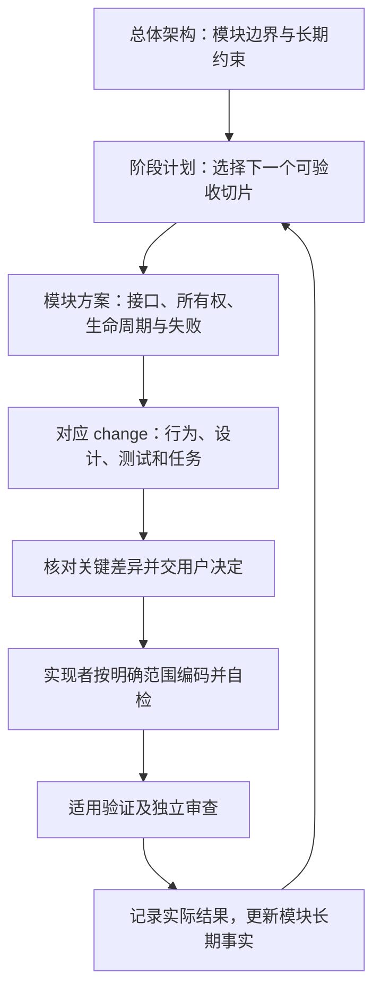

# AR Engine 实施路线与阶段计划

修订：2。日期：2026-11-03。状态：实施拆分建议，尚未整体确认或实施。

本页回答“下一步设计什么、实现什么、怎样判断可以继续”。系统边界以[总体架构](总体架构与技术路线.md)的实际确认范围为准，产品范围引用[需求](../渲染引擎需求.txt)，选型引用[ADR](adr/)，不建立第二套需求。具体行为及验收仍只在对应 change 的 proposal 编辑。

## 1. 当前起点与决定

- 用户已明确先完成学校需要的渲染器，后续游戏引擎能力另定；本轮明确“先不做 Probe”。不建设独立 ArProbe 产品工具，能力查询和诊断仍属于引擎基础能力。
- core/rhi/runtime 静态模块、固定 MSVC/C++23preview 和动态 CRT 方向保留；静态库由测试程序和后续独立渲染程序链接运行。
- 本机最小工具链工程与依赖消费工程已经跑通 Debug/RelWithDebInfo。它们不是正式引擎验收；当前尚无自有引擎实现，旧 P0 实施任务未勾选。
- 当前 [P0 方案](../openspec/changes/bootstrap-engine-p0/design.md)已按先不做ArProbe更新。本轮已修订其契约、图示、测试及任务，CTest承接和core细节保持候选；旧CLI/进程退出验收暂缓，不照旧命令实现。
- 下列阶段拆分、测试入口替代方式及未确认接口是 architect 建议。R1 职责细化、毕设冻结范围和四配置实验要求不因本页自动获批。

本页是路线导航，不维护第二份任务勾选或运行日志。实时进展见[当前状态](workflow/当前决策与待办清单.md)，具体任务及检查记录见各 change。

## 2. 方案怎样逐步进入实现

架构角色负责准备 C/D 和修订证据成立的问题；实现者负责代码；验证和独立审查按用户安排执行。已有确认不反复批准，普通实现细节由执行者自主处理。方案审查与用户决定是不同事实，不要求领取写包或等待流程 gate。

一个切片可以同时涉及多个模块，但只维护一套目标和验收。不要求先完成整个 core，再开始整个 rhi；也不提前写完未来全部模块的接口。每次方案需要说明：

1. 输入与输出、主责模块、依赖方向、非目标及已有确认。
2. 公开接口与数据所有权、借用期、取消和销毁条件。
3. CPU 线程约束、GPU 依赖与完成条件；不适用时明确说明。
4. 失败分类、诊断内容及性能约束。
5. 构建依赖、可验证结果、实现顺序和交给下一切片的接口。

必要的跨模块关系和时序用 Mermaid 表达；只有真实类型所有权需要解释时才画类图。

## 3. 阶段与可验收切片

沿用总体架构 P0—P7 编号，a/b/c 只是本页的建议切片标识，不是已创建的 change-id 或旧 tasks 编号。以下结果是后续 proposal 的验收设计输入，不取代现有契约。

| 阶段/切片 | 先准备的技术方案 | 涉及模块 | 交给下一步的可观察结果 |
| --- | --- | --- | --- |
| P0a 基础工程与诊断 | 固定构建配置、诊断会话、事件/摘要、错误值与输出失败处理 | build、core | 正式静态目标与有实际调用的测试联编；两配置测试；正常及失败路径有真实诊断，关闭可验证 |
| P0b 加载与能力查询 | LoaderSource、loader/instance 所有权、查询状态、API/feature/扩展判定 | rhi、core | 查询返回拥有自身数据的结果；缺能力、查询失败和合成测试来源可区分；失败清理顺序可验证 |
| P0c 模块组合 | runtime 创建/关闭、配置与报告交接、部分初始化回滚；替代 Probe 的测试入口 | runtime、rhi、core | 集成测试调用正式公开入口；诊断先开后关，instance 在 loader 前释放；两配置联编和生命周期测试通过 |
| P1a 首个画面 | 窗口/surface/device/queue/swapchain、Dynamic Rendering、Shader 构建与最小提交 | platform、rhi、runtime、build | 独立渲染程序清屏/三角形；有限帧退出与截图；能力不足明确拒绝，不强行运行 |
| P1b 帧资源与窗口变化 | 帧上下文、acquire/present、重建、最小化和关闭；同步失败处理 | platform、rhi、runtime | 多帧在途且不靠每帧 waitIdle；resize/最小化/关闭可复现；Validation 问题有结论 |
| P2a 资源与上传 | Buffer/Image/View、VMA、上传就绪、完成令牌、句柄失效与退役 | rhi、render 最小调用方 | 数值回读正确；CPU 失效与 GPU 安全回收分离；在途资源不会被提前复用 |
| P2b A 路径绑定 | Descriptor Set/Indexing、纹理与 sampler 数组、容量、默认资源、槽位退役；Shader 数据布局 | rhi、render、build | 不同索引/纹理/材质访问正确；陈旧句柄和容量边界可定位；在途更新与槽位复用受保护 |
| P3a 最小 GPU Driven | 测试几何与包围体、Compute 剔除、间接参数/计数、绘制依赖、CPU 参考 | render、rhi、runtime | 固定相机下可见集合与 CPU 参考一致；空集合/全可见/容量边界正确；不依赖 glTF 完整加载 |
| P3b 静态场景与资产 | glTF/纹理解码、资产标识、基本 Transform/Camera、场景保存、提取到渲染输入 | assets、scene、runtime、render | 同一资产可多实例使用；加载失败可定位；保存重开结果一致；render 不保存可变 ECS 地址 |
| P3c 材质与基础画面 | GBuffer、PBR、IBL 准备、HDR/曝光/色调映射、基础材质分类 | render、assets、rhi | 固定材质/环境场景可复现；颜色与法线等有调试视图/数值依据；Mip/layer 操作有明确状态跟踪 |
| P4a 轻量 Graph | 资源/子资源声明、外部与持久资源、Bindless 访问集合、barrier 与执行计划 | render、rhi、runtime | 既有 pass 迁移后输出一致；漏声明/冲突有诊断；跨帧状态明确；不先做资源别名或自动多队列 |
| P4b 阴影与多视图 | 方向光阴影、独立深度约定、每视图状态和历史失效 | render、scene、runtime | 固定阴影场景与多视图输出正确；视图缓存不互相污染；可定位每 pass 耗时和资源 |
| P5 Heap 独立原型及集成 | B 路径能力、工具链、布局/对齐、更新与回收；共用材质/场景语义 | rhi、render、build | 支持环境上实际运行；相同场景 A/B 输出及资源行为可对照；不支持时明确未验收 |
| P6 扩展与实验 | 按学校要求确定实验矩阵、场景规模、并行录制启用粒度及其他优化 | 按实际实验涉及 | 同质量、同场景、可复现；记录 CPU/GPU 成本、收益与退化；不能只报告一个 FPS |
| P7 冻结交付 | 学校展示范围、稳定版本、运行包、复现说明与已知限制 | 独立程序及实际使用模块 | 从加载、观察/调节到保存重开形成闭环，版本、场景、截图和论文数据对应 |

推荐先完成 P3a，再扩大真实场景和材质复杂度；P3b/P3c 的资源需求可以反向校验 P2 接口。P4a 在阴影、多视图、GI 之前接入。P3c 的 IBL 子资源处理必须先在专用流程中声明用途与最终状态，不能等待 Graph 才解决正确性。

P5 可在 P2 稳定后先做独立小原型；完整场景集成仍依赖已稳定的渲染与生命周期。学校交付不应机械等待所有实验完成；P5/P6 是否属于硬性要求、P7 放在哪个节点，由用户结合学校要求决定。

## 4. 各模块在哪些阶段细化

| 模块/领域 | 第一轮方案 | 随后增量 | 当前不提前建设 |
| --- | --- | --- | --- |
| core | P0a 的诊断、事件、摘要、错误值 | 实际帧循环需要的计时及标识；日志并发策略按负载细化 | 完整 Jobs、反射、自定义 CPU 分配器、服务定位器 |
| rhi | P0b 的加载、查询、所有权与失败 | P1 设备/提交/帧资源；P2 资源/上传/绑定；P5 Heap | 额外通用后端抽象、自动多队列、未使用的 GPU API |
| runtime | P0c 的组合和回滚 | P1 Tick/关闭；P3 场景提取和完成交接；P4 调用 Graph 执行阶段 | 游戏行为、插件系统、巨型全能 Engine 类 |
| platform | P1 的窗口、输入、surface 接入边界 | 窗口状态变化及编辑器视口需要 | 跨平台框架 |
| assets | P3b 前按真实加载需要设计；详细设计仍延期至该阶段 | P3c 材质/HDR 数据；实际需要后的异步加载 | 资产数据库、流送和复杂导入流水线 |
| scene | P3b 的 Transform/Camera/资产引用及保存 | Light、层级与编辑操作 | 完整游戏对象行为系统 |
| render | P2 只读资源语义及最小绘制调用方 | P3 GPU Scene/视图/材质；P4 Graph/阴影；P5 B 接入 | Nanite/Lumen/ReSTIR/SSGI 等具体算法实现 |
| editor | 独立渲染程序稳定后按需加入参数/诊断面板 | 场景树、属性、选择、gizmo、资产浏览和保存交互 | 作为渲染主路径的前置条件、完整游戏编辑器 |
| build/Shader/验证 | P0 构建身份与依赖；P1 Shader 构建入口 | 随每个切片增加布局核验、CPU/GPU/图像检查与采集 | 与当前能力无关的全套工具平台 |

GPU Driven、worker 并行录制、持久 GPU Scene、每视图历史及未来 Surface Cache 边界按已有确认保留。串行参考路径用于定位问题；何时启用并行录制、任务粒度和性能预算在对应切片中决定，不能无限期遗忘，也不在 P0 实现完整调度器。未来 GI 的扩展需求用于检验所有权和数据边界，不要求现在创建空的 GI 系统。

## 5. 紧接着要准备什么

本轮已在现有 `bootstrap-engine-p0`完成下列1—4项方案准备，第5项仍待后续交给实现者。下一步审阅新增差异，再细化rhi/runtime接口；相关后续实现仍集中在该变更，不为每个静态库另造重复 change：

1. **先修订 P0 范围。** 在 proposal 中落实“先不做独立 ArProbe”；逐项处理 CLI 三种模式、进程退出码、Probe 专属负向 ID 和 Harness 命令。区分可复用的查询/错误分类、CPU 合成测试、真实加载集成测试及后续渲染器入口测试，再 derive specs。不能把 CPU 测试冒称原进程语义已验收。
2. **细化 core 最小技术方案。** 更新 [core 入口](modules/core/README.md)中的职责与候选接口、会话/输出所有权、失败及线程约束；P0 design 解释本切片组合方式，proposal 承载行为与验收。预期失败返回方式、异常边界等未确认部分列推荐与替代，不把现有错误规范草案整体升级。
3. **以 rhi/runtime 调用方核对 core。** 明确 rhi 错误如何携带原始 Vulkan 结果，runtime 如何汇总；core 不反向依赖 Vulkan。必要的共享接口同时细化，避免临时日志通道。
4. **明确替代 Probe 的验证设计。** 推荐 P0 使用有实际调用的 CTest CPU/集成测试程序链接正式静态库，P1 建立独立渲染程序并承接启动诊断；这是真实测试可执行文件，不恢复独立 Probe 工具，不提前把窗口纳入 P0。该替代方式需在 P0 修订中交用户审阅。
5. **交接给实现者。** 提供准确的 change/任务编号、接口与调用顺序、允许范围、两配置构建/测试及失败预期；当前架构对话不直接编码。每完成一个纵切，再按实测结果补下一轮方案，不等待整个模块完成。

## 6. 确认与交接边界

| 事项 | 当前处理 |
| --- | --- |
| 先不做 Probe、先学校渲染器 | 当前用户决定；P0本轮已同步，不再等待重新确认这一意图 |
| 本页 P0a—P4b 拆分及 P0 测试入口替代 | architect 推荐的具体实施安排，供用户确认；没有勾选旧任务 |
| R1 Graph/runtime/rhi 具体职责细化 | 推荐沿用总体架构的 R1 建议，仍待用户确认；不能以本路线表代替接口确认 |
| Heap、四配置实验、编辑器完整程度及冻结日期 | 需求和已有确认保留；学校硬性验收范围及具体实验规模待定，不在此取消或追加 |
| 本机 Vulkan 1.3 与产品 1.4 | 分开记录；现有开发允许范围不等于 1.4/Heap 正式验收，缺能力时继续独立可行部分 |

交接至少说明实际输入版本、改动、有效检查、未执行项、待决定差异和下一位执行者。本页不批准代码实现、提交、推送或付费调用，也不要求为普通执行另建流程审批。
