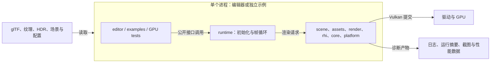
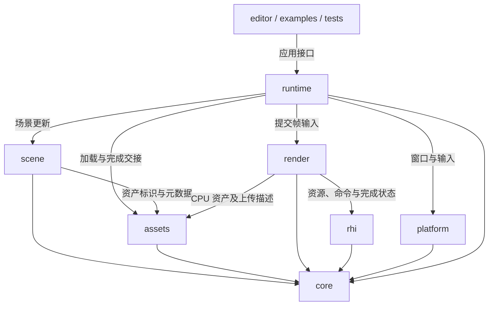
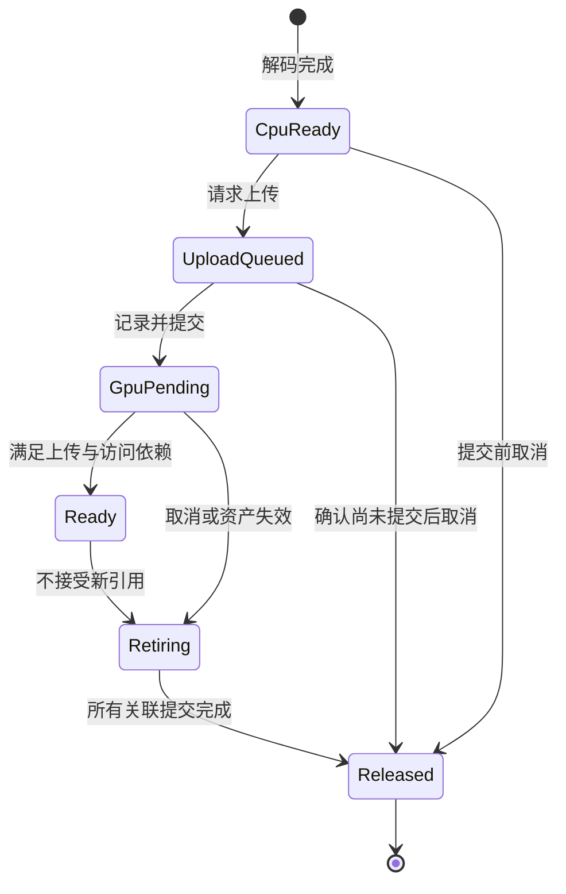
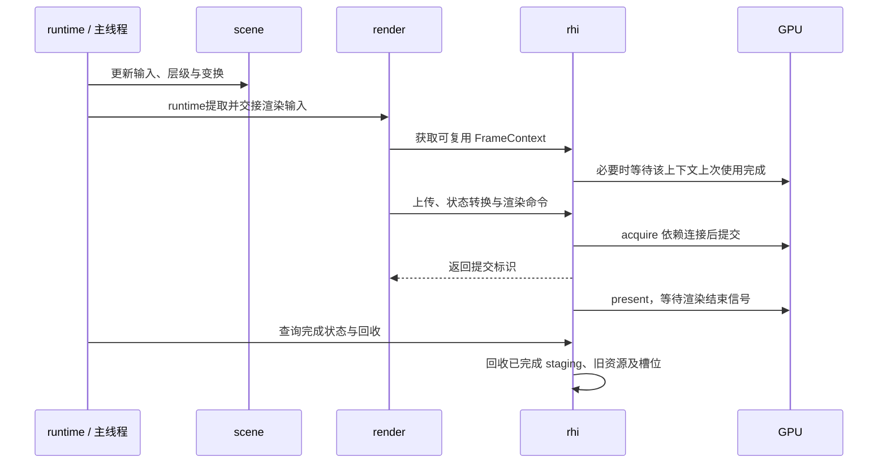
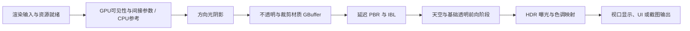
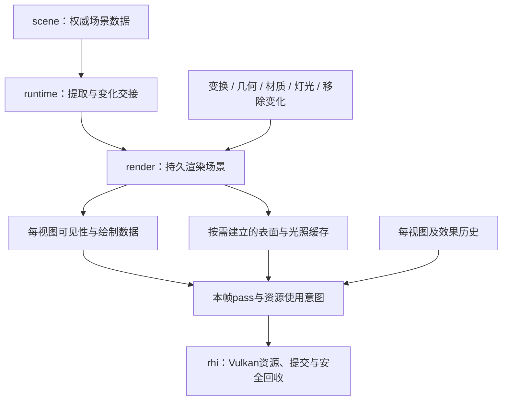
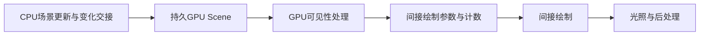
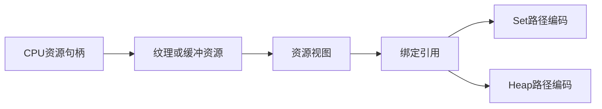

# AR Engine 总体架构与技术路线

文档 ID：ARCH-001。修订：12（部分边界已确认，其余为讨论稿）。更新：2026-11-03。

状态：面向首次实现的架构讨论稿；渲染优先与基础依赖选型已确认，局部确认及待讨论项集中在第13节的2026-10-23、2026-10-24及2026-10-26架构确认记录；2026-10-27职责澄清单列为待用户确认建议；其余模块、线程、资源提案不等于逐项获批。新版 Vulkan SDK 已安装；P0 前置的 C++23preview 联编与依赖恢复门禁已在本机临时工程中跑通，但正式引擎构建工程与 P0 源码尚未建立，云端 runner 未验证。本文中的模块、类型、目标名和里程碑为设计，不表示已经实现。已有选型与规范继续有效，其余建议不能自动覆盖已确认 ADR。

本项目采用 C++23、Vulkan 1.4，建设独立渲染引擎和轻量编辑器。建议以 Flower 的可理解渲染组织为起点，借鉴其他实现的数据分层、资源依赖和 GPU 驱动方法。以GPU Driven为主路径形成能调试、能验证的基础渲染，再完善双绑定比较与性能扩展；简单CPU绘制仅为原型和正确性参考。

用户已明确：渲染优先，编辑器逐步补齐；随后同意所列基础依赖，见 [ADR-0007](adr/0007-基础构建与第三方依赖选型.md)。这不表示本文所有架构建议均已确认。独立渲染程序承载首轮画面与实验，完整编辑器不阻塞任一渲染里程碑。

## 1. 当前输入与工程事实

依据：[项目需求](../渲染引擎需求.txt)、[当前决策](workflow/当前决策与待办清单.md)、[架构模板](archive/2026-10-19/templates/02-总体架构.md)、适用的 [C++ 风格](standards/C++目录命名与格式规范.md)、[生命周期规范](standards/C++类型接口与资源生命周期规范.md) 和现有 ADR。

架构调研阶段的目录快照：当时项目已有文档和项目技能，尚无自有引擎源码、CMake 工程或 Git 仓库。之后工作流建设已初始化本地 Git；实时部署状态以 [当前清单](workflow/当前决策与待办清单.md) 为准。外部渲染器参考代码未复制到引擎源码目录。

已确认：C++23、Vulkan 1.4、VS 2026/MSVC、VMA、GLSL → SPIR-V、GLM、主视图 Reverse-Z、spdlog 与薄诊断封装；两条 Bindless 路径、独立引擎与编辑器的产品方向；本稿第 10 节所列基础依赖选型。

2026-10-19 历史核查：RTX 4060 Laptop GPU，驱动 566.26，设备 API 1.3.289，SDK 当时为 D:/VulkanSDK/1.4.304.1，CMake 4.2.1。2026-10-20 用户已安装新版 SDK 并选择暂不更新显卡驱动；最新安装位置、工具验证及进程环境差异统一见 [当前清单的开发环境](workflow/当前决策与待办清单.md#开发环境与阶段边界)。旧快照不作为继续使用旧 SDK 的要求。VS/C++23 标准开关的已知问题见 [ADR-0006](adr/0006-Windows构建采用VisualStudio2026.md)；2026-11-03 已用最小工程验证 `/std:c++23preview` 的编译、运行及 Debug/RelWithDebInfo 产物，但正式 P0 工程尚未接入，不能据此认定 P0 完成。

阶段边界：产品目标仍为 Vulkan 1.4。现有驱动下可以先做明确标记的 Vulkan 1.3 开发探针，验证窗口、资源、Set Bindless 和基础绘制；探针应使用匹配的 API/Shader 目标与能力查询，不能把产品程序请求 1.4 后强行运行。基础探针成功不算 1.4 产品验收；Heap 另需扩展、feature、编译链及小型运行原型通过，不仅检查头文件。当前不为开始原型强制更新驱动，也不新增长期维护 1.3 产品后端的承诺。

历史依赖与绑定建议稿原位于父目录，现保留在项目内 [旧依赖讨论](archive/2026-10-19/discussions/渲染引擎依赖与资源绑定方案.txt)，已标明历史状态。现行依赖选型以 [ADR-0007](adr/0007-基础构建与第三方依赖选型.md) 为准，其中 Ninja 默认入口等旧建议不作为当前基线。

## 2. 参考实现与采用边界

本轮是源码静态调研，未运行参考项目，未进行基准测试。远程文件来自 2026-10-19 读取的 main/master；正式复用代码时需要固定提交并核对许可证。

| 参考 | 直接观察到的实现 | AR Engine 建议借鉴 | 本轮不采用的内容 |
| --- | --- | --- | --- |
| 本地 Flower | `DeferredRenderer::tick` 显式组织 pass；`RenderScene` 收集每帧数据；`BindlessBase` 内部使用 Descriptor Set；独立 ShaderVariant、Uploader、GPU timer | 渲染功能清楚、pass 易定位、场景转渲染数据、效果与诊断配套 | 全局 `getContext()` 耦合、引擎与编辑器合编单 executable、GPU 类型跨模块散布、原样移植缓存和同步策略 |
| Niagara | 资源绑定辅助函数、Compute 剔除、Indirect Count、前后阶段可见性处理、可选 Mesh Shader 与 Descriptor Heap | GPU 数据组织、剔除与绘制闭环、小步验证；源码明确区分 Heap 可用性与 GPU-AV 检查限制 | 将集中实验程序整体当作长期工程架构，首版同时承担全部几何与光追实验 |
| Filament | FrameGraph 的 setup/execute 分离、read/write 声明、compile/execute 与资源导入接口 | 清晰表达 pass 读写和外部资源，后续构建轻量 Render Graph | 立即复制其完整材质编译器、后端命令系统和多平台支持范围 |
| Donut / NVRHI | Scene 区分材质、几何与实例 GPU 数据，具有导入、纹理缓存和场景更新职责；NVRHI 提供图形 API 抽象 | 分开资产、实例和 GPU 数据，研究接口职责 | 同时引入 NVRHI 再另造功能重复的完整 RHI；本轮不据库能力承诺两种绑定路径可直接接入 |
| Godot | RenderingServer 以 RID 提供资源操作，并定义渲染线程调用边界 | 场景与设备对象分离、句柄和线程归属清楚 | 移植整个对象系统、反射、Variant、脚本与游戏框架 |

Flower 中 `BindlessTextureDescriptorHeap` 的名字不能作为采用 VK_EXT_descriptor_heap 的证据，它的实际成员是 `VkDescriptorSetLayout`、`VkDescriptorPool`、`VkDescriptorSet`。

不从这些项目的模块名推导其一定高性能；采用建议是本项目的设计判断，后续必须验证。

## 3. 总体架构目标

1. 渲染核心独立运行，编辑器可替换为示例或验证程序。
2. 两种绑定方式改变资源访问适配，不复制 PBR、阴影和场景加载逻辑。
3. CPU 场景、每帧输入、GPU 常驻资源和临时资源分别有所有者。
4. 先维护一条清晰执行路径，再按证据增加线程、队列和缓存复杂度。
5. 增加效果有明确入口，定位错误能追溯场景、Shader、资源和 GPU 提交。

第一版不建设完整游戏引擎、插件热加载、跨工具链 ABI、多图形 API 或复杂资产数据库。

## 4. 系统与模块边界

以下图为总体方案；已确认子集以第 13 节确认记录为准，其余关系保持建议。图 B1 表示调用与输入输出，图 M1 的箭头表示静态代码依赖；不是运行时消息流，也不表示为每个盒子创建 DLL。

图 B1：每次启动只选择一个程序入口和一种场景绑定模式；编辑器、示例与测试复用引擎实现。

图 M1：Vulkan 实现属于 rhi 的私有实现。render 不依赖编辑器或 EnTT 容器；runtime 的提取适配读取 scene，再生成 render 公开数据类型。编辑器专用 UI 后端可以通过受控的 rhi 扩展接口接入，不反向进入 scene。

| 模块 | 职责与对外能力 | 所有的数据 | 不负责的内容 | 建议位置 |
| --- | --- | --- | --- | --- |
| core | 日志、配置、错误值、ID、基础计时；以后放最小任务抽象 | 日志服务、基础运行配置 | GPU 管理、全局查找全部系统 | engine/core |
| platform | 窗口、输入、surface 创建所需的平台接入 | 窗口及输入状态 | PBR 与材质 | engine/platform |
| assets | 读取、解析和解码；CPU 模型、纹理、材质及 AssetId | CPU 资产记录、加载请求与结果 | Vulkan 对象、场景编辑、GPU 提交 | engine/assets |
| scene | ECS、Transform、层级、Camera、Light、场景保存加载 | 实体、组件、层级与资产引用 | VkBuffer、描述符、命令录制 | engine/scene |
| rhi | GPU 资源、视图、管线、命令、提交、完成状态与后端能力 | Vulkan 对象、VMA、帧资源、上传暂存及退役队列 | 场景树、PBR 算法、ImGui 业务 | engine/rhi |
| render | GPU 常驻资产映射、渲染场景、材质数据、pass、绑定策略和渲染统计 | 逻辑 GPU 资产表、对象/材质数据、输出与历史资源 | 用户场景的权威编辑数据 | engine/render |
| runtime | 组合模块、主循环、场景到渲染数据提取、加载完成交接 | 模块实例、当前场景、帧上下文编排 | 把全部模块细节集中成巨型 Engine 类 | engine/runtime |
| editor | 场景树、视口、属性、调试与性能界面 | 选择状态、面板与 UI 数据 | 引擎初始化之外的 GPU 所有权暗门 | editor |

已确认 rhi 内直接实现薄 Vulkan 封装，不额外叠加通用后端层，不强制虚接口；不把每个 Vulkan 调用机械改名；Vulkan 私有代码仍可清楚表达 barrier、绑定和内存细节。两种绑定实现放在该后端内部，由 render 提供资源语义，不向 scene 暴露 set、pool 或 heap 偏移。

## 5. 类型、资源与生命周期

核心类型为接口设计候选，命名遵守项目规范：

- `AssetId`：稳定的资产身份，不等于 ECS Entity 或 GPU 索引。
- `TextureHandle`、`BufferHandle`：建议采用类型化槽位与 generation，拒绝陈旧 CPU 引用。
- `RenderSceneInput`：当前帧对象、相机、灯光等只读值数据及受控资源引用，不保存指向可变 ECS 容器的裸指针。
- `GpuScene`：render 所有的对象、几何和材质 GPU 数据及 dirty 更新记录。
- `FrameContext`：rhi 所有的当前 CPU/GPU 帧资源和提交状态，不与交换链 image index 混为同一概念。
- `BindingMode`：SetBindless / DescriptorHeap，启动时明确选择并输出能力检查结果。
- `UploadTicket`、`SubmissionToken`：区分上传已接受、GPU 使用就绪与已完成，具体字段在模块方案中确定。

| 数据或资源 | 所有者 | 使用条件 | 回收条件 |
| --- | --- | --- | --- |
| CPU 场景 | scene | 初期主线程修改与提取 | 提取借用结束，异步引用已处理 |
| 解码数据 | assets / 显式转交的上传请求 | 上传复制前保持有效 | 数据已复制到引擎拥有的 staging 或不再需要 |
| staging 与命令池 | rhi 的上传或帧上下文 | 只由其约定线程操作 | 关联 GPU 工作完成 |
| GPU 资产和材质表 | render 持有 rhi 句柄 | 上传与状态转换已完成或由 GPU 等待正确连接 | 不再被新帧引用，所有旧引用完成 |
| 描述符槽位 | 绑定实现 | 槽位初始化且资源有效 | 引用该槽位的所有提交完成，之后才可复用 |
| 帧内临时资源 | FrameContext | 当前帧提交范围 | 完成值达到后重置 |
| 时序历史、持久输出 | render | 明确跨帧读写与重建条件 | 最后一次 GPU 使用完成后销毁 |

CPU generation 检查不能阻止已经提交的 Shader 使用旧索引；GPU 在途保护和描述符退役需要独立协议。RAII 释放的是 CPU 所有权，可以将真正 Vulkan 销毁排入退役队列。

图 L1：示意单项 GPU 资产的生命周期；真实实现需补齐失败、设备丢失、取消竞态和共享资产引用规则。Ready 可以通过提交间 GPU 等待建立，不要求每次 CPU 阻塞回读。

## 6. 帧循环与线程路线

2026-10-24已确认支持worker并行命令录制，保留串行参考执行；按较粗任务拆分，实际并行粒度通过测量确定。命令池及临时分配区按帧上下文、录制worker和所需队列族隔离。交换链期望3张图像，按设备/呈现约束记录实际数量；在途帧上下文以2为默认候选，支持对照测试3。worker数、交换链图像数、在途帧数与GI历史数量分别管理。独立渲染线程、GPU多队列及具体同步原语仍待方案，不由支持并行录制自动推定。

单线程起步不表示每帧等待 GPU 空闲；允许多个 GPU 帧在途，只有复用对应上下文时等待必要完成条件。主线程/渲染线程分离时使用有界快照交接与背压，不同时引入多队列和并行命令录制。

图 S1：逻辑协作时序，不预设已建立独立 render CPU 线程。提交返回不等于 GPU 完成；WSI acquire/present 信号量的消费及交换链重建另有生命周期要求，不能只用图形提交完成值推断呈现资源可销毁。

任务系统先满足异步读盘、纹理解码和可独立计算的准备任务。推荐固定大小 worker 池与明确完成队列；是否使用第三方实现通过 Jobs 模块方案决定，不为“必须 Jobs”先引入完整工作窃取调度器。

CPU 内存先使用标准容器、预留容量和有限帧内 arena；只有测量证实分配热点后再评估专用分配器。VMA 只管理 Vulkan 内存。

## 7. 渲染流程与 Render Graph

建议的基础顺序：

图 D1：逻辑执行顺序；具体读写依赖在 pass 方案中展开。IBL 预计算是资产准备，不要求每帧重新生成。阴影和 GBuffer 并不是所有资源都存在直接数据依赖。

建议 GBuffer 先保存可验证的法线、基础颜色和材质参数，由深度重建位置；不提前过度压缩。HDR 中间颜色使用适合的浮点格式。最终通道、格式、精度与带宽预算在基础渲染方案中确定，不能将示意表当作已确认布局。

主视图继续遵守已有 Reverse-Z、坐标和颜色规范；阴影深度单独设计，不把 Reverse-Z 主视图规则无条件复制到所有用途。暂不推翻已有旋转和投影约定，四元数存储仍是待讨论建议。

Render Graph已确认分两步接入（详细边界见2026-10-26记录C3）：

1. 最小绘制原型使用显式pass顺序，验证Dynamic Rendering、提交与资源生命周期。
2. 扩展多视图、阴影和GI前接入轻量Graph：声明资源用途、子资源范围和Bindless访问集合，检查依赖并规划同步、录制和执行。持久资源由所属功能管理。别名和自动多队列调度后续评估。

初期将 Image 按整资源追踪时要明确其保守限制。加入 Mip 生成、IBL 预滤波与 Hi-Z 等不同子资源访问前，应显式追踪 mip/layer/aspect，或在受控专用 pass 内处理并声明最终状态；不能声称简单整图追踪已覆盖任意子资源。

资源别名及自动异步Compute/多队列调度按后续测量评估；worker并行录制已纳入架构，具体粒度待验证。Shader 使用 Bindless 并不使资源依赖消失，pass 仍需要声明实际读写范围或可验证的保守集合。

## 8. 两条资源绑定与 GPU 驱动

资源绑定接口按“注册资源、生成 Shader 引用、绑定当前 pass、退役资源、输出诊断”组织；不对每个对象生成虚类，初期用两个具体实现和单次模式选择即可。固定虚接口或 variant 的具体选择留给 RHI 方案。

A：Descriptor Set + Descriptor Indexing。先实现纹理和 sampler 数组、材质索引、容量和生命周期，再学习在途更新。

B：VK_EXT_descriptor_heap。先用 set/binding Shader 到 Heap 的映射复用着色逻辑，再评估原生 GLSL Heap 访问。正确区分写入大小、槽位步长、对齐、保留区、独立 sampler 和 combined sampler 映射。

两者的 Pipeline、Shader 编译元数据与参数传递可以不同；公共材质公式和资产语义保持一致。启动时选择，首版不在运行中热切整个绑定模型。

UI backend 若保留传统 Descriptor Set，则单独安排 UI 阶段，并在跨绑定模型处完整恢复状态。不能宣称 UI 也已经采用 Heap。

2026-10-24用户明确GPU Driven为核心方向，调整“完成两条绑定后才加入”的旧顺序；基础闭环应前移，具体里程碑归属仍待重排。P6扩展/四配置实验及其是否为毕设硬要求未被取消或决定：对象包围体 → Compute 剔除 → 生成间接参数/计数 → 同步 → Indirect Count 绘制。按兼容的顶点/索引布局和管线分组；Bindless 不会自动把不同 Shader 或渲染状态合成一个 draw。

比较实验为 A/B 绑定 × CPU/GPU 可见性处理四种配置，固定场景、批次和画面质量，分别记录 CPU 提交、GPU 额外成本和整体帧时间。Hi-Z、Mesh Shader、DGC 和光追不是这条基本闭环的前置条件。

## 9. Shader 工具链与数据契约

沿用 [Flower 调研](research/Flower-Shader编译与宏机制调研.md) 的结论，glslc编译入口已经选定；本轮进一步确认首版构建期并行编译GLSL、有限变体与可追溯产物，不将运行时编译、热更新与完整反射作为前置条件。确认来源见2026-10-26记录C4，具体工具版本和元数据格式仍待验证。

Shader 编译请求包含源码、stage、入口、规范化宏、绑定模式、目标环境和诊断/优化配置。允许像 Flower 一样一个 GLSL 文件包含多 stage/pass，但每个合法变体产生独立 SPIR-V，不能用每帧宏变化代替 GPU 参数。

缓存覆盖传递 include 内容、宏、编译器、目标及选项；区分 C++ 配置和 Shader 配置。失败保留完整诊断并返回非零状态，不弹框无限重试。

GPU 数据独立于 ECS/序列化定义。初期显式结构配合 sizeof/alignof/offsetof 和 SPIR-V 接口核验；只有总大小为 16 倍数不足以证明布局一致。不要直接上传含 bool、指针、std::string 或容器的业务结构。

SPIRV-Reflect 可评估为接口核验工具，但其实际锁定版本对 Heap/untyped pointers 的覆盖要单独验证；缺少反射支持时可使用显式小规模元数据和数值测试，不伪造自动核验结果。

## 10. 已选依赖与集成顺序

用户已同意下面的基础选型，见 [ADR-0007](adr/0007-基础构建与第三方依赖选型.md)。选型确认、版本锁定和集成通过是不同状态；本轮只更新文档，不安装依赖。

| 能力 | 推荐 | 状态/原因 |
| --- | --- | --- |
| Windows 工具链 | VS 2026 MSVC | 已确认；2026-11-03 最小工程已验证 `/std:c++23preview`，P0 正式接入待实现 |
| GPU 分配、数学、日志 | VMA、GLM、spdlog | 已确认；配置和版本待锁定 |
| 构建 | CMake + VS 2026 generator + MSBuild，CTest | 已选定；最小工程已验证配置/编译，P0 正式构建与 CTest 待实现 |
| 依赖管理 | vcpkg manifest + 固定 baseline，少数固定源码例外 | 已选定；Vulkan 头、volk、VMA 与 SDK 来源待固定 |
| 窗口与输入 | GLFW | 已选定 |
| Vulkan 函数加载 | volk | 已选定；检查所需扩展入口，与统一头文件匹配 |
| Shader 工具 | glslc、spirv-val、spirv-dis | 已选定；SDK 版本、目标环境与 Heap 能力待验证 |
| 场景存储 | EnTT | 已选定；父子关系与脏变换由 scene 定义 |
| 模型与图像 | fastgltf、stb_image | 已选定；glTF 子集与 CPU 解码/GPU 上传边界待设计 |
| 场景与配置 | nlohmann/json | 已选定；实际 schema 待设计 |
| 编辑器 | Dear ImGui、后续 ImGuizmo | 已选定；按渲染优先顺序接入 |
| CPU 分析 | Tracy | 已选定；接入与开销待验证 |
| CPU 测试 | Catch2 | 已选定；按适用逻辑接入 |
| GPU 验证与抓帧 | Validation、RenderDoc、按需 Nsight | 开发工具；Heap 的捕获/重放/调试能力分别验证 |

### 集成时机与后置依赖

基础库不再列作待选。以下安排用于按需集成，不要求在首个三角形前把所有依赖接完。

- 渲染启动前：接入 CMake/MSBuild、vcpkg、GLFW、volk、glslc 及 SPIR-V 检查工具。与此同时固定头文件、loader、VMA、SDK 工具的来源和实际兼容版本。
- 模型与场景接入前：fastgltf、stb_image、EnTT、nlohmann/json。首个三角形不依赖完整 ECS、模型解析或场景序列化。
- 验证与分析：Catch2、Tracy、RenderDoc/Nsight 的具体版本和接入方式；基础 Validation、时间戳与日志从最小闭环开始，CPU 测试框架按适用的首批逻辑接入，不拖到最终交付。
- 编辑器阶段：Dear ImGui、ImGuizmo 的具体采用版本与 backend。简单参数面板可按需提前加入，但场景树、资产浏览、gizmo 和完整编辑流程不阻塞渲染。
- 按需求再定：Jobs 的实现或任务库、CPU 反射/属性元数据方案、SPIR-V 反射工具、压缩纹理/资产流送库及 CPU 分配器。当前没有证据要求一开始增加全部依赖。

已有 VMA、GLM、spdlog、VS 2026、GLSL 和 C++23/Vulkan 1.4 方向不重选，但其版本、配置、实际功能支持和联编结果仍需固定与验证。

不引入完整 NVRHI/Donut 作为运行依赖，因为当前学习目标包含自己实现资源绑定和 Vulkan 边界；它们保留为代码研究对象。若原型证明自建 RHI 成本过高，再以完整方案比较，不叠两套相同抽象。

当前保留 `core/rhi/runtime` 静态库；2026-11-03用户明确先不做独立ArProbe。P0候选验证方式为CTest测试程序调用正式模块，P1再接独立渲染程序；内部模块用构建target表达依赖，编辑器和独立示例分别作为executable。若后续产品需要单一 `ArEngine` 动态库，再在静态库边界上评估 DLL 包装，不作为当前实现前提。各模块的内存分配与释放配对，固定 CRT，避免把内部容器和 GPU 类型任意变成跨工具链 ABI 承诺。

## 11. 落地顺序与完成条件

本节保留阶段概览。可验收切片、模块方案准备顺序及下一项工作见[实施路线与阶段计划](实施路线与阶段计划.md)。2026-11-03 用户进一步明确先不做独立 Probe；P0契约、图示和测试已同步为不建设独立ArProbe的候选稿，不作为继续建设该工具的依据。静态模块与独立渲染程序方向保留；新增路线拆分仍为建议。

| 阶段 | 实现范围 | 必须观察到的结果 |
| --- | --- | --- |
| P0 环境与构建原型 | 标准开关、实际依赖候选、SDK/驱动能力报告、静态模块与真实测试程序联编 | C++23 小探针及 Debug/优化构建结果，明确 A/B 支持状态；无能力的检查不能写通过 |
| P1 图形最小闭环 | window/device/swapchain、清屏或三角形、同步、日志、有限帧退出、resize | 稳定启动关闭与截图，Validation 无未处理错误 |
| P2 资源与 A 绑定 | Buffer、Image、上传、句柄、退役、纹理/sampler 数组、数值回读 | 零/非零索引、Mip、多个材质、槽位安全复用，能够抓帧理解 |
| P3 场景与基础画面（顺序待重排） | glTF、scene/camera、GPU Driven主路径、PBR/IBL/HDR；先不做方向光阴影；CPU绘制用于对照 | 固定展示场景正确，能保存/恢复基本参数 |
| P4 渲染组织与诊断 | 稳定 pass 逐步迁移到轻量资源声明；Graph 接入后加入方向光阴影与多视图；独立程序输出调试图、耗时和截图 | 图中读写与实际提交一致，可定位每 pass；阴影/多视图在 Graph 后接入；完整编辑器不是完成条件 |
| P5 B 绑定 | Heap 原型与相同场景迁移 | A/B 对照输出，独立 sampler、Buffer 和多帧更新验证；失败能定位 |
| P6 扩展与实验（旧顺序待重排） | 基础GPU剔除/间接绘制已要求前移；本阶段保留扩展与四种配置对照 | 可见对象正确、参数无越界，性能收益与退化均有记录 |
| P7 冻结交付 | 稳定修复、运行包、文档与实验归档 | 引擎版本、配置、场景和论文数据相互对应 |

P2 后可以先做小型 Heap 探针验证方向，完整 B 集成仍晚于稳定 A。环境升级未就绪时，可继续第 1 节定义的开发探针与 CPU 资产/场景建设；P1/P2 的开发探针结果和目标 1.4 的正式运行结果分别记录，不把 Vulkan 1.3 运行冒充产品目标通过，也不擅自降级基线。Heap 缺能力时报告未就绪，不阻断 A 路径的独立学习。

编辑器作为伴随建设逐步加入：先可选的参数与性能面板，再增加视口、场景树、属性、资产浏览和 gizmo。若没有实际必要，不等待完整 P4 graph 或编辑器完成才开始 P5 的独立原型；后续集成必须遵守统一的状态与生命周期契约。

每个阶段都形成可运行纵向链路，不提前堆出完整 ECS、Jobs、Render Graph、插件和反射框架。worker并行录制已纳入架构；具体启用粒度、独立渲染线程和异步上传按模块方案验证，保留串行参考执行。

## 12. 诊断、验证与工作流交接

至少提供：运行标识、设备/依赖版本、binding mode、场景/相机/Shader 变体与产物标识、资源数量、提交完成状态、截图及阶段耗时。

测试按能力组织：数学与句柄/槽位 CPU 测试，资源和绑定数值验证，完整场景固定截图，窗口及生命周期专项检查。GPU 时间戳不通过每帧 waitIdle 获取；正式性能运行单独排除 Validation、捕获和高频日志开销。

未来对 Harness 提供稳定的预检、构建、CPU 测试、有限帧 GPU 验证和数据导出入口。当前未建立这些命令，文档示意不能视作可执行。流程建设文档继续负责状态、审查和合并门槛，不在本文重写工作流。

## 13. 决策状态与剩余大方向

| 事项 | 当前状态 | 下一步 |
| --- | --- | --- |
| 既有语言、API、VS、VMA、GLM、GLSL、Reverse-Z、日志方向 | 已确定 | 不重选，验证具体版本与配置 |
| 模块职责及依赖、链接产物 | RHI与scene/render等局部边界已确认，见下方记录；当前P0为静态模块+独立EXE，单DLL为后续可选包装 | 按确认子集维护模块入口；DLL是否引入另行决定 |
| 自建薄 RHI、A/B 两实现共用渲染 | 双路径需求已定；rhi内直接实现Vulkan、不叠通用层已确认；具体接口待定 | 资源与绑定模块方案 |
| CMake/MSBuild/vcpkg 与第 10 节基础库 | 已确定，见 ADR-0007 | 构建原型、版本锁定与集成验证 |
| 并行录制及帧数配置 | 2026-10-24局部确认：worker录制/串行参考，交换链期望3、在途帧2候选并测试3 | 独立渲染线程、多队列、实际并行粒度与同步仍待验证 |
| 显式 pass 后迁移轻量 graph | 本文建议 | 不阻塞首个画面，明确迁移检查 |
| 多队列、资源别名、Mesh Shader、GI、光追 | 暂缓 | 在基础交付和真实需求之后推进 |

### 首版实施提案与待确认边界

2026-10-20 用户要求先对齐文档和实施边界。本节将先前五项分散建议集中为供整体审阅的提案；该授权允许整理具体方案，不冒充用户已逐项确认全部架构，也不把下列建议变成新的工作流阻塞。产品范围以根需求为源，选型仍以 ADR 为源。

| 优先级 | 大方向 | 当前建议与需明确的边界 |
| --- | --- | --- |
| 高 | 第一版与毕设的交付范围 | 已定基础画面、A/B 绑定项目目标和稳定毕设版本，具体范围见根需求。2026-10-24确认GPU Driven主路径，基础GPU视锥剔除→间接参数/计数→间接绘制应前移，取代旧P6后置安排；具体里程碑与毕设验收仍待重排。环境不支持 Heap 时不虚报 B 完成，也不因此阻塞 A 的基础阶段；具体冻结日期、学校要求和场景规模未定 |
| 高 | 模块与 RHI 边界 | 提案采用第4节八模块职责；薄Vulkan边界已局部确认；当前P0为静态模块+独立EXE，单DLL是否作为后续包装另行决定；内部以构建 target 表达依赖；editor/examples 分别为程序。P0当前范围为core/rhi/runtime；独立tools/probe已按2026-11-03用户要求暂缓；platform和窗口在P1，不能因本架构提案提前加入 P0。具体导出接口、句柄字段及 ABI 按模块方案设计 |
| 高 | 线程与资源生命周期 | 已确认支持worker并行录制、保留串行参考；在途帧2为候选并对照3，交换链期望3。上传就绪与提交完成分开；对象失效后停止生成新引用，旧资源和描述符等最后一次 GPU 使用完成再退役。worker录制支持纳入架构；独立渲染线程、多队列及Jobs实现另定，不先引入完整任务框架 |
| 中 | 渲染流程组织 | 延迟 PBR 已定。提案先显式 pass 和集中状态/barrier，再迁移到声明资源依赖的轻量 Render Graph；引入 mip/layer 操作时补子资源跟踪。图形框架不阻塞第一幅画面，首版不承担异步多队列和资源别名 |
| 中 | Shader 与错误处理契约 | 工具已定。提案构建期 GLSL 编译、有限变体、显式 target、接口布局核对及可追溯产物，热更新和完整反射后加。加载/编译等预期失败用带原因结果，第三方异常在可处理边界收敛；std::expected 等具体用法等 C++23 探针。此提案不整体批准相关规范的全部细则 |

资产加载的 CPU/GPU 分工、稳定 AssetId 和场景 JSON schema 在模块与生命周期方案内落实。验收场景、实验规模、运行配置与毕设冻结时间在交付方案中明确，不凭空承诺 FPS 或性能提升比例。

### 不需要继续扩大前期决策的事项

具体 GBuffer 格式、两帧上下文初值、句柄字段、UI backend、管线分组和依赖版本属于模块设计与验证。Jobs 库、反射、CPU 分配器、压缩纹理与资源流送按实际需求决定，不阻塞当前实现。SDK/驱动、C++23 标准开关与 Heap 调试能力由原型查明，不能让用户事先猜测兼容性结果。

基础依赖不再重选。下一项引擎工作是 P0：建立基础工程变更、锁定来源与版本、验证 C++23 编译开关、输出设备能力和开发探针结果，再进入最小窗口/清屏。P0 完成前不能宣称引擎构建、1.4 运行、Heap 或 GPU 验收通过。

后续整体审阅以本节五项提案为输入，不再从头重做选库调研。未确认的关键契约保留提案状态；普通类型字段和实现细节在已确认范围内自主拆分，不逐函数审批。AI 工作流的当前余项与交付状态见 [当前清单](workflow/当前决策与待办清单.md)。

图文检查：B1 的程序入口对应 editor/examples/tests；M1 的依赖对应模块表；S1 的场景输入与提交标识对应所有权表；L1 的退役条件对应 GPU 完成；D1 仅表示流程，不替代 pass 资源契约。后续模块、线程或提交方式变化需同步这些图。

### 2026-10-23 架构确认记录

本节记录本 architect 对话中用户实际确认的边界，是本文本轮局部修订的依据，不将全文、参考引擎或未来能力升级为已批准实现。当前任务为 [architecture-record-confirmed-boundaries](../openspec/changes/architecture-record-confirmed-boundaries/proposal.md)。无稳定消息链接；以下保留原话、紧邻讨论上下文与确认范围，不编造消息时间或身份认证。日期为本次整理日期。

| 编号 | 对话来源与上下文 | 本轮记录范围 |
| --- | --- | --- |
| A1 | 在“rhi 内直接实现 Vulkan，不额外叠加通用 RHI → Vulkan 包装层，不强制虚接口”说明后，用户回复“可以” | 确认 RHI 职责与抽象边界；不决定每个接口或未来跨后端契约 |
| A2 | 在“scene 保存权威数据，runtime 提取，render 不直接访问 EnTT；第一版同步提取和调用”建议后，用户回复“可以”，并要求参考 Godot、Unity、UE 与 GK Engine | 确认数据分离和初期同步调用方向；外部项目仅供比较，不批准照搬 |
| A3 | 用户提出后续可能实现 Nanite、Lumen、ReSTIR GI 等，并明确“lumen 是由 surface cache 的所以现在……要考略一下”；在辅助视图、共享材质求值、派生数据和缓存失效边界建议后回复“可以 继续” | 确认面向未来几何/GI研究的扩展边界，不追加首版或P0实现承诺；“ssgo”仅暂按SSGI理解，缩写仍待澄清 |
| A4 | 在“持久场景 + 按视图执行的流程 + 可独立更新的缓存”、变化事实由消费者响应的建议后，用户回复“可以”，并提出调试日志、效果验证、Bindless GPU bug和健壮性要求 | 确认render内部的数据寿命与职责划分，以及可诊断、可验证方向 |
| A5 | 用户进一步要求“你还是要考略性能 不能 全是日志”；在正常/开发验证/专项定位三档、有界按需采集与诊断成本测量建议后回复“继续” | 记录诊断与性能共同约束；具体字段、检查组合、采集容量和开销预算待验证，不批准完整错误策略草案 |
| A6 | 用户要求“讨论下来的……文档落实呢 可以 然后 资产可以后面做”，后续同意统筹分配文档写包 | 授权整理已确认边界；资产与材质详细方案延期，不将前一轮资产建议作为定案 |

#### 跨模块及render内部边界

scene保存对象、层级、变换、相机、灯光等权威编辑数据，不保存描述符槽位；runtime内的提取适配读取scene并转换为render输入。render不访问EnTT容器或保存组件地址，持有自身渲染记录。初期同步调用；以后引入独立渲染线程前，另定数据交接、背压与借用期。

render内部区分持久渲染场景、每视图数据、GPU资产映射与跨帧缓存；这是职责划分，不要求每项建立独立模块或虚接口。RenderScene是方案名，表达场景中参与渲染的持久对象，而不是主相机可见列表。主相机、编辑器、阴影和表面捕获分别准备所需的可见性与pass；可以共享工具，不强制执行同一套完整流程。

图 ARCH-DATA-02：已确认的数据边界，箭头表示数据交接或消费，不表示线程、继承或静态链接关系。算法、物理布局和更新粒度仍待模块方案。

全量CPU遍历、GPU数据更新与资产上传是不同成本，不因“每帧提取”而每帧重建全部资源。可先用可验证的保守更新，再依据负载测量采用增量更新；具体容器、脏标记与同步协议未定。已有L1/S1是生命周期与帧流程建议，不能据本节认定其中所有参数已确认。

#### 虚拟几何、Surface Cache和GI的扩展边界

同一资产允许关联不同派生表示，例如普通几何、未来的几何簇、Cards或距离场；当前不设计格式、生成工具或资产管理器。几何前端产生表面信息，光照消费其语义，不把“普通顶点/索引缓冲加draw”固化为唯一几何模型。第一版传统GBuffer方向不变；可见性缓冲、材质求值方式等另行设计，不承诺未来接入无需改造。

材质求值与主视图GBuffer输出应有清晰边界，供后续表面捕获或命中点求值复用适用逻辑；具体材质体系、实例共享和支持子集延期。RenderScene保留主视图外对象的必要信息，GI不能只依赖主相机剔除结果。

区分表面属性缓存、光照缓存及每视图时序历史。缓存跨帧存活，由所属render功能持有，帧流程只安排本帧更新及依赖。消费者根据变换、几何、材质、自发光、灯光和对象生命周期变化决定失效范围；灯光变化不自动要求重新捕获全部材质属性。相机切换、分辨率变化、对象移除等对各效果历史分别处理，允许保守失效，具体策略待定。替换旧缓存或历史资源也必须满足最后GPU使用完成条件。

Nanite类几何、Lumen类GI与ReSTIR GI是研究方向，不是本轮选定实现；Cards生成、图集分页、缓存覆盖、更新预算、追踪表示与采样算法均待专项方案。rhi只在实际需要时增加加速结构或追踪能力；Vulkan1.4目标不能证明具体feature可用。

#### 健壮性、诊断与性能边界

Bindless资源句柄、Shader索引与描述符槽位承担不同职责；具体编码未定。CPU句柄检查不能保护已提交Shader中的旧索引。资源停止接受新引用之后，旧资源与槽位须等关联GPU工作完成才能销毁或复用；上传接受、可供后续使用与GPU完成分别表达。Set/Heap各自的布局、在途更新和退役策略必须专项验证，不能互相继承通过结果。

沿用ADR-0004的spdlog薄封装、文本/结构化事件和统一运行标识。按需关联对象、资产、GPU资源、槽位、frame/pass/submission和Shader产物；日志输出顺序不代替因果或完成关系。图像、数值和生命周期检查共同验证效果，不以退出0、无Error或无Validation报告单独证明正确。

| 运行配置 | 设计边界 |
| --- | --- |
| 正常运行 | 必要输入与状态检查、生命周期保证、关键错误和低频摘要；避免逐对象详细日志、热路径字符串分配、刷盘及诊断性GPU等待 |
| 开发验证 | 按任务启用Validation、同步检查、适用GPU检查及数值回读；记录额外开销和实际工具覆盖 |
| 专项定位 | 按指定帧/pass/资源采集详细事件、中间图和抓帧；容量、范围和运行时间有界，不默认每像素写日志 |

三档使用正式实现；诊断检查按需附加。禁用日志时不构造诊断字符串；高频统计先聚合，详细跟踪使用有限容量并明确丢失状态。正常帧循环不为诊断增加waitIdle；截图与回读按需执行。正式性能数据与验证配置分开记录，测量诊断开关对CPU/GPU耗时、内存和输出量的影响后制定预算；当前没有数值或实测结论。

可处理失败按实际契约报告，不能静默占位后声称原操作成功；无效绑定、核心状态损坏或设备丢失时停止受影响工作并尽可能保存证据，不承诺自动恢复。具体错误类型、恢复策略及Shader诊断变体待设计；工具对Heap等路径的覆盖尚未核实。

#### 后续验收与待讨论项

本轮只做文档一致性检查。后续实现按能力定义可重复验收：父子变换与多实例更新；移除后无新绘制、在途资源与槽位安全回收；辅助视图不遗漏主相机外对象；场景/相机/分辨率或材质变化后的缓存与历史失效；Set/Heap各自的已知索引数值检查；固定条件图像及GI动态变化和收敛检查；同负载下的诊断成本对照。参考输出与容差需有依据，以上均未执行，不作为本轮引擎验收。

待讨论：资产与材质详细设计；具体接口、所有权类型与派生数据格式；CPU线程分工及交接、帧上下文候选值的实测选择、GPU同步与在途描述符更新；GI算法、历史和缓存失效粒度；日志schema、采集预算与工具覆盖；性能场景与容差。单ArEngine DLL、C++23标准模式与CRT继续按P0待确认状态处理。

### 2026-10-24 GPU Driven、并行录制与Dynamic Rendering确认记录

本节补充同一architect对话的新决定，取代上文相冲突的旧提案；未改动P0、根需求或ADR。当前用户明确授权“把我们的决策都写入文档 然后继续讨论”。无稳定消息链接，保留原话和确认上下文；未实现、未测，不将参考项目的行为当成本项目批准。

| 编号 | 用户原话与紧邻上下文 | 确认边界 |
| --- | --- | --- |
| B1 | 对照Flower、Chord、Godot、Unity、GK后，建议支持worker并行录制/串行参考，按帧与worker隔离池，交换链期望3、在途帧2候选并测试3；用户回复“可以” | 确认并行录制方向及数量分别管理；不同时批准独立渲染线程、多队列或固定worker数 |
| B2 | 用户明确“这个是一个 GPU dirven 的引擎”；本次要求将全部决定落文档 | GPU Driven为核心架构主路径，基础闭环前移；CPU逐对象绘制保留作原型/正确性参考，具体里程碑和首批几何/材质支持范围待收敛 |
| B3 | 用户要求考虑Dynamic Rendering；在推荐自有图形pass以此为主、同步单独管理、第三方按实际能力处理后，回复“可以 把我们的决策都写入文档 然后继续讨论” | 采用Dynamic Rendering方向，不同时建设两套自有图形入口；feature、接口及性能仍需实际验证 |
| B4 | 用户提出“自动tick更新……回调还是什么”；其后讨论转到GPU Driven | 记录自动驱动需求线索；固定阶段、扩展回调、注销语义和执行线程是待讨论方案，不能凭后续统称决策而批准尚未明确的细节 |

#### GPU Driven主路径与CPU职责

runtime组织场景变化与渲染输入，render维护持久GPU Scene及对象/几何/材质映射；具体存储与资产所有权仍延期。主绘制链路由GPU完成适用的可见性处理和间接参数/计数生成，后续绘制消费这些结果，正常主路径不依赖CPU回读可见列表再逐对象提交。主相机、阴影与辅助捕获的可见性需求分别处理。

先尽早贯通GPU Scene→GPU视锥剔除→间接参数/计数→间接绘制；遮挡剔除、LOD及虚拟几何按后续方案推进，不以Nanite完成为前提。Bindless不消除管线/状态分组，基础GPU Driven也不以Heap路径完成为前提。GPU生成数据后的访问依赖必须落实，不能只靠记录先后顺序。

图 ARCH-GPU-03：已确认主路径的数据流；具体剔除、分组算法、缓冲布局与执行批次未定，箭头不表示CPU线程或GPU队列分配。

#### 并行录制与帧资源

并行录制、独立渲染线程、GPU多队列与多帧在途是独立维度。架构支持按粗任务并行录制，保留同一正式实现的串行参考执行；不承诺小任务或少量draw也能获益。worker应读取稳定输入，使用专属命令资源；pass/资源依赖规划属于render内Graph；runtime提交协调的具体分工见[R1待用户确认建议](#2026-10-27-待确认的职责澄清建议)，任务汇合和受控提交接口仍待细化。primary/secondary的选择及任务划分待专项验证，不把secondary当唯一实现。

| 项目 | 已确认方向 | 验证边界 |
| --- | --- | --- |
| 交换链图像 | 期望3张 | 遵守surface及呈现模式约束，查询并记录实际数量；不是恒等于3 |
| 在途帧上下文 | 2为默认候选，支持测试3 | 比较吞吐、延迟、内存后选默认；完成条件成立后才能复用 |
| worker数量与命令池 | 按帧上下文/worker/所需队列族隔离 | 不与图像数或在途帧数绑定；具体池数量和调度待定 |
| GI及其他历史 | 按算法读写和寿命管理 | 不机械复制为交换链数量，不以帧号绕回代替安全性证明 |

性能重点包括变化上传、数据准备、视图准备和pass录制，不能只把CPU逐对象draw分配到多个线程。后续验收比较串行/并行输出、2/3在途帧、资源回收和时序历史；当前无性能结果。交换链图像索引、CPU帧号及帧上下文索引仍然分别管理，呈现系统使用期另行处理。

#### Dynamic Rendering

自有图形pass以Dynamic Rendering为主，rhi落实开始/结束渲染及必要状态转换；render声明附件、清除/保留要求和资源使用意图，render内Graph拥有pass/资源依赖与barrier计划（该职责细化为R1建议，尚未经用户确认，确认前不作为实现契约）；runtime的阶段与提交协调职责细化见[R1待用户确认建议](#2026-10-27-待确认的职责澄清建议)。它减少VkRenderPass/VkFramebuffer对象管理，但不替代逻辑pass或Render Graph，不自动产生同步及布局转换，也不默认带来性能提升。

使用前查询并启用dynamicRendering feature；管线仍需要相应附件格式、采样等兼容信息。并行secondary录制须提供正确的Dynamic Rendering继承上下文；具体组合经验证后采用。第三方UI按实际backend支持情况接入，不为此默认建设第二套自有图形路径。P0仍仅能力查询，窗口、绘制与Shader管线不混入。

#### 查证依据与后续细化

2026-10-24仅静态查阅：本地Flower无Git身份可确认；Chord提交408900645557b1ef3a9a9987eb24d099a47659c8；Godot为4.6-stable；GK源码为13f209d643aae034a79c8e9c38c49e00775371bf的D3D9后端。未运行或测量参考引擎。Flower通常请求最小图像数加1；Chord默认期望3，不能据此认定所有引擎均固定3帧。Godot secondary设施默认配置为0，不将存在辅助代码描述为默认启用。

- [Khronos并行录制示例](https://docs.vulkan.org/samples/latest/samples/performance/command_buffer_usage/README.html)：独立池与任务粒度成本参考，不套用示例收益数字。
- [Godot帧队列与交换链设置](https://docs.godotengine.org/en/4.6/classes/class_projectsettings.html#class-projectsettings-property-rendering-rendering-device-vsync-frame-queue-size)：默认2/3分别表达；[源码配置](https://github.com/godotengine/godot/blob/4.6-stable/servers/rendering/rendering_device.cpp#L135)。
- [Unity队列限制](https://docs.unity3d.com/6000.0/Documentation/ScriptReference/QualitySettings-maxQueuedFrames.html)、[Split Graphics Jobs](https://docs.unity3d.com/cn/6000.0/ScriptReference/GraphicsJobMode.Split.html)：配置语义参考，不推断内部交换链数量。
- [Dynamic Rendering示例](https://docs.vulkan.org/samples/latest/samples/extensions/dynamic_rendering/README.html)、[继承上下文](https://docs.vulkan.org/refpages/latest/refpages/source/VkCommandBufferInheritanceRenderingInfo.html)。

截至本段记录时仍待讨论：Tick阶段与回调、录制任务所有权/失败汇合、Jobs实现、独立渲染线程与队列策略、barrier及提交接口、主路径前移的具体里程碑。其中Tick/回调和生命周期原则已由后续C1/C2局部确认，具体接口及调度实现仍待设计。资产细节、GI算法、日志预算、P0链接/CRT/标准模式等原未决事项保持不变。本次写包只补文档，没有实现、构建、GPU验证、独立Review或gate通过结论。

### 2026-10-26 Tick、生命周期、Graph、Shader与绑定确认补记

本节按实际architect对话补记B节之后的逐项确认；2026-10-26为整理日期，不伪造早先消息时间。用户先前已授权“把我们的决策都写入文档 然后继续讨论”，本次沿用该范围。无稳定消息链接，下表保留紧邻提案与用户原话；实际支持、性能和实现均未验证。

| 编号 | 提案上下文及用户回复 | 确认范围与剩余边界 |
| --- | --- | --- |
| C1 | 在“runtime自动Tick、固定核心阶段、场景回调、资源声明式pass接入、完成通知，以及交接后输入保持稳定”的说明后，用户回复“可以” | 确认自动驱动和受控扩展点；回调具体名称、线程、注册/注销接口待定。更新B4当时仅为线索的状态 |
| C2 | 在取消/场景切换/关闭分阶段，以及初期保守场景切换建议后，用户回复“可以” | 停止新工作、结束在途工作、释放资源分开；晚到结果核对身份，回调安全收尾；具体机制和失败清理待定 |
| C3 | 在轻量Render Graph职责与两步接入方案后，用户回复“可以” | render内编排、rhi执行；资源用途/子资源/Bindless集合声明，导入持久资源；别名/自动多队列后置 |
| C4 | Shader方案后用户回复“可以”，并要求查看Godot/Flower/Chord；在查证后提出有限具名变体、GLSL构建期并行编译、双重身份和布局核验，用户再次回复“可以” | 确认工程方向；元数据、反射工具、生成方式待定。后续询问C++/Clang Shader后用户说“算了 我们继续讨论……”，不产生更换GLSL授权 |
| C5 | 在CPU句柄、资源视图与绑定位置分离、Set/Heap共享语义允许不同编码，以及按真实使用期退役的方案后，用户回复“可以” | 确认身份与生命周期边界；位宽、容器、GPU映射层按资源类别验证，资产详细设计延期 |

#### 自动Tick与受控扩展

runtime组织核心阶段：输入与应用更新→场景/世界变换更新→变化提取和稳定渲染输入交接→GPU Scene与视图/缓存任务准备→render内Graph生成依赖及录制任务计划、worker录制→rhi执行提交→处理完成通知和回收。此序列不表示runtime另行规划pass资源依赖；C3确认render内编排、rhi执行，进一步的提交协调及完成/回收所有权见R1待确认建议。具体可重叠区间与实现接口待设计。

应用回调用于相机控制、场景修改和参数调整；渲染功能通过声明资源读写的pass接入；截图与异步查询通过带请求身份的完成通知返回。输入交接后，当前消费者读取的数据保持稳定，后续修改进入下一次更新；稳定引用或帧数据的具体机制另定，不要求复制全部场景。Tick不等于每对象回调或全量上传，变化和预算决定实际工作量。

回调必须约定可修改状态、执行线程、注册及注销有效期。注销阻止新调用；已开始的调用须有结束或目标存活保障，不允许worker借回调任意修改scene。具体接口仍未确定。

#### 取消、场景切换与关闭

取消请求接受、CPU任务结束与资源退役完成分别表达。待执行任务可取消，已运行CPU任务在安全点收尾；放弃GPU结果不等于撤销已提交的GPU工作。场景切换使用请求身份或版本拒绝晚到结果，同时由所有权保证结果可释放。初期按旧场景安全退出后再启用新场景的保守顺序实现，重叠加载后续设计；不要求全局资产全部卸载。

关闭顺序：停止新Tick和请求→取消未执行任务/通知运行任务收尾→汇合CPU使用并处理未提交命令引用→满足GPU与呈现的实际完成条件→按依赖释放模块，诊断最后关闭。等待不持有完成方需要的锁。提交失败或设备丢失采用相应失败收尾，不等待不可能到达的正常完成信号。具体等待原语、设备异常及交换链清理仍需方案和验证。

#### 轻量Render Graph

Graph在render内收集pass及资源声明，校验依赖，生成执行、barrier和录制任务计划（该职责细化为R1建议，待用户确认）；rhi落实Vulkan命令，图形pass使用Dynamic Rendering。runtime与rhi的更细提交、完成及回收职责尚待用户确认，见R1；确认前正文不把R1细化当作已确认职责。声明包含访问用途和必要的mip/layer/aspect范围；Bindless仍须声明实际访问集合或可验证的保守集合。CPU录制并行关系和GPU执行依赖分别规划。

GPU Scene、Surface Cache及历史资源由所属功能持有，Graph导入并安排当前使用；跨帧状态和完成条件明确衔接，不能每帧重置成未知并忽略之前使用。首版轻量Graph聚焦资源、依赖、同步、执行与诊断，编译成本也测量，复用存储避免每帧大量小分配。最小绘制原型先显式执行，扩展多视图/阴影/GI前接入Graph。自动别名、多队列及调度优化后续评估。

#### Shader工程与CPU/GPU数据契约

沿用GLSL→glslc→SPIR-V及已选验证工具；首版构建期并行编译。共享坐标/颜色/表面/材质/光照语义，Set/Heap提供绑定适配，各pass提供执行入口。定义有限具名变体维度，显式登记允许组合并拒绝非法组合；频繁变化参数通过GPU数据传递。运行时编译与热更新另行设计。

区分逻辑变体身份（pass/阶段/宏等）和产物身份（源码、传递include内容、工具版本、目标、绑定模式、调试/优化选项等）。缓存失效与运行摘要关联实际产物，不以文件存在或时间戳代替完整内容身份。

对象、材质、灯光、剔除和间接参数使用GPU专用定义，核验字段偏移、对齐、数组步长、总大小及矩阵约定；不直接上传业务对象。共同定义来源和反射仅辅助布局核验，具体schema/生成工具尚未选择。Graph的资源声明、Shader接口及Bindless运行访问分别核对。优先用已知输入验证GPU Scene、材质、剔除及间接参数，反射通过不等于动态索引或画面正确。

静态查证仅作参考：Flower的[变体与运行时glslc调用](<F:/cpp project/flower/source/engine/graphics/shader.cpp>)；Chord的[permutation](<F:/cpp project/chord/source/shader_compiler/permutation.h>)和[CPU/HLSL共享定义](<F:/cpp project/chord/install/resource/shader/base.h>)；[Godot 4.6 ShaderRD](https://github.com/godotengine/godot/blob/4.6-stable/servers/rendering/renderer_rd/shader_rd.cpp)。不复制其语言、缓存、弹框重试或仅总大小检查作为本项目实现保证，未运行参考项目。

#### 资源句柄、视图和绑定

| 身份 | 职责 | 边界 |
| --- | --- | --- |
| AssetId | 持久资产引用 | 详细设计延期，不保存GPU槽位 |
| CPU类型化资源句柄 | 定位当前运行时资源，并以槽位/generation拒绝陈旧引用 | 位宽、容器及耗尽策略未定 |
| 资源视图与绑定引用 | 表达某资源的具体访问视图及Shader用途 | 同一资源可有不同视图；移除绑定不自动销毁整个资源 |
| 后端位置 | Set数组或Heap所需的位置/编码 | 受后端分配、在途使用和退役规则管理 |

Set/Heap共享资源与材质含义，允许GPU编码/布局不同，启动选择模式。直接保存后端位置与GPU逻辑索引间接表各有成本，按资源类别验证，不强制所有访问增加映射层；具体跨表协议仍待设计。

创建并初始化绑定，满足上传/访问依赖后方可使用。移除先停止新引用，再处理已录制未提交引用和已提交工作，满足实际最后使用完成条件后回收位置、视图和资源。CPU generation不能保护已提交Shader中的旧索引；Set/Heap在途更新分别设计验证。正常路径在接口与交接边界校验、批量维护GPU记录；明确缺失资源占位与无效/过期索引错误的区别。

图 ARCH-BIND-04：已确认映射边界，箭头为引用解析/后端编码，不代表所有权或每次同时建立两条后端。字段、采样器安排及额外间接层仍待方案。

本轮只做文档记录。后续验收分别覆盖阶段修改边界、注销/晚到结果/取消、Graph依赖和跨帧状态、Shader布局及缓存失效、错误索引及槽位安全回收；具体测试夹具、容差、性能预算、工具覆盖未定且未执行。资产/材质所有权、Jobs/队列、具体接口与错误类型、GI算法、P0待确认项继续保留，不因本节整体批准其他草案。

### 2026-10-27 待确认的职责澄清建议

以下R1—R4是architect建议，待用户确认，不属于A/B/C已确认记录，也不构成实现契约。来源、修复授权与审查过程维护于[本次变更](../openspec/changes/architecture-record-confirmed-boundaries/proposal.md#待确认的四项细化)；文档修复授权不批准这些细化。

| 编号与边界 | 推荐的细化表述（均待用户确认） | 原确认范围 |
| --- | --- | --- |
| R1 Graph / runtime / rhi | 建议Graph拥有pass/资源依赖及barrier计划；runtime拥有阶段顺序与提交协调，不再规划另一套pass资源依赖；rhi执行barrier/命令与提交，负责完成状态和安全回收。rhi的同步指Vulkan执行机制及约束 | C1固定阶段、C3 render内编排/rhi执行；细化所有权未获明确确认 |
| R2 相机与视图 | 建议scene持有场景相机权威参数及关联变换；runtime提取后render持有派生矩阵、可见性和历史/缓存，不形成第二份可编辑场景相机权威数据 | A2/A4 scene权威、runtime提取、render派生；具体字段归属未获明确确认 |
| R3 GPU Driven与P6 | 建议将基础GPU Driven闭环前移解释为实施顺序调整，保留P6扩展/四配置实验；是否属于毕设硬要求及具体里程碑继续另定 | B2主路径和基础闭环前移；没有取消或批准P6具体验收的依据 |
| R4 数值单源 | 建议帧配置数值长期仅在B节并行录制与帧资源表维护，模块入口引用；候选不变成实测默认 | B1原数值及候选状态保留；本次减少重复不等于用户批准长期维护规则 |

推荐R1/R2以减少竞争所有权解释；R3避免把实施顺序当作毕设范围决定；R4减少数值漂移。代价是后续模块方案必须引用主源并补齐提交、完成和数据字段接口。替代方案是在模块方案中分别定义并建立逐项一致性检查，维护成本更高。具体技术选择与毕设范围由用户最终决定；建议未确认前只按A/B/C已有边界继续准备方案。

## 14. 实现参考入口

- [Flower 绑定实现](<F:/cpp project/flower/source/engine/graphics/bindless.h>)、[场景提取](<F:/cpp project/flower/source/engine/renderer/render_scene.h>)、[渲染流程](<F:/cpp project/flower/source/engine/renderer/deferred_renderer.cpp>)、[上传器](<F:/cpp project/flower/source/engine/graphics/uploader.h>)。
- [Niagara 主循环与资源绑定](https://github.com/zeux/niagara/blob/master/src/niagara.cpp)。本轮源码中存在 Heap 运行选择与 GPU-AV 限制处理，不推断其所有模式已在本机运行。
- [Filament FrameGraph](https://github.com/google/filament/blob/main/filament/src/fg/FrameGraph.h)。
- [Donut Scene](https://github.com/NVIDIA-RTX/Donut/blob/main/include/donut/engine/Scene.h)、[NVRHI](https://github.com/NVIDIA-RTX/NVRHI)。
- [Godot RenderingServer](https://github.com/godotengine/godot/blob/master/servers/rendering/rendering_server.h)。
- [Descriptor Heap 规范](https://docs.vulkan.org/refpages/latest/refpages/source/VK_EXT_descriptor_heap.html)、[官方示例](https://docs.vulkan.org/samples/latest/samples/extensions/descriptor_heap/README.html)。

本轮参考源码下载存放于项目外的 F:/毕业/tmp/ar-architecture-research，仅用于阅读，不属于待编译代码或已选依赖。
