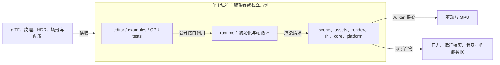
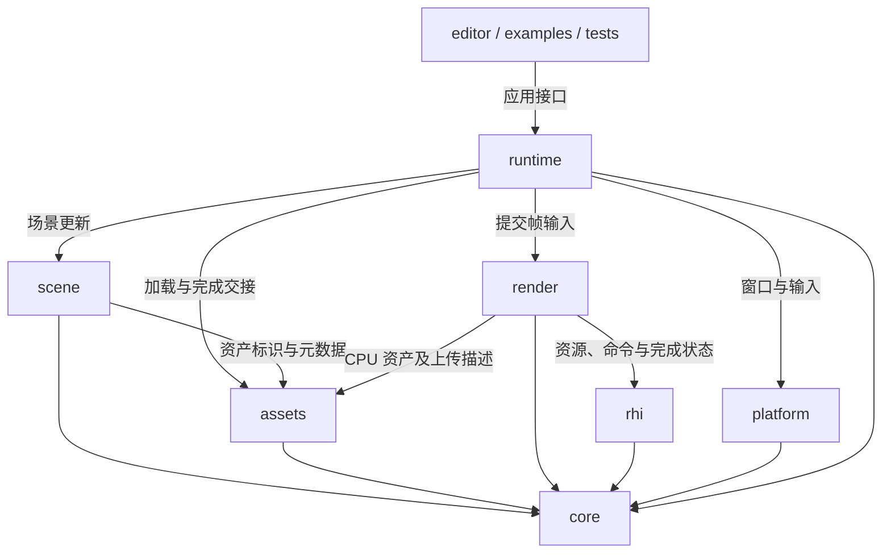
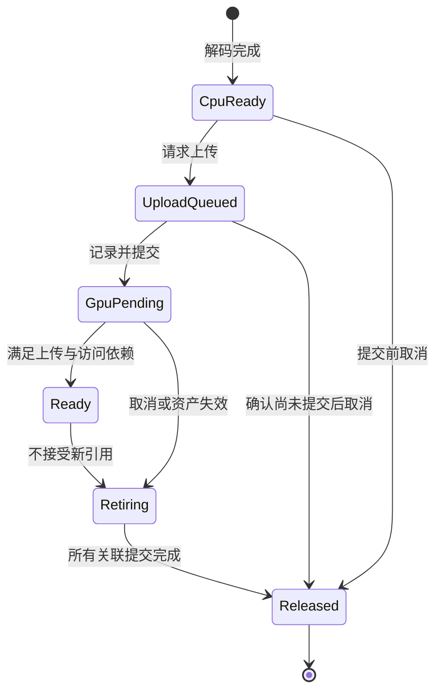
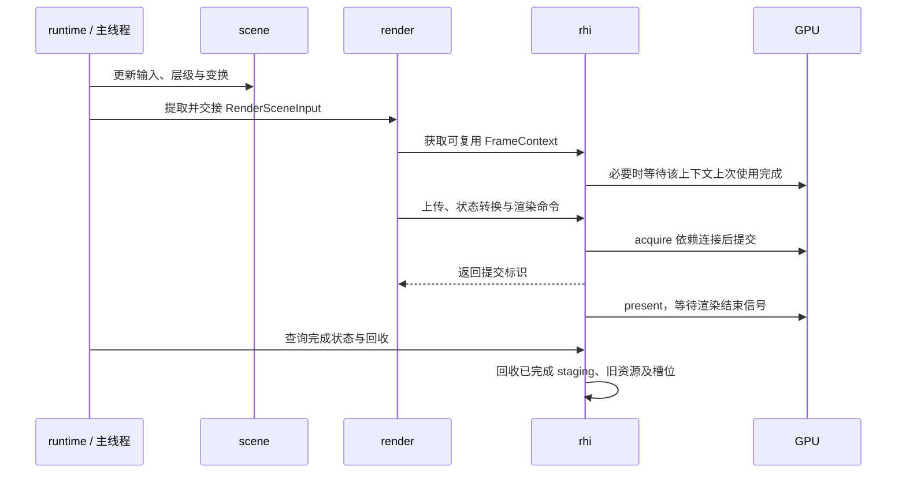
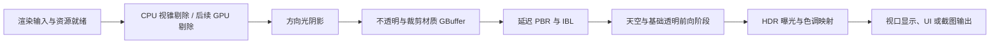

# AR Engine 总体架构与技术路线

文档 ID：ARCH-001。修订：讨论稿 4。更新：2026-10-20。

状态：面向首次实现的架构讨论稿；渲染优先与基础依赖选型已确认，模块、线程、资源等首版实施提案集中在第 13 节，仍不等于逐项获批。新版 Vulkan SDK 已安装；引擎第三方依赖尚未集成，也未建立构建工程。本文中的模块、类型、目标名和里程碑为设计，不表示已经实现。已有选型与规范继续有效，其余建议不能自动覆盖已确认 ADR。

本项目采用 C++23、Vulkan 1.4，建设独立渲染引擎和轻量编辑器。建议以 Flower 的可理解渲染组织为起点，借鉴其他实现的数据分层、资源依赖和 GPU 驱动方法。先形成能调试、能验证的基础渲染，再接双绑定比较与性能扩展。

用户已明确：渲染优先，编辑器逐步补齐；随后同意所列基础依赖，见 [ADR-0007](adr/0007-基础构建与第三方依赖选型.md)。这不表示本文所有架构建议均已确认。独立渲染程序承载首轮画面与实验，完整编辑器不阻塞任一渲染里程碑。

## 1. 当前输入与工程事实

依据：[项目需求](../渲染引擎需求.txt)、[当前决策](workflow/当前决策与待办清单.md)、[架构模板](archive/2026-10-19/templates/02-总体架构.md)、适用的 [C++ 风格](standards/C++目录命名与格式规范.md)、[生命周期规范](standards/C++类型接口与资源生命周期规范.md) 和现有 ADR。

架构调研阶段的目录快照：当时项目已有文档和项目技能，尚无自有引擎源码、CMake 工程或 Git 仓库。之后工作流建设已初始化本地 Git；实时部署状态以 [当前清单](workflow/当前决策与待办清单.md) 为准。外部渲染器参考代码未复制到引擎源码目录。

已确认：C++23、Vulkan 1.4、VS 2026/MSVC、VMA、GLSL → SPIR-V、GLM、主视图 Reverse-Z、spdlog 与薄诊断封装；两条 Bindless 路径、独立引擎与编辑器的产品方向；本稿第 10 节所列基础依赖选型。

2026-10-19 历史核查：RTX 4060 Laptop GPU，驱动 566.26，设备 API 1.3.289，SDK 当时为 D:/VulkanSDK/1.4.304.1，CMake 4.2.1。2026-10-20 用户已安装新版 SDK 并选择暂不更新显卡驱动；最新安装位置、工具验证及进程环境差异统一见 [当前清单的开发环境](workflow/当前决策与待办清单.md#开发环境与阶段边界)。旧快照不作为继续使用旧 SDK 的要求。VS/C++23 标准开关的已知问题见 [ADR-0006](adr/0006-Windows构建采用VisualStudio2026.md)，尚未运行 C++ 功能探针，不认定已解决。

阶段边界：产品目标仍为 Vulkan 1.4。现有驱动下可以先做明确标记的 Vulkan 1.3 开发探针，验证窗口、资源、Set Bindless 和基础绘制；探针应使用匹配的 API/Shader 目标与能力查询，不能把产品程序请求 1.4 后强行运行。基础探针成功不算 1.4 产品验收；Heap 另需扩展、feature、编译链及小型运行原型通过，不仅检查头文件。当前不为开始原型强制更新驱动，也不新增长期维护 1.3 产品后端的承诺。

历史依赖与绑定建议稿原位于父目录，现保留在项目内 [旧依赖讨论](archive/2026-10-19/discussions/渲染引擎依赖与资源绑定方案.txt)，已标明历史状态。现行依赖选型以 [ADR-0007](adr/0007-基础构建与第三方依赖选型.md) 为准，其中 Ninja 默认入口等旧建议不作为当前基线。

## 2. 参考实现与采用边界

本轮是源码静态调研，未运行参考项目，未进行基准测试。远程文件来自 2026-10-19 读取的 main/master；正式复用代码时需要固定提交并核对许可证。

| 参考 | 直接观察到的实现 | AR Engine 建议借鉴 | 本轮不采用的内容 |
| --- | --- | --- | --- |
| 本地 Flower | `DeferredRenderer::tick` 显式组织 pass；`RenderScene` 收集每帧数据；`BindlessBase` 内部使用 Descriptor Set；独立 ShaderVariant、Uploader、GPU timer | 渲染功能清楚、pass 易定位、场景转渲染数据、效果与诊断配套 | 全局 `getContext()` 耦合、引擎与编辑器合编单 executable、GPU 类型跨模块散布、原样移植缓存和同步策略 |
| Niagara | 资源绑定辅助函数、Compute 剔除、Indirect Count、前后阶段可见性处理、可选 Mesh Shader 与 Descriptor Heap | GPU 数据组织、剔除与绘制闭环、小步验证；源码明确区分 Heap 可用性与 GPU-AV 检查限制 | 将集中实验程序整体当作长期工程架构，首版同时承担全部几何与光追实验 |
| Filament | FrameGraph 的 setup/execute 分离、read/write 声明、compile/execute 与资源导入接口 | 清晰表达 pass 读写和外部资源，后续构建轻量 Render Graph | 立即复制其完整材质编译器、后端命令系统和多平台支持范围 |
| Donut / NVRHI | Scene 区分材质、几何与实例 GPU 数据，具有导入、纹理缓存和场景更新职责；NVRHI 提供图形 API 抽象 | 分开资产、实例和 GPU 数据，研究接口职责 | 同时引入 NVRHI 再另造功能重复的完整 RHI；本轮不据库能力承诺两种绑定路径可直接接入 |
| Godot | RenderingServer 以 RID 提供资源操作，并定义渲染线程调用边界 | 场景与设备对象分离、句柄和线程归属清楚 | 移植整个对象系统、反射、Variant、脚本与游戏框架 |

Flower 中 `BindlessTextureDescriptorHeap` 的名字不能作为采用 VK_EXT_descriptor_heap 的证据，它的实际成员是 `VkDescriptorSetLayout`、`VkDescriptorPool`、`VkDescriptorSet`。

不从这些项目的模块名推导其一定高性能；采用建议是本项目的设计判断，后续必须验证。

## 3. 总体架构目标

1. 渲染核心独立运行，编辑器可替换为示例或验证程序。
2. 两种绑定方式改变资源访问适配，不复制 PBR、阴影和场景加载逻辑。
3. CPU 场景、每帧输入、GPU 常驻资源和临时资源分别有所有者。
4. 先维护一条清晰执行路径，再按证据增加线程、队列和缓存复杂度。
5. 增加效果有明确入口，定位错误能追溯场景、Shader、资源和 GPU 提交。

第一版不建设完整游戏引擎、插件热加载、跨工具链 ABI、多图形 API 或复杂资产数据库。

## 4. 系统与模块边界

以下图均为拟议设计。图 B1 表示调用与输入输出，图 M1 的箭头表示静态代码依赖；不是运行时消息流，也不表示为每个盒子创建 DLL。

图 B1：每次启动只选择一个程序入口和一种场景绑定模式；编辑器、示例与测试复用引擎实现。

图 M1：Vulkan 实现属于 rhi 的私有实现。render 不依赖编辑器或 EnTT 容器；runtime 的提取适配读取 scene，再生成 render 公开数据类型。编辑器专用 UI 后端可以通过受控的 rhi 扩展接口接入，不反向进入 scene。

| 模块 | 职责与对外能力 | 所有的数据 | 不负责的内容 | 建议位置 |
| --- | --- | --- | --- | --- |
| core | 日志、配置、错误值、ID、基础计时；以后放最小任务抽象 | 日志服务、基础运行配置 | GPU 管理、全局查找全部系统 | engine/core |
| platform | 窗口、输入、surface 创建所需的平台接入 | 窗口及输入状态 | PBR 与材质 | engine/platform |
| assets | 读取、解析和解码；CPU 模型、纹理、材质及 AssetId | CPU 资产记录、加载请求与结果 | Vulkan 对象、场景编辑、GPU 提交 | engine/assets |
| scene | ECS、Transform、层级、Camera、Light、场景保存加载 | 实体、组件、层级与资产引用 | VkBuffer、描述符、命令录制 | engine/scene |
| rhi | GPU 资源、视图、管线、命令、提交、完成状态与后端能力 | Vulkan 对象、VMA、帧资源、上传暂存及退役队列 | 场景树、PBR 算法、ImGui 业务 | engine/rhi |
| render | GPU 常驻资产映射、渲染场景、材质数据、pass、绑定策略和渲染统计 | 逻辑 GPU 资产表、对象/材质数据、输出与历史资源 | 用户场景的权威编辑数据 | engine/render |
| runtime | 组合模块、主循环、场景到渲染数据提取、加载完成交接 | 模块实例、当前场景、帧上下文编排 | 把全部模块细节集中成巨型 Engine 类 | engine/runtime |
| editor | 场景树、视口、属性、调试与性能界面 | 选择状态、面板与 UI 数据 | 引擎初始化之外的 GPU 所有权暗门 | editor |

这里的 rhi 是薄接口，不把每个 Vulkan 调用机械改名；Vulkan 私有代码仍可清楚表达 barrier、绑定和内存细节。两种绑定实现放在该后端内部，由 render 提供资源语义，不向 scene 暴露 set、pool 或 heap 偏移。

## 5. 类型、资源与生命周期

核心类型为接口设计候选，命名遵守项目规范：

- `AssetId`：稳定的资产身份，不等于 ECS Entity 或 GPU 索引。
- `TextureHandle`、`BufferHandle`：建议采用类型化槽位与 generation，拒绝陈旧 CPU 引用。
- `RenderSceneInput`：当前帧对象、相机、灯光等只读值数据及受控资源引用，不保存指向可变 ECS 容器的裸指针。
- `GpuScene`：render 所有的对象、几何和材质 GPU 数据及 dirty 更新记录。
- `FrameContext`：rhi 所有的当前 CPU/GPU 帧资源和提交状态，不与交换链 image index 混为同一概念。
- `BindingMode`：SetBindless / DescriptorHeap，启动时明确选择并输出能力检查结果。
- `UploadTicket`、`SubmissionToken`：区分上传已接受、GPU 使用就绪与已完成，具体字段在模块方案中确定。

| 数据或资源 | 所有者 | 使用条件 | 回收条件 |
| --- | --- | --- | --- |
| CPU 场景 | scene | 初期主线程修改与提取 | 提取借用结束，异步引用已处理 |
| 解码数据 | assets / 显式转交的上传请求 | 上传复制前保持有效 | 数据已复制到引擎拥有的 staging 或不再需要 |
| staging 与命令池 | rhi 的上传或帧上下文 | 只由其约定线程操作 | 关联 GPU 工作完成 |
| GPU 资产和材质表 | render 持有 rhi 句柄 | 上传与状态转换已完成或由 GPU 等待正确连接 | 不再被新帧引用，所有旧引用完成 |
| 描述符槽位 | 绑定实现 | 槽位初始化且资源有效 | 引用该槽位的所有提交完成，之后才可复用 |
| 帧内临时资源 | FrameContext | 当前帧提交范围 | 完成值达到后重置 |
| 时序历史、持久输出 | render | 明确跨帧读写与重建条件 | 最后一次 GPU 使用完成后销毁 |

CPU generation 检查不能阻止已经提交的 Shader 使用旧索引；GPU 在途保护和描述符退役需要独立协议。RAII 释放的是 CPU 所有权，可以将真正 Vulkan 销毁排入退役队列。

图 L1：示意单项 GPU 资产的生命周期；真实实现需补齐失败、设备丢失、取消竞态和共享资产引用规则。Ready 可以通过提交间 GPU 等待建立，不要求每次 CPU 阻塞回读。

## 6. 帧循环与线程路线

初期建议单 CPU 渲染调用线程、一个图形队列；先在同一队列完成上传、Compute 与绘制。帧上下文数量先以 2 作为待验证初值，可配置且有上限。保持清晰所有权，随后演进为主线程、渲染线程及有限 worker。

单线程起步不表示每帧等待 GPU 空闲；允许多个 GPU 帧在途，只有复用对应上下文时等待必要完成条件。主线程/渲染线程分离时使用有界快照交接与背压，不同时引入多队列和并行命令录制。

图 S1：逻辑协作时序，不预设已建立独立 render CPU 线程。提交返回不等于 GPU 完成；WSI acquire/present 信号量的消费及交换链重建另有生命周期要求，不能只用图形提交完成值推断呈现资源可销毁。

任务系统先满足异步读盘、纹理解码和可独立计算的准备任务。推荐固定大小 worker 池与明确完成队列；是否使用第三方实现通过 Jobs 模块方案决定，不为“必须 Jobs”先引入完整工作窃取调度器。

CPU 内存先使用标准容器、预留容量和有限帧内 arena；只有测量证实分配热点后再评估专用分配器。VMA 只管理 Vulkan 内存。

## 7. 渲染流程与 Render Graph

建议的基础顺序：

图 D1：逻辑执行顺序；具体读写依赖在 pass 方案中展开。IBL 预计算是资产准备，不要求每帧重新生成。阴影和 GBuffer 并不是所有资源都存在直接数据依赖。

建议 GBuffer 先保存可验证的法线、基础颜色和材质参数，由深度重建位置；不提前过度压缩。HDR 中间颜色使用适合的浮点格式。最终通道、格式、精度与带宽预算在基础渲染方案中确定，不能将示意表当作已确认布局。

主视图继续遵守已有 Reverse-Z、坐标和颜色规范；阴影深度单独设计，不把 Reverse-Z 主视图规则无条件复制到所有用途。暂不推翻已有旋转和投影约定，四元数存储仍是待讨论建议。

Render Graph 推荐分两步：

1. 第一幅完整画面使用显式 pass 顺序，集中维护读写状态、barrier 与调试标记。
2. 流程稳定后增加轻量 graph：声明 pass 资源、导入持久资源、校验未初始化读取、推导执行和同步；先单队列、非别名分配。图工具只是表达与验证依赖，不要求首版完成所有优化。

初期将 Image 按整资源追踪时要明确其保守限制。加入 Mip 生成、IBL 预滤波与 Hi-Z 等不同子资源访问前，应显式追踪 mip/layer/aspect，或在受控专用 pass 内处理并声明最终状态；不能声称简单整图追踪已覆盖任意子资源。

资源别名、异步 Compute、多队列调度和并行录制留到真实瓶颈出现。Shader 使用 Bindless 并不使资源依赖消失，pass 仍需要声明实际读写范围或可验证的保守集合。

## 8. 两条资源绑定与 GPU 驱动

资源绑定接口按“注册资源、生成 Shader 引用、绑定当前 pass、退役资源、输出诊断”组织；不对每个对象生成虚类，初期用两个具体实现和单次模式选择即可。固定虚接口或 variant 的具体选择留给 RHI 方案。

A：Descriptor Set + Descriptor Indexing。先实现纹理和 sampler 数组、材质索引、容量和生命周期，再学习在途更新。

B：VK_EXT_descriptor_heap。先用 set/binding Shader 到 Heap 的映射复用着色逻辑，再评估原生 GLSL Heap 访问。正确区分写入大小、槽位步长、对齐、保留区、独立 sampler 和 combined sampler 映射。

两者的 Pipeline、Shader 编译元数据与参数传递可以不同；公共材质公式和资产语义保持一致。启动时选择，首版不在运行中热切整个绑定模型。

UI backend 若保留传统 Descriptor Set，则单独安排 UI 阶段，并在跨绑定模型处完整恢复状态。不能宣称 UI 也已经采用 Heap。

GPU 驱动在基础 CPU 绘制和两条绑定正确后加入：对象包围体 → Compute 剔除 → 生成间接参数/计数 → 同步 → Indirect Count 绘制。按兼容的顶点/索引布局和管线分组；Bindless 不会自动把不同 Shader 或渲染状态合成一个 draw。

比较实验为 A/B 绑定 × CPU/GPU 可见性处理四种配置，固定场景、批次和画面质量，分别记录 CPU 提交、GPU 额外成本和整体帧时间。Hi-Z、Mesh Shader、DGC 和光追不是这条基本闭环的前置条件。

## 9. Shader 工具链与数据契约

沿用 [Flower 调研](research/Flower-Shader编译与宏机制调研.md) 的结论，glslc 编译入口已经选定；推荐首版外部工具离线编译，不把运行时编译、热更新与完整反射同时设为前置条件。后者属于工作方式建议，并非仅凭选择 glslc 就已确认整个编译系统。

Shader 编译请求包含源码、stage、入口、规范化宏、绑定模式、目标环境和诊断/优化配置。允许像 Flower 一样一个 GLSL 文件包含多 stage/pass，但每个合法变体产生独立 SPIR-V，不能用每帧宏变化代替 GPU 参数。

缓存覆盖传递 include 内容、宏、编译器、目标及选项；区分 C++ 配置和 Shader 配置。失败保留完整诊断并返回非零状态，不弹框无限重试。

GPU 数据独立于 ECS/序列化定义。初期显式结构配合 sizeof/alignof/offsetof 和 SPIR-V 接口核验；只有总大小为 16 倍数不足以证明布局一致。不要直接上传含 bool、指针、std::string 或容器的业务结构。

SPIRV-Reflect 可评估为接口核验工具，但其实际锁定版本对 Heap/untyped pointers 的覆盖要单独验证；缺少反射支持时可使用显式小规模元数据和数值测试，不伪造自动核验结果。

## 10. 已选依赖与集成顺序

用户已同意下面的基础选型，见 [ADR-0007](adr/0007-基础构建与第三方依赖选型.md)。选型确认、版本锁定和集成通过是不同状态；本轮只更新文档，不安装依赖。

| 能力 | 推荐 | 状态/原因 |
| --- | --- | --- |
| Windows 工具链 | VS 2026 MSVC | 已确认；实际 C++23 开关及功能探针待完成 |
| GPU 分配、数学、日志 | VMA、GLM、spdlog | 已确认；配置和版本待锁定 |
| 构建 | CMake + VS 2026 generator + MSBuild，CTest | 已选定；实际构建与标准开关待验证 |
| 依赖管理 | vcpkg manifest + 固定 baseline，少数固定源码例外 | 已选定；Vulkan 头、volk、VMA 与 SDK 来源待固定 |
| 窗口与输入 | GLFW | 已选定 |
| Vulkan 函数加载 | volk | 已选定；检查所需扩展入口，与统一头文件匹配 |
| Shader 工具 | glslc、spirv-val、spirv-dis | 已选定；SDK 版本、目标环境与 Heap 能力待验证 |
| 场景存储 | EnTT | 已选定；父子关系与脏变换由 scene 定义 |
| 模型与图像 | fastgltf、stb_image | 已选定；glTF 子集与 CPU 解码/GPU 上传边界待设计 |
| 场景与配置 | nlohmann/json | 已选定；实际 schema 待设计 |
| 编辑器 | Dear ImGui、后续 ImGuizmo | 已选定；按渲染优先顺序接入 |
| CPU 分析 | Tracy | 已选定；接入与开销待验证 |
| CPU 测试 | Catch2 | 已选定；按适用逻辑接入 |
| GPU 验证与抓帧 | Validation、RenderDoc、按需 Nsight | 开发工具；Heap 的捕获/重放/调试能力分别验证 |

### 集成时机与后置依赖

基础库不再列作待选。以下安排用于按需集成，不要求在首个三角形前把所有依赖接完。

- 渲染启动前：接入 CMake/MSBuild、vcpkg、GLFW、volk、glslc 及 SPIR-V 检查工具。与此同时固定头文件、loader、VMA、SDK 工具的来源和实际兼容版本。
- 模型与场景接入前：fastgltf、stb_image、EnTT、nlohmann/json。首个三角形不依赖完整 ECS、模型解析或场景序列化。
- 验证与分析：Catch2、Tracy、RenderDoc/Nsight 的具体版本和接入方式；基础 Validation、时间戳与日志从最小闭环开始，CPU 测试框架按适用的首批逻辑接入，不拖到最终交付。
- 编辑器阶段：Dear ImGui、ImGuizmo 的具体采用版本与 backend。简单参数面板可按需提前加入，但场景树、资产浏览、gizmo 和完整编辑流程不阻塞渲染。
- 按需求再定：Jobs 的实现或任务库、CPU 反射/属性元数据方案、SPIR-V 反射工具、压缩纹理/资产流送库及 CPU 分配器。当前没有证据要求一开始增加全部依赖。

已有 VMA、GLM、spdlog、VS 2026、GLSL 和 C++23/Vulkan 1.4 方向不重选，但其版本、配置、实际功能支持和联编结果仍需固定与验证。

不引入完整 NVRHI/Donut 作为运行依赖，因为当前学习目标包含自己实现资源绑定和 Vulkan 边界；它们保留为代码研究对象。若原型证明自建 RHI 成本过高，再以完整方案比较，不叠两套相同抽象。

建议一个对外 `ArEngine` 动态库，内部模块用构建 target 表达依赖，必要时静态链接并入 DLL；编辑器和独立示例分别作为 executable。无需一开始每个模块都做 DLL。各模块的内存分配与释放配对，固定 CRT，避免把内部容器和 GPU 类型任意变成跨工具链 ABI 承诺。

## 11. 落地顺序与完成条件

| 阶段 | 实现范围 | 必须观察到的结果 |
| --- | --- | --- |
| P0 环境与构建原型 | 标准开关、实际依赖候选、SDK/驱动能力报告、一个库与程序联编 | C++23 小探针及 Debug/优化构建结果，明确 A/B 支持状态；无能力的检查不能写通过 |
| P1 图形最小闭环 | window/device/swapchain、清屏或三角形、同步、日志、有限帧退出、resize | 稳定启动关闭与截图，Validation 无未处理错误 |
| P2 资源与 A 绑定 | Buffer、Image、上传、句柄、退役、纹理/sampler 数组、数值回读 | 零/非零索引、Mip、多个材质、槽位安全复用，能够抓帧理解 |
| P3 场景与基础画面 | glTF、scene/camera、CPU 绘制、PBR/IBL/阴影/HDR | 固定展示场景正确，能保存/恢复基本参数 |
| P4 渲染组织与诊断 | 稳定 pass 逐步迁移到轻量资源声明；独立程序输出调试图、耗时和截图 | 图中读写与实际提交一致，可定位每 pass；完整编辑器不是完成条件 |
| P5 B 绑定 | Heap 原型与相同场景迁移 | A/B 对照输出，独立 sampler、Buffer 和多帧更新验证；失败能定位 |
| P6 GPU 驱动与实验 | Compute 剔除、Indirect Count 与四种配置对照 | 可见对象正确、参数无越界，性能收益与退化均有记录 |
| P7 冻结交付 | 稳定修复、运行包、文档与实验归档 | 引擎版本、配置、场景和论文数据相互对应 |

P2 后可以先做小型 Heap 探针验证方向，完整 B 集成仍晚于稳定 A。环境升级未就绪时，可继续第 1 节定义的开发探针与 CPU 资产/场景建设；P1/P2 的开发探针结果和目标 1.4 的正式运行结果分别记录，不把 Vulkan 1.3 运行冒充产品目标通过，也不擅自降级基线。Heap 缺能力时报告未就绪，不阻断 A 路径的独立学习。

编辑器作为伴随建设逐步加入：先可选的参数与性能面板，再增加视口、场景树、属性、资产浏览和 gizmo。若没有实际必要，不等待完整 P4 graph 或编辑器完成才开始 P5 的独立原型；后续集成必须遵守统一的状态与生命周期契约。

每个阶段都形成可运行纵向链路，不提前堆出完整 ECS、Jobs、Render Graph、插件和反射框架。CPU 并行、独立渲染线程、异步上传按后续完整模块方案逐步加入，保留单线程参考运行模式。

## 12. 诊断、验证与工作流交接

至少提供：运行标识、设备/依赖版本、binding mode、场景/相机/Shader 变体与产物标识、资源数量、提交完成状态、截图及阶段耗时。

测试按能力组织：数学与句柄/槽位 CPU 测试，资源和绑定数值验证，完整场景固定截图，窗口及生命周期专项检查。GPU 时间戳不通过每帧 waitIdle 获取；正式性能运行单独排除 Validation、捕获和高频日志开销。

未来对 Harness 提供稳定的预检、构建、CPU 测试、有限帧 GPU 验证和数据导出入口。当前未建立这些命令，文档示意不能视作可执行。流程建设文档继续负责状态、审查和合并门槛，不在本文重写工作流。

## 13. 决策状态与剩余大方向

| 事项 | 当前状态 | 下一步 |
| --- | --- | --- |
| 既有语言、API、VS、VMA、GLM、GLSL、Reverse-Z、日志方向 | 已确定 | 不重选，验证具体版本与配置 |
| 八模块职责及依赖、单 DLL 对外 | 本文建议 | 审阅整体边界；确认后拆模块设计 |
| 自建薄 RHI、A/B 两实现共用渲染 | 双路径需求已定，接口为建议 | 资源与绑定模块方案 |
| CMake/MSBuild/vcpkg 与第 10 节基础库 | 已确定，见 ADR-0007 | 构建原型、版本锁定与集成验证 |
| CPU 单线程起步、单 GPU 队列、两帧上下文初值 | 本文建议 | 资源和同步原型，后续独立渲染线程方案 |
| 显式 pass 后迁移轻量 graph | 本文建议 | 不阻塞首个画面，明确迁移检查 |
| 多队列、资源别名、Mesh Shader、GI、光追 | 暂缓 | 在基础交付和真实需求之后推进 |

### 首版实施提案与待确认边界

2026-10-20 用户要求先对齐文档和实施边界。本节将先前五项分散建议集中为供整体审阅的提案；该授权允许整理具体方案，不冒充用户已逐项确认全部架构，也不把下列建议变成新的工作流阻塞。产品范围以根需求为源，选型仍以 ADR 为源。

| 优先级 | 大方向 | 当前建议与需明确的边界 |
| --- | --- | --- |
| 高 | 第一版与毕设的交付范围 | 已定基础画面、A/B 绑定项目目标和稳定毕设版本，具体范围见根需求。实施提案将 GPU 视锥剔除 → 间接参数/计数 → Indirect Count 放 P6；是否作为毕设硬性验收仍待交付方案明确。环境不支持 Heap 时不虚报 B 完成，也不因此阻塞 A 的基础阶段；具体冻结日期、学校要求和场景规模未定 |
| 高 | 模块与 RHI 边界 | 提案采用第 4 节八模块职责、自建薄 Vulkan 接口、一个对外 ArEngine DLL，内部以构建 target 表达依赖；editor/examples 分别为程序。P0 只建实际需要的 core/platform/rhi/runtime，不先创建所有空模块。具体导出接口、句柄字段及 ABI 按模块方案设计 |
| 高 | 线程与资源生命周期 | 提案先单 CPU 调用线程、单图形队列、多帧在途，两个帧上下文仅作原型初值。上传就绪与提交完成分开；对象失效后停止生成新引用，旧资源和描述符等最后一次 GPU 使用完成再退役。worker、独立渲染线程与多队列后加，不引入新的前置任务框架 |
| 中 | 渲染流程组织 | 延迟 PBR 已定。提案先显式 pass 和集中状态/barrier，再迁移到声明资源依赖的轻量 Render Graph；引入 mip/layer 操作时补子资源跟踪。图形框架不阻塞第一幅画面，首版不承担异步多队列和资源别名 |
| 中 | Shader 与错误处理契约 | 工具已定。提案构建期 GLSL 编译、有限变体、显式 target、接口布局核对及可追溯产物，热更新和完整反射后加。加载/编译等预期失败用带原因结果，第三方异常在可处理边界收敛；std::expected 等具体用法等 C++23 探针。此提案不整体批准相关规范的全部细则 |

资产加载的 CPU/GPU 分工、稳定 AssetId 和场景 JSON schema 在模块与生命周期方案内落实。验收场景、实验规模、运行配置与毕设冻结时间在交付方案中明确，不凭空承诺 FPS 或性能提升比例。

### 不需要继续扩大前期决策的事项

具体 GBuffer 格式、两帧上下文初值、句柄字段、UI backend、管线分组和依赖版本属于模块设计与验证。Jobs 库、反射、CPU 分配器、压缩纹理与资源流送按实际需求决定，不阻塞当前实现。SDK/驱动、C++23 标准开关与 Heap 调试能力由原型查明，不能让用户事先猜测兼容性结果。

基础依赖不再重选。下一项引擎工作是 P0：建立基础工程变更、锁定来源与版本、验证 C++23 编译开关、输出设备能力和开发探针结果，再进入最小窗口/清屏。P0 完成前不能宣称引擎构建、1.4 运行、Heap 或 GPU 验收通过。

后续整体审阅以本节五项提案为输入，不再从头重做选库调研。未确认的关键契约保留提案状态；普通类型字段和实现细节在已确认范围内自主拆分，不逐函数审批。AI 工作流的余项与另一对话交接见 [工作流交接](workflow/AI工作流后续完善交接-2026-10-20.md)。

图文检查：B1 的程序入口对应 editor/examples/tests；M1 的依赖对应模块表；S1 的场景输入与提交标识对应所有权表；L1 的退役条件对应 GPU 完成；D1 仅表示流程，不替代 pass 资源契约。后续模块、线程或提交方式变化需同步这些图。

## 14. 实现参考入口

- [Flower 绑定实现](<F:/cpp project/flower/source/engine/graphics/bindless.h>)、[场景提取](<F:/cpp project/flower/source/engine/renderer/render_scene.h>)、[渲染流程](<F:/cpp project/flower/source/engine/renderer/deferred_renderer.cpp>)、[上传器](<F:/cpp project/flower/source/engine/graphics/uploader.h>)。
- [Niagara 主循环与资源绑定](https://github.com/zeux/niagara/blob/master/src/niagara.cpp)。本轮源码中存在 Heap 运行选择与 GPU-AV 限制处理，不推断其所有模式已在本机运行。
- [Filament FrameGraph](https://github.com/google/filament/blob/main/filament/src/fg/FrameGraph.h)。
- [Donut Scene](https://github.com/NVIDIA-RTX/Donut/blob/main/include/donut/engine/Scene.h)、[NVRHI](https://github.com/NVIDIA-RTX/NVRHI)。
- [Godot RenderingServer](https://github.com/godotengine/godot/blob/master/servers/rendering/rendering_server.h)。
- [Descriptor Heap 规范](https://docs.vulkan.org/refpages/latest/refpages/source/VK_EXT_descriptor_heap.html)、[官方示例](https://docs.vulkan.org/samples/latest/samples/extensions/descriptor_heap/README.html)。

本轮参考源码下载存放于项目外的 F:/毕业/tmp/ar-architecture-research，仅用于阅读，不属于待编译代码或已选依赖。
