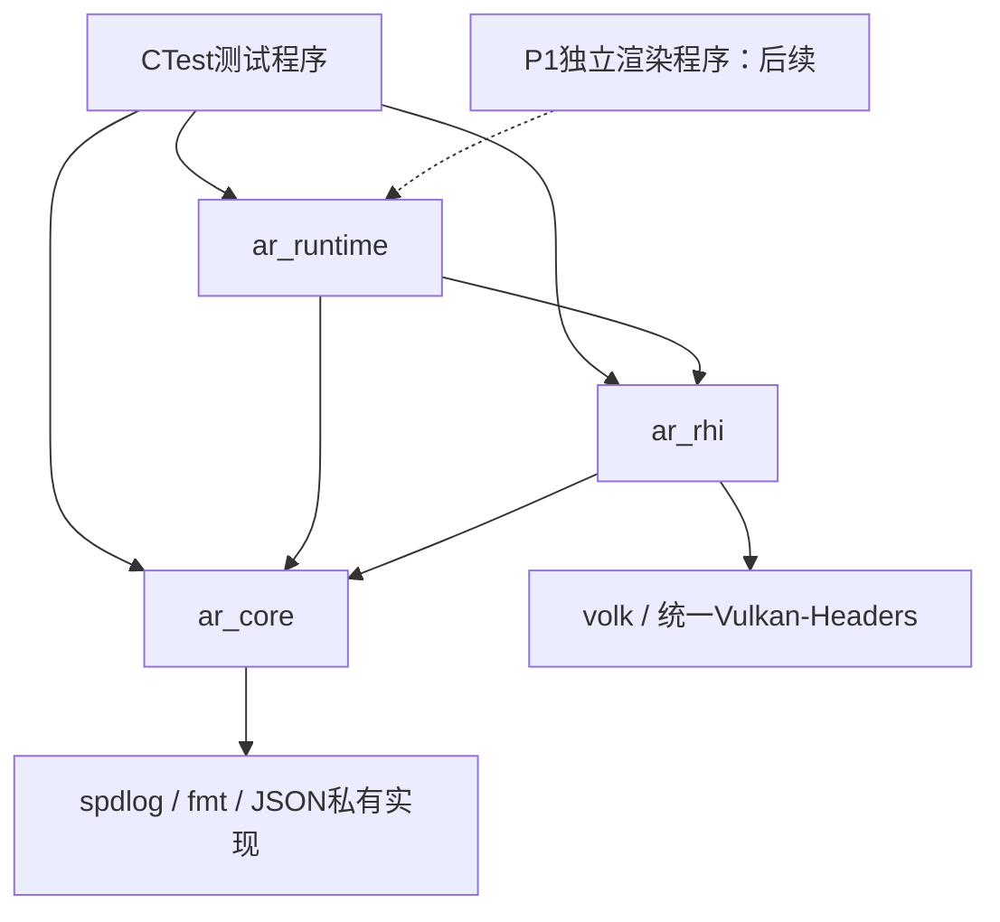
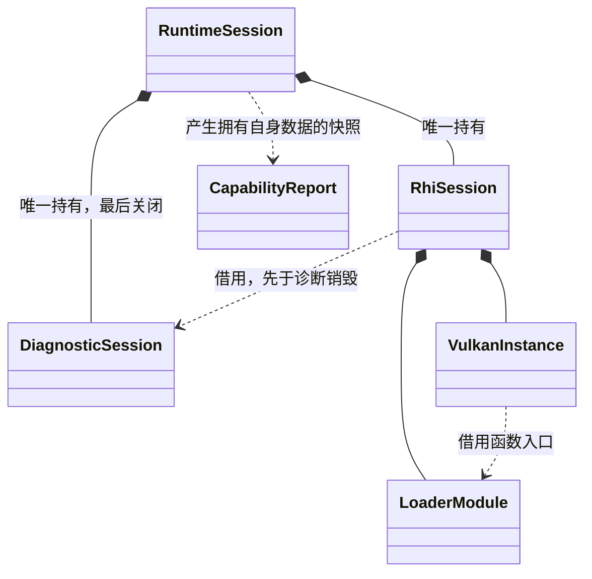
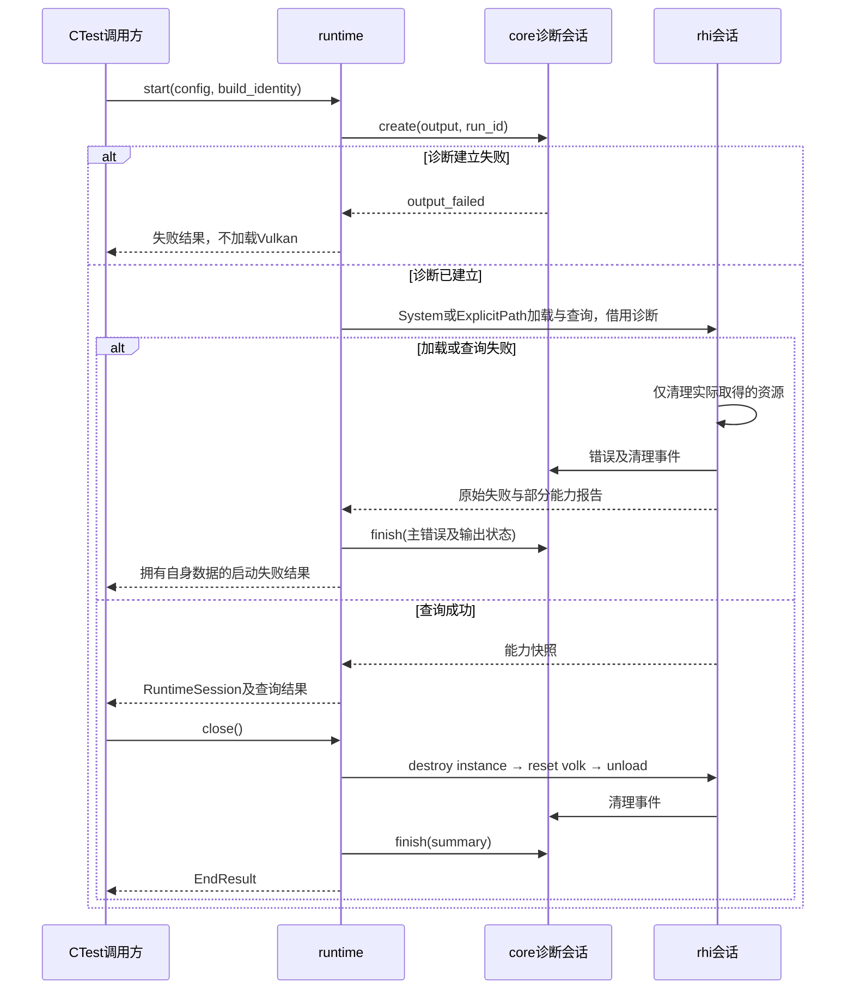

# P0 基础工程技术方案

修订：11，2026-11-04。状态：按“先不做Probe”修订；core细化及测试承接方式为候选。仅准备文档，无引擎代码。行为、字段、配额、负向矩阵和身份规则唯一源为[proposal](proposal.md)。

## 1. 授权、依据与主责

用户明确先不做独立Probe，并要求按整体计划逐段设计。本轮从[实施路线](../../../docs/实施路线与阶段计划.md)的P0a—P0c准备方案；保留三模块静态库、C++23preview及动态CRT，不恢复ArProbe，不扩展P1窗口/渲染。模块职责入口：[core](../../../docs/modules/core/README.md)、[rhi](../../../docs/modules/rhi/README.md)、[runtime](../../../docs/modules/runtime/README.md)。

原D1—D3确认来源见proposal。本轮改变的是消费者和验证层级，不能把原CLI确认转成新C++函数签名批准。R1/全项目异常/Jobs仍未定，已有规范只按确认范围使用。架构角色负责本方案，后续实现者按准确任务编号实现，不在此直接编码。

## 2. 本机已验证事实与限制

| 项目 | 已有证据 | 正式P0仍需做 |
| --- | --- | --- |
| 工具链 | 最小工程CMake4.2.1、VS18 2026、toolset14.51.36231/cl19.51.36248，单一/std:c++23preview；两配置编译运行、MDd/MD通过 | 在正式目标/依赖上复核真实命令与功能；不能照搬临时工程成功结论 |
| 依赖 | vcpkg 2026-07-27工具、baseline cb2981c4e03d421fa03b9bb5044cd1986180e7e4、x64-windows-static-md恢复成功；直接消费测试通过 | 记录正式manifest/features/工具与triplet内容哈希、实际端口清单；不将安装快照冒充完整registry来源 |
| 本机路径条件 | 任务自有ASCII下载/临时/构建根，进程内TMP/TEMP排除了本次D8050；未禁调试信息，端口使用CMake4.4 | 正式构建入口显式管理任务路径及子进程环境；不能笼统称CMake普遍不支持中文，不能强降端口CMake到4.2.1 |
| 依赖消费 | RelWithDebInfo需正确映射Release导入库，避免链接Debug依赖 | 首选受控vcpkg toolchain；核对实际库路径、CRT与配置 |
| Heap头文件 | Vulkan-Headers1.4.341.0中相应结构/字段已实际编译 | 固定正式依赖后再编译核对；设备Heap仍未支持/未验收 |
| 设备/云端 | 历史设备API1.3.289，本轮未重新运行GPU；云端VS2026未验证 | 按真实runtime查询记录；不由SDK/loader推导device1.4，云端不阻断独立本地设计工作 |

证据位于本机`.ar-workflow/p0-gate-20261103/`和`.ar-workflow/p0-d8050-fix-20261103/`。正式P0验收未执行，旧任务不因环境准备勾选。

## 3. 依赖、对象与时序

图P0-DEP-02：拟议静态链接依赖，箭头表示左侧依赖右侧；无独立Probe。core第三方实现均私有；rhi公开LoaderSource使runtime具有必要的公开类型依赖。

P0不实际分配GPU资源，VMA只做依赖/结构联编检查，不创建假资源管理器。数学性质测试由tests/support/GlmConfig.h持有GLM入口，使用已确认RH/ZO约定，不引入GLM_FORCE_LEFT_HANDED。

图P0-OWN-02：拟议对象所有权；组合为唯一持有，虚线为不转移所有权的借用。具体函数签名和core类型仍为本轮候选。

图P0-SEQ-02：拟议启动/结束及失败收尾，同一owner线程，省略CPU纯判定细节。

## 4. core接口与内部机制

详细候选职责/借用/线程见[core技术方案](../../../docs/modules/core/README.md)。P0公共头拟为Error.h、Diagnostics.h；不先建立泛用事件总线。std::expected返回预期失败是本轮推荐，工具链已证明支持不等于错误策略已全项目批准。

DiagnosticSession不复制、不移动，由runtime持有unique_ptr，给rhi稳定地址引用；这仅是单一所有权，无共享服务注册。Error拥有字符串及可选原始domain/code，传播成功路径不格式化错误。诊断公开API接受结构化项目类型，私有实现用spdlog及nlohmann/json编码；不在公共签名带第三方类型。文件sink数量固定，不开放任意插件sink接口。

P0使用同步输出：只在启动、查询和关闭记录有限事件，级别过滤先于格式化；不承诺用于以后逐帧高频日志。与异步队列相比实现及退出更简单，代价是写入占owner线程，因此文件I/O延迟由有界集成测试监测，不能宣称同步写盘有硬实时上界。未来并发/帧内日志需增量方案。

显式finish处理flush和摘要错误并返回EndResult；EndResult分开保留primary_error、diagnostic_errors和cleanup_errors，capability_json由runtime传入、core不解释。析构只兜底释放、最低限度提示未正常finish，不抛出且不捏造成功摘要。若会话创建失败，不调用rhi；若查询失败，runtime回滚rhi后finish，再返回拥有错误、cleanup_errors和部分报告的StartFailure，避免返回指向已关闭诊断的对象。

候选API语义：create(config, identity)返回独占诊断会话或Error；emit(event)返回expected<void,Error>；finish(summary)返回EndResult（primary_result、primary_error及diagnostic_errors分别保存）。owner线程串行使用；不为一个mutex引入P0并发承诺。文件配额、字段和幂等要求只在proposal定义，本节不复制数值。

第三方异常仅在可处理的诊断/加载边界转换；不全局禁用异常、不无条件noexcept。OOM不能保证还能分配Error字符串，最低限度固定stderr输出是尽力行为，不承诺恢复。

## 5. rhi/runtime承接边界

rhi保持LoaderSource公共配置，System/ExplicitPath走同一OS加载及volkInitializeCustom路径。rhi独占OS模块、VkInstance与volk状态清理；不期待volk替自有模块卸载。正式固定版本需核对custom初始化/重置API，不沿用master网页为已联编证据。P0会话和fixture串行，禁止全局volk状态重叠；禁止跨模块包含src私有头。

runtime候选启动配置包含QueryMode、LoaderSource、显式API请求、DeviceSelection和诊断配置；启动结果区分会话成功与StartFailure，不返回裸VkInstance。CapabilityReport是rhi查询值数据，runtime补构建/运行身份并编码为capability_json，core只写通用事件/摘要，不判断Vulkan支持。

inspect只在查询完整且输出正常时success，require-product在资格不足时unsupported，development需要显式1.3；这些是保留的查询策略，不是承诺实现三个CLI。API谓词/字段/错误分类与负向事实只以proposal为准。VK_ERROR_INCOMPATIBLE_DRIVER仍是requested_api_unsupported，普通创建失败不冒充版本不足；未知不能判通过。

P0b/P0c的候选公开签名、报告借用/复制及失败返回已补入[rhi模块方案](../../../docs/modules/rhi/README.md)和[runtime模块方案](../../../docs/modules/runtime/README.md)。rhi公开报告借用只在open会话有效；runtime复制为自有快照，关闭rhi不使runtime快照失效。本轮已收口：QueryMode在runtime（inspect/require_product/development），DeviceSelection在rhi（FirstEnumerated/ExplicitIndex，不评分、不静默换设备），无设备initialization_failed/device_not_found，索引越界invalid_arguments；错误category/stage为固定枚举；cleanup_errors独立；rhi CloseResult幂等；公开会话PIMPL。rhi外部借用DiagnosticSession在销毁rhi后结束。

## 6. 构建、身份与验证入口

沿用VS18 x64多配置，固定toolset/SDK，CMake4.2.1在project()后设置经探针验证的C++23标准选项适配，检查真实cl只有一个/std:c++23preview，不能追加覆盖latest。每配置MDd/MD匹配依赖。输出根按本机已观察的路径条件配置，子进程不继承重复大小写代理变量；不修改系统环境。

target显式列源和依赖：ar_core的spdlog/fmt/JSON私有；ar_rhi到core、runtime到rhi/core按公开签名表达PUBLIC或PRIVATE；公共头独立可包含，不暴露私有源。无需DLL导出宏/跨工具链ABI层。正式manifest从固定版本图生成，原baseline及triplet先复核，不另选库。

BuildInfo及toolchain/dependencies/identity schema、确定编码/哈希与命令依赖只在proposal维护。输入清单覆盖实际源码、公开头、CMake、manifest、命令表/测试配置及生成输入；输出和BuildInfo本身排除。实际工具版本/端口CMake与顶层CMake可分别记录，不隐瞒差异。离线无Git元数据时revision=null、dirty=unknown，input_hash仍必需。

CTest调用生产公共入口，不造一个等价实现。测试支持层可提供受控fixture Vulkan库；只经公开LoaderSource加载，不测试私有头。库缺符号、实例失败、实例成功后枚举失败等使用受控API fixture；不存在路径是真实OS失败；system查询则是真实驱动事实。fixture必须独立打标，绝不能替代真实设备资格。

九个负向ID从独立进程命令改为命名CTest；原child_exit=2/3/4/5全部暂缓。另加runtime-device-none、runtime-device-index-invalid、runtime-cleanup-failure、runtime-cleanup-empty、runtime-quarantine-reopen、runtime-repeat-close、runtime-summary-capability七个用例。command table中直接命令wrapper_exit=0、child_exit=null，CTest结果还需验证命名集合、逐用例原始返回/错误事实和身份，不能只信进程0。旧CLI解析、未知选项及stderr最小CLI JSON检查移出本P0；输出失败仍由真实文件测试覆盖。P1应用退出码另定。

建议有界时间：工具记录60秒、依赖恢复/configure各1800秒、identity prepare120秒/check60秒、每配置build1200秒、每配置CTest180秒；单CPU用例5秒、单真实查询/fixture用例15秒，超时只结束本任务进程树。构建并行候选2。Windows可能阻塞的I/O由父测试超时兜底，不声称库函数本身可抢占硬超时。

云端VS2026未核实则云端CPU未满足，仍可记录独立本地结果；人工工作不以verify/gate命令为审批前提。若接Harness，保留原三条工作流检查，真实命令与解析器齐备后再替换原生源码占位保护，不能只删除阻断。

## 7. 取舍、验证与交接

| 选择 | 推荐/理由 | 代价及替代 |
| --- | --- | --- |
| P0执行入口 | CTest测试程序链接正式三模块，P1再接渲染程序 | 当前不验收应用CLI/退出码；独立Probe可操作但已按用户要求暂缓 |
| 预期错误 | P0核心同步边界expected及拥有值数据的Error | 需明确每个调用方处理；替代是项目状态结构，但不能再并列bool+全局lastError |
| 诊断所有权 | runtime独占会话、rhi借用，显式finish | 需要处理部分启动失败；全局logger方便但隐藏生命周期，本轮不推荐 |
| 同步日志 | 启动/查询低频路径，有限文件/事件预算 | 写盘占owner线程；异步方案增加队列/退出协议，等实际帧内需求 |
| 测试层级 | CPU判定、真实OS加载、受控API、system查询分开 | 证据较多但不会把模拟成功当硬件支持 |

下一步先审阅本轮新增候选，再按tasks 2.2→2.3→2.1完成core→rhi→runtime纵切；1.1/1.2正式构建准备先行，3.1测试随层加入而不是最后补。具体映射见[test-plan](test-plan.md)。独立方案评审逐项核对本轮变更，不把内部自检当用户批准。

context.json列本轮依据/允许路径，历史日志和before快照保留在本机证据目录。无新增实现文件、无提交/推送、无付费调用；恢复时核对实际文档与哈希，不以旧检查批准改后的输入。

## 2026-11-04 三项复核修订

按proposal契约“本轮三项复核修订”同步候选：rhi借用在close后失效，runtime自有快照持续到会话销毁；保持引用接口的前置条件，不增加无法撤回既有借用的optional包装。capability_json采用optional UTF-8对象文本，core只做语法/顶层对象校验并嵌入summary.capability；错误写null和output_failed，不双重编码。

CloseResult.closed固定表示API终止，新增resources_released/residual_resources区分资源状态。残留时停止不安全的父资源清理，close缓存且析构不重试，禁止后续rhi会话，退出进程收尾；代价为不支持同进程恢复。真实void销毁无失败返回，OS卸载失败和项目前置条件故障分开验证，不把崩溃当普通错误。该选择仍需用户确认，不因复核报告自动批准。

## MF-01/MF-02承接细化（候选）

RunSummaryInput采用专用capability_encoding_error及显式清理事实，映射由proposal统一维护；不引入泛化supplemental错误总线。隔离拒绝复用cleanup_failed及stage=cleanup，说明故障来源，先诊断后rhi检查且不取得新资源。输入冲突、正常空清理及隔离重开分别精确测试；本轮不编码。
