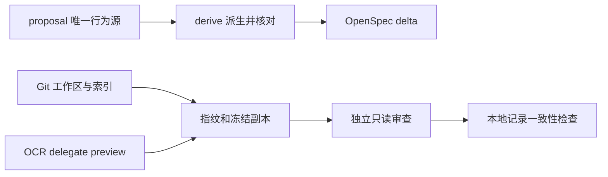

# 技术方案：本地流程基础接入

日期：2026-10-19。授权来源：用户本次要求整理全部文档并开始接入 SDD/Code Review；不是新引擎架构审批。

## 实现与取舍

保留原路径并建立 README、AGENTS 与 docs/README 索引。历史讨论注明时点，修正 EnTT、构建、日志、Shader 等选型过期表述，未确认规范保持原状态。

使用项目本地 OpenSpec 1.14.3 与锁文件，schema 为 ar-engine：proposal → 派生 specs → design → test-plan → tasks。proposal 契约块是行为与验收单源，Python 标准库工具派生并检查精确文件集合，不建立第二套人工规格审批。初版 capability 限定单段 kebab-case，未知文件报错而不自动删除。

使用 OCR 1.13.1 官方静态 Windows AMD64 二进制，SHA-256 固定。delegate 模式只做筛选/规则提供，实际审查使用独立只读上下文；不配置外部模型。规则显式覆盖 Shader、头文件、测试和流程文件，排除参考原文与生成锁文件的理由入清单。

Python 脚本仅实现 check/doctor/derive/review-prepare/review-check，采用 subprocess 参数数组，不执行任意来自文档的命令；子进程有时限。审查指纹包含当前 HEAD（允许首次未提交）、索引和 Git 可见文件内容，快照与报告放忽略目录。写入前检查路径边界；快照复制前后核对内容。

图只表示本轮本地数据流，不表示受信远程 Review、CI 或合并状态机已经建立。

备选：全局安装会扩大机器配置影响，暂不用；只放提示词无法检查过期内容，增加小型确定性工具；实现完整 Harness/平台则超出当前最小建设，保留原设计作后续。

## 验证与恢复

验证见 test-plan.md。失败保留具体命令和原因；重新安装只操作项目工具目录。快照准备后工作区变化则重建 packet，旧报告不修改成新指纹继续使用。

本地 JSON 独立身份字段是声明，不是认证。当前不实现 PR source/target、暂存树专属 Commit gate、受信结果发布、hooks、远程保护、完整状态数据库或归档自动批准。无真实 C++/Shader/GPU 验证，均记录未就绪。后续需要远程仓库地址和发布边界才能接 Actions/保护。
