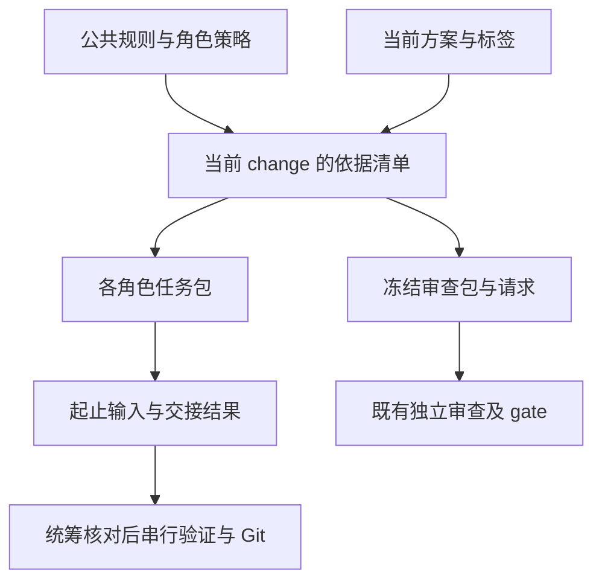

# 技术方案

## 授权与依据

依据本变更 proposal 的四项要求、AI-EXEC-01 至 06 及用户已确认的单工作区协作方式。用户本次已授权落实前述讨论，普通实现不重复请求。引擎总体架构与设计图草案的状态保持原样。

## 实现与取舍

新增 `workflow_context.py` 和 `workflow_agents.py`，分别负责确定性上下文与协作记录；仍由 workflow.py 提供命令、runtime 的 operation_lock 串行化操作。`workflow/agent-policy.json` 维护角色、技能触发和适用依据；每个 change 可用 context.json 选择额外文档、标签和允许写入路径，不复制需求正文。没有 context.json 的旧 change 使用保守公共依据和本 change 规划文件，不猜选其他 change。

新任务 prepare_review 显式接收 change，目录身份和 manifest 指纹包含任务上下文；上下文从 snapshot 重算，缺文件、越界、无依据的状态提升不默许。内容声明仅供追溯，不是用户批准或身份认证。显式参考始终标为 reference；总体架构和图示规范作为参考，不能按全篇已批准处理。通用无任务 hook/远程输入保持旧身份且明确只有源码通用审查。旧无字段包仍可核对历史身份，新 task 包的 gate 核对 change 和 context。

Review 请求使用冻结清单全文，包括当前 proposal/design/test-plan/tasks 与适用 SKILL.md；删除固定 complete-local-workflow 的逻辑。上下文清单按变更类型/标签选择，不每次加载全部技能。角色身份、时间戳和交接历史不进入模型缓存键；请求正文和适用依据改变仍会使缓存失效。

`agent-pack` 领取只读或写入任务，`agent-handoff` 保存结果，`agent-release` 带原因异常释放，`agent-status` 查看现场。writer 存在于整个工作区，仅允许一个；任何 change 的第二 writer 被拒。核验源文件修改范围；只读结果输入变化标为 stale，写任务范围外修改标为 blocked。任务包允许路径只能来自 change 的 write_paths，未显式声明写范围的旧任务只能领只读包。外部 Git/编辑器不受 OS 隔离；协作检查只能检测偏离并拒绝后续资格。Git 提交由写任务交接后统筹执行。

任务包由主 Agent 传给具备独立上下文的子 Agent；工具本身不启动进程/聊天、不读取密钥。所有角色交接都只是结果声明，不写 task verification/review 资格。Review/裁决角色默认只读且仍需原始模型证据；主 Agent 不因汇总角色自报 pass 放行。无 Agent 分配的普通单 Agent 路径保持可用。异常释放不自动回滚文件或认定任务完成。

## 验证与恢复

离线临时仓库回归覆盖不同任务身份、冻结依据篡改、技能路由、草案标签、只读过期、全工作区 writer 互斥、越界写入和异常释放。使用本任务拥有的测试输出，不控制桌面，不执行 GPU。实际任务包生成/交接后运行共享 ci，并执行独立只读审查；正式付费复审先 review-plan，记录范围/预算和结果。未完成的 review/gate 不标已交付，不提交推送、不自动归档。
