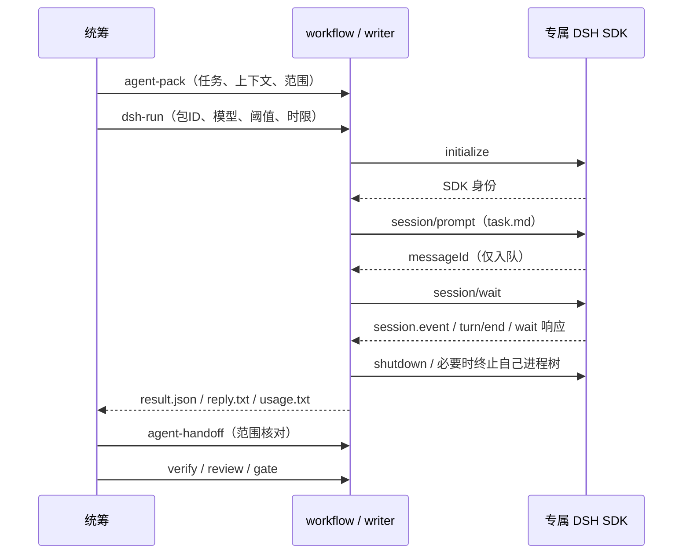

# 技术方案

## 授权与依据

本轮“可以开始”授权实现 DSH 直接下发，沿用 proposal 与已有 Agent 协作协议。已安装 DSH NEXT 2.0.19-next / DSH 0.2.1-rc.2；核对本机 app.asar 中 SDK server、minimal 配置、协议声明与 token-meter 实现。安装路径通过命令参数传入，不作为所有机器默认路径。

## 实现与取舍

用户随后要求会话能在 DSH 客户端看到：CLI 默认 desktop 存储、保留 isolated。运行时 DSH_HOME 不变，只有 sessions 插件 root 指向已有客户端 sessions，压缩模式必须匹配。本机为 zstd，首次 none 配置在生成前被官方后端拒绝，随后匹配配置的独立新会话实际显示成功；没有开启浏览器访问、绕过认证、修改用户全局 profile 或手工复制会话。由官方持久化层创建并锁定新会话，客户端刷新后发现。--desktop-home 和 --desktop-compression 支持显式配置，缺目录失败，不伪装为已显示。

最新模型选择覆盖原 Pro 选择：DeepSeek-V4.1-Flash（1017）、High，SDK 映射 deepseek-flash/high；工具锁规定 API thinking=enabled、reasoning_effort=high。发出新 paid 请求前按当前锁核对，包括旧包的裁决；冻结历史 request 构造保持旧字段以便追溯，而不是改写旧证据。原生 OCR runner 缺少已核实 High 参数映射时阻断，默认 Review 改为 direct-api，OCR 仍负责固定输入筛选。模型切换当时只核验配置与无模型握手；本轮用户已明确恢复 Flash/High 独立复审，不据历史停止记录拒绝当前授权。

`workflow_dsh.py` 用 Python 标准库启动 `DSH NEXT.exe` 的 packaged `lib/desktop-cli.js`，设置 ELECTRON_RUN_AS_NODE=1、独立 DSH_HOME、sdk-minimal 和 maxTokensAsSuccess=false。NDJSON stdin/stdout JSON-RPC；stderr 单独保存。SDK 初始化 provider=deepseek-official；model 显式指定。每项任务新 UUID，不连接已有 GUI HTTP 端口，不加载第三方桥接插件。

客户端 reader 线程、有限帧长/事件数/总日志量、绝对截止时间，严格匹配请求 ID，未知协议/队列溢出阻断。prompt 返回后立即 wait，循环处理通知；只有 owned root 的 completed 和有效用量、正文及 wait 响应齐全才模型完成。当前 SDK minimal 不配置子 Agent；如出现未知子会话或压缩费用不能核算则阻断、提示未知费用。任务日志只记所属会话，不重放全文到控制台。

执行期间持有既有 operation_lock；writer 保留到显式交接。运行记录在 `.ar-workflow/dsh-bridge/jobs/<id>`，记录 PID、状态、安装包摘要、输入/任务摘要、模型、阈值、时限。每个 assignment 至多一个 job，即使失败也不自动重发。status 离线读取记录；异常中断的 running 不是成功。Windows 创建暂停进程，绑定独占 named Job Object（kill-on-close）、保存 ownership，再恢复主线程，避免子进程在绑定前逃逸。正常清理用 shutdown，再终止整个 Job 并查询 active=0；根进程退出不能代替整树核验。主控被强制结束时系统关闭 handle 终止 Job，dsh-stop 在操作锁原 owner 退出后按随机 Job 名核验并保存恢复事实，不以可能复用的旧 PID 杀进程；未知拥有关系继续阻断。没有自动重发、抢占或回滚。

预算入场用任务 UTF-8 字节数加输出上限保守估计第一步；DSH 不提供每次模型请求前准入钩子，后续工具/系统上下文未知，收到 usage 到阈值就终止。实际费用可能越过阈值，未知请求不记零。专属 overlay 禁用 llm-retry、compaction-basic 和 image-offload，关闭默认模型重试与溢出付费摘要。DeepSeek key 从现有可信 credential() 读取，仅进 child env；DSH 默认 scrub shell KEY/TOKEN 等变量，但这不是安全沙箱，SDK 有持久 PowerShell 写能力。

## 任务上下文与协作

context.json 标签 integration，写入覆盖脚本、文档、本变更，以及本轮一并收尾的角色上下文、工作流策略/模板和 commit-msg hook，具体路径以 context.json 为准；复用适用任务/技能策略。真实 DSH 小样本在独立临时 Git fixture 中完成，不借正式工程任务写入未批准引擎代码。执行包包含全文依据与角色要求，sdk-minimal 不宣称自动加载项目技能；任务包已选择并注入适用技能，额外资源由路径读取。模型可运行工作区 shell，范围限制是协作与事后核验，不是 OS 隔离。

## 验证与恢复

离线 fake RPC 覆盖无 completed、截断、缺 usage、重复事件、错误响应、超时、过期包、重复投递和进程存活时交接。真实 doctor 不读 key、不生成；小样本明确限时与小阈值并保留结果、usage。结果不能写 review 状态。断线只查 status 和证据，不自动 resume/prompt；准备新包属于新执行，需要统筹先判断旧执行修改。无常驻服务，停用只需不运行命令，保留证据。
