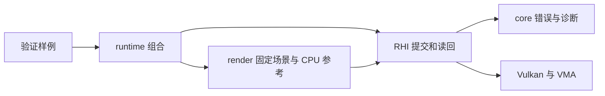
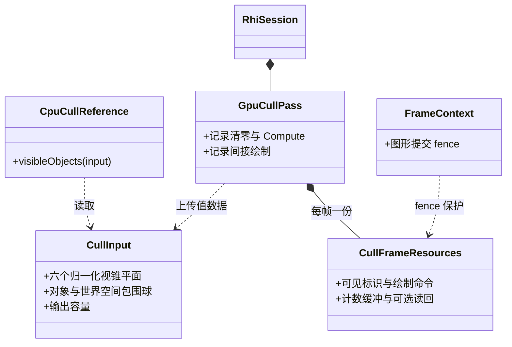
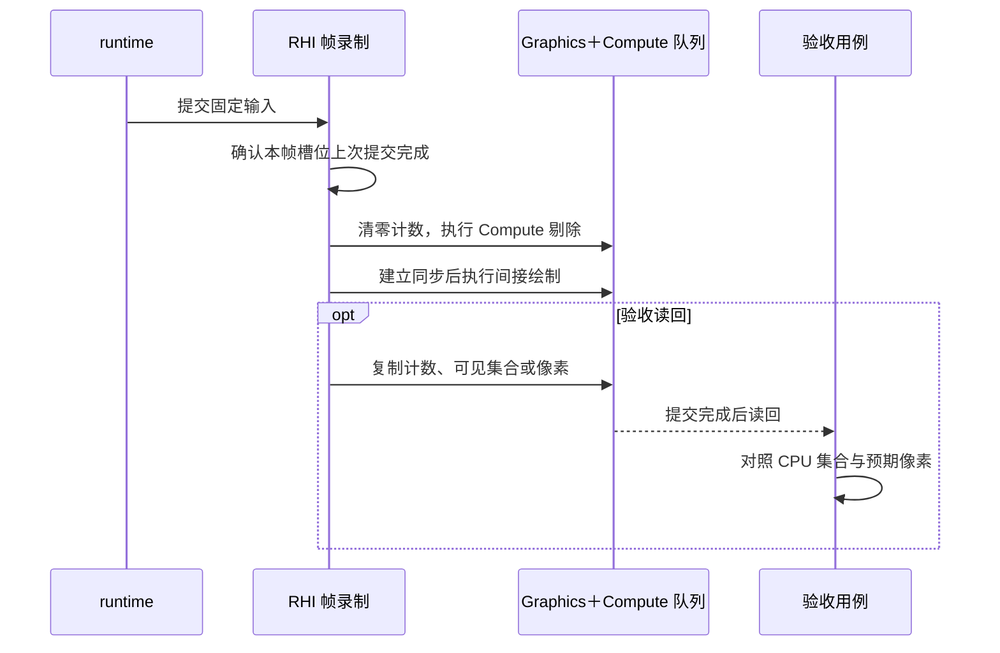

# P3a 最小 GPU Driven 技术方案

## 状态与依据

本页是待实现方案。P2b 已通过本地验证和独立复审。P3a 的范围及验收以 [proposal](proposal.md) 为准。采用 [模块设计模板](../../../docs/modules/模块设计模板.md) 的结构，沿用[实施路线](../../../docs/实施路线与阶段计划.md)、[数学规范](../../../docs/standards/数学坐标与颜色规范.md)和 [GLSL／SPIR-V ADR](../../../docs/adr/0002-Shader采用GLSL与SPIR-V.md)。

## 职责与非目标

- render 生成固定测试几何、对象标识、世界空间包围球和视锥，并提供 CPU 参考。
- RHI 负责能力检查、缓冲、管线、命令录制、同步和完成后的读回。
- runtime 组合固定场景与 RHI 会话；样例负责场景选择和输出。资产加载、动态场景、遮挡剔除、跨队列调度和性能门禁留给对应后续阶段。

## 模块关系与依赖

图中箭头表示允许的依赖。首批 render 的 CPU 参考可独立执行，无需加载 Vulkan。RHI 只接收平面、对象和绘制输入的值数据，不依赖 render 类型或场景对象。CPU 参考结果由测试用于对照，运行中的 GPU 绘制直接消费 Compute 输出。

## 稳定契约与资源生命周期

下图使用候选类型名表达所有权。RhiSession 是现有入口，Compute 剔除与绘制资源由其私有实现持有。

输入由调用方拥有，RHI 上传后持有设备侧副本。固定顶点和对象数据可跨帧复用，命令、计数和验证读回按帧隔离。部分初始化失败按逆序回滚，帧资源在对应 fence 完成后重用。关闭先等待提交，再释放管线和资源。超时及设备丢失沿用 RHI 会话的隔离和清理约定。

### CPU／GPU 数据布局

| 数据 | 表示与契约 |
| --- | --- |
| 视锥 | 六个向内的单位平面，每个 16 字节，四个 float 为 n.xyz 与 d |
| 对象 | std430 步长 32 字节。首 16 字节为中心 xyz 与非负半径，后 16 字节为对象 ID、firstVertex、vertexCount、保留字段，均为 uint32 |
| 可见标识 | uint32 数组，与命令使用同一输出位置。并行顺序未定义 |
| 间接命令 | 四个 uint32，顺序为 vertexCount、instanceCount、firstVertex、firstInstance，步长 16 字节。每对象一实例，firstInstance 固定为 0 |
| 计数 | uint32 总可见数和有界命令数，偏移分别为 0、4。溢出由总可见数大于容量判断 |

实现时用 C++ 静态断言核对尺寸和偏移，GLSL 使用显式 std430 布局。每个对象只处理一次，距任一平面严格小于负半径时剔除，相交或相切保留。Compute 用原子操作取得输出位置，只有位置小于容量才写命令和 ID，并增加有界计数。容量为零时使用合法的最小分配或直接走零输出路径，绘制阶段跳过零容量调用。只读回有效前缀。混合场景使用互不重叠的几何，避免结果依赖命令顺序。

## 关键时序与并发

同一队列支持 graphics 和 compute。清零用 transfer 写入，屏障目标为 Compute 的读写。间接命令与计数使用 storage 和 indirect 用途，Compute 写入经屏障对 DRAW_INDIRECT 的 INDIRECT_COMMAND_READ 可见。验证复制另建立到 transfer read 的依赖，复制结果在 fence 完成后按内存一致性要求读取。普通帧不做验证读回。

## 错误与可观测性

启用时检查 drawIndirectCount、multiDrawIndirect 及实际使用的设备上限，包含间接命令上限、storage buffer 范围和 Compute 派发上限。输入字节数计算需检查溢出。缺少能力或描述不合法时返回具名错误，不进入提交。用现有诊断会话记录场景、帧、容量及失败阶段。验收失败输出缺失／意外对象 ID、计数或像素坐标和预期值。调试与性能采样分别记录，本阶段暂无性能实测。

## 验证与实现边界

[验证计划](test-plan.md) 依次验证 CPU 参考、真机可见集合及间接绘制像素。T18 覆盖相切、空集和容量边界，T19 验证 GPU 生成结果和溢出，T20 验证画面与连续帧计数清零。完整门禁同时回归 P1、P2a 和 P2b。本页类型、数据布局和时序为待实现设计。

## 在途演进

进度见 [TASK.md](../../../TASK.md)。P3a 验收后将已验证的稳定边界合入 [render](../../../docs/modules/render/README.md) 与 [RHI](../../../docs/modules/rhi/README.md) 长期设计。

T20 为 Compute 剔除、间接绘制以及命令和计数缓冲提供稳定的调试标签或名称，便于按需使用 RenderDoc 在 Event Browser 与资源视图中定位。

T19 真机验证通过 RHI 同步入口提交 Compute，用 VMA host-visible 缓冲读回计数及有效前缀。由现有提交 fence 和关闭隔离保护资源。这条验证入口每次独立创建资源；T20 绘制路径再接入每帧持久缓冲及 DRAW_INDIRECT 同步。
