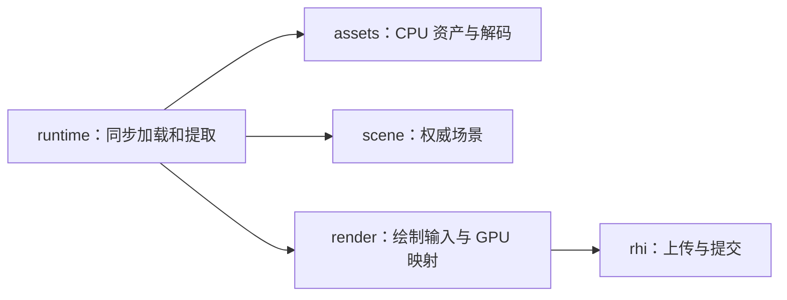
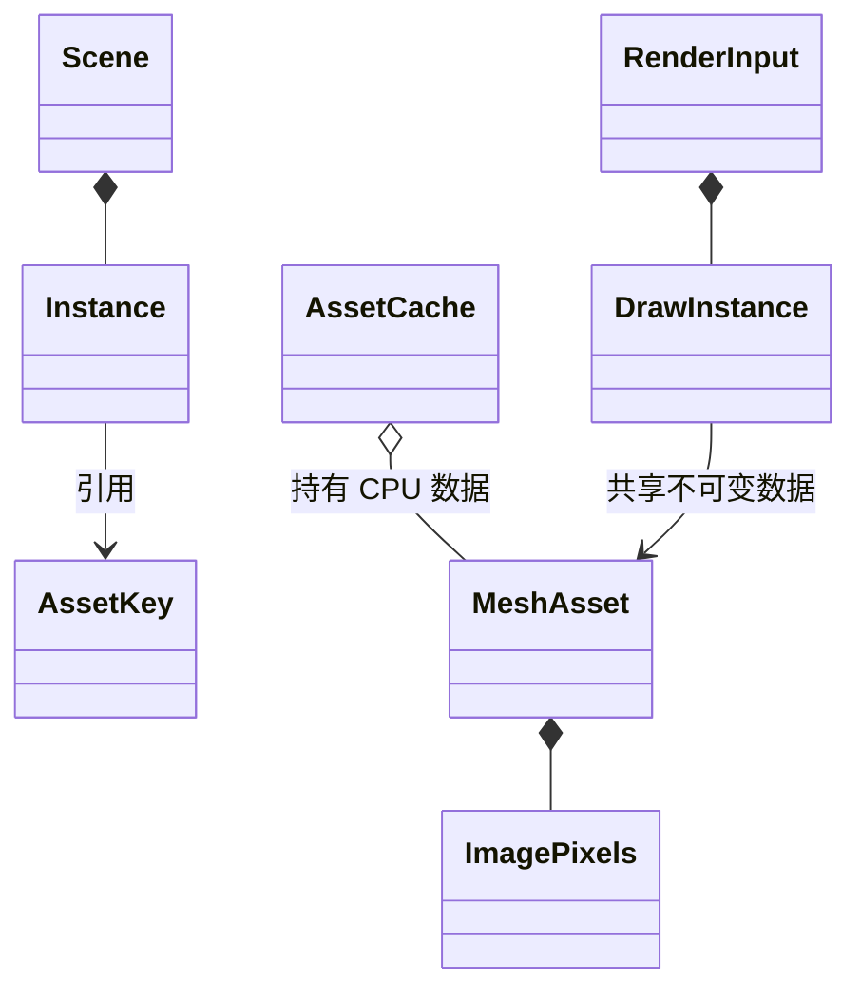
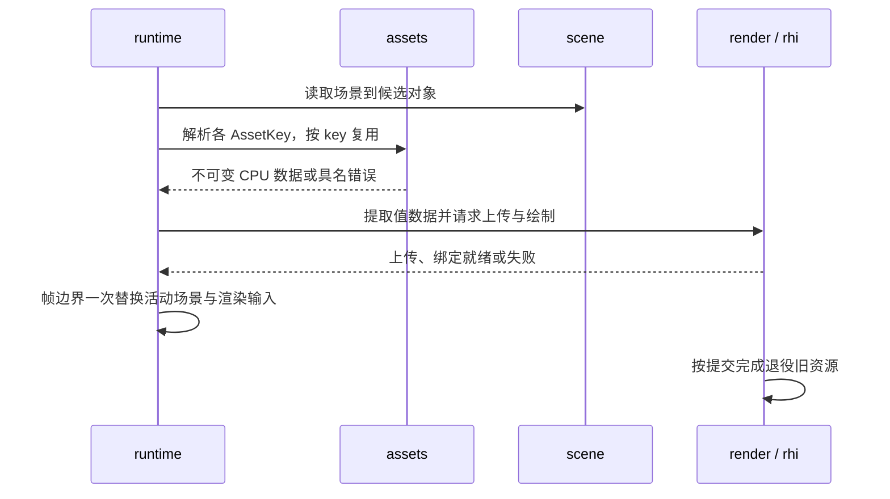

# P3b 技术方案

## 状态与依据

本方案用于静态场景首个垂直切片，尚未实现。范围和验收见[提案](proposal.md)。沿用 [模块模板](../../../docs/modules/模块设计模板.md)、[依赖选型](../../../docs/adr/0007-基础构建与第三方依赖选型.md)和 P3a 真机测试入口。相机历史、矩阵长期归属仍以[总体架构决策](../../../docs/总体架构与技术路线.md)为准。

## 职责与模块关系

[scene](../../../docs/modules/scene/README.md) 使用 EnTT 存储局部实体，只保存稳定标识、变换和资产引用值。[assets](../../../docs/modules/assets/README.md) 使用 fastgltf 和 stb_image，解析器及图像解码类型留在私有实现。runtime 负责解析引用并组装 render 的值输入。render 通过 P2 的资源接口上传和复用 GPU 对象，编译层保持对 EnTT、fastgltf 的隔离。

## 接口与数据抽象

以下类型名是候选，字段与所有权用于约束实现。

| 数据 | 形态与所有权 |
| --- | --- |
| AssetKey | 项目资产根下以 / 表示的规范化相对路径。每个会话按校验后的规范路径缓存，拒绝绝对引用、根外解析与越界 URI。路径比较遵循实际文件系统；保存采用受控文件的规范拼写 |
| MeshAsset | 首批仅接受一个索引 TRIANGLES primitive，可含多张三角面。解码完成后形成不可变值数据。限制尺寸和元素个数，验证索引、缓冲范围，失败不插入成功缓存 |
| Scene | JSON 带 schema 版本，按稳定对象 ID 序列化；独立实例保存位置、四元数、缩放和 AssetKey。首批场景平铺，固定验证相机保存位置、朝向及投影参数，使用项目右手系和 Reverse-Z |
| RenderInput | 提取输出持有实例矩阵值及 CPU 资产的不可变共享引用，跨越 ECS 修改或销毁仍有效。GPU 缓存条目由 render 管理，无 GPU 句柄写入场景文件 |

### T22 的 glTF 输入

- 只接收 glTF 2.0 文本：一个默认场景、一个无子节点的网格节点、一个网格和一个 primitive。节点允许缺省变换或显式 identity TRS；矩阵及非 identity TRS 返回格式错误。实例变换由场景文件管理。
- POSITION 为非归一化 FLOAT VEC3，TEXCOORD_0 为非归一化 FLOAT VEC2，两者数量须一致。索引为非归一化 UBYTE、USHORT 或 UINT SCALAR，数量为 3 的倍数且每项小于顶点数。首批接受有字节偏移的紧密数据，拒绝交错 stride、稀疏 accessor 和量化。
- 纹理沿 primitive material → pbrMetallicRoughness.baseColorTexture → texture.source → 外部 PNG，使用 TEXCOORD_0，解码成 RGBA8，保留 PNG 行顺序。所有 accessor 共用一个外部 .bin。外部 .bin 和 .png URI 从 .gltf 所在目录按本地相对路径解析，打开前校验规范化后的实际路径仍在资产根内。首批不接收 GLB、内嵌数据 URI、远程 URI 或自定义扩展。
- JSON 上限 4 MiB，单个外部缓冲或 PNG 上限 64 MiB；顶点和索引各最多 1,048,576 项，PNG 宽高最多 4096。校验范围后再读取 accessor 和解码图像。

## 生命周期与时序

### T23 场景文件与 CPU 提交点

- JSON v1 顶层为 `version`、`camera`、`objects`。相机保存位置、XYZW 朝向、竖向视场角（弧度）及物理近远面；实例保存正整数 ID、相对资产路径、位置、XYZW 四元数及缩放。读取仅接受有限的数值、单位四元数与合法相机范围，最多 4 MiB 和 10,000 个实例。按稳定 ID 排序保存与提取。
- runtime 用 GLM 生成列主序 `T × R × S` 矩阵。提取结果保存相机参数值与不可变网格的共享引用。CPU 候选全部解析、验证和解析资产后，`StaticSceneSession` 一次替换活动状态。失败保留旧场景和旧输入；调用方保留的旧输入可独立存活。T24 接入 GPU 时使用下方的完整提交点。
- 保存先用独占创建在目标同目录写入临时文件，关闭成功后以文件重命名替换目标。失败清理本轮临时文件并返回保存错误。

初期同步加载和提取。候选解析、提取、上传和绑定全部就绪后才提交切换。失败只回收候选新取得的资源，活动场景继续出图，共享资源继续有效，可重新尝试。保存先在目标同目录写入完整临时文件，再使用现有平台能力替换，失败保留旧文件。场景关闭先解除新帧引用，再按 RHI 完成信号释放在途 GPU 资源。

## 错误、诊断与验收

记录加载阶段（读取、解析、解码、上传）、相对资产名或对象 ID，以及原始错误。夹具由仓库生成或提交自制文件，记录来源，测试输出放 build 下。验收映射见[验证计划](test-plan.md)。首批 GPU 样例验证两实例绘制与纹理，沿用已有上传及绑定能力；P3a GPU 剔除作为独立回归。RenderDoc 保留按需调试入口。

## 实施边界

先做 CPU 资产加载，再做场景保存和提取，最后接 GPU 像素闭环。暂缓一般 glTF 节点层级、PBR、动画、热重载、数据库和异步流送，也不在本切片合并 P3a 与所有资产绘制路径。P3a 样例入口继续用于回归与故障隔离。
