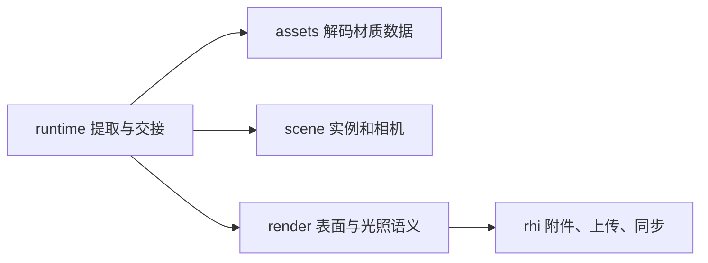
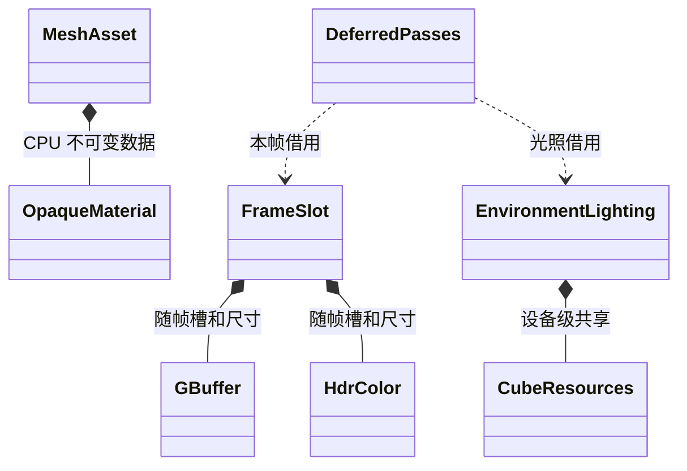
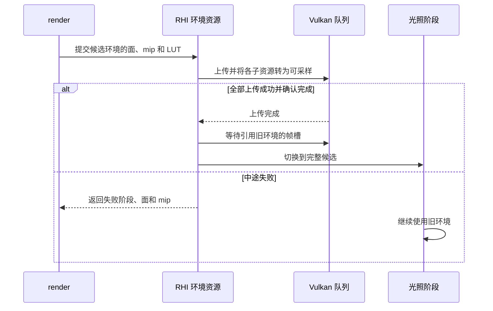
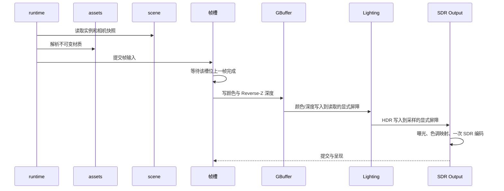

# P3c 技术方案

## 状态与依据

沿用 [已确认的延迟 PBR 架构](../../../docs/总体架构与技术路线.md)、[数学与颜色规范](../../../docs/standards/数学坐标与颜色规范.md)和 [P3b 呈现方案](../p3b-static-scene-assets/design.md)。本批验收由[提案](proposal.md)维护。下面的类型名和附件格式是首版实现选择，尚未做设备验证。

## 职责与依赖

箭头从使用方指向依赖模块。scene 只存资产引用和实例。render 持有材质映射、候选帧配置及 pass 语义，RHI 管理 Vulkan 对象和可观测同步。P3b 样例继续用于回归，P3c 使用显式启用的延迟路径。

## 数据与所有权

| 资源 | 首版语义及候选格式 |
| --- | --- |
| OpaqueMaterial | glTF 基础颜色、金属度、粗糙度因子与可选纹理。缺省因子分别为白色、1、1，缺省数据纹理按白值解释。颜色采样按 sRGB，金属粗糙纹理按线性解释，B 为金属度、G 为粗糙度。P3b 原展示路径维持原输出 |
| GBuffer | 基础颜色候选 RGBA8 UNORM，写入线性颜色；视空间有符号法线候选 RGBA16F；金属度/粗糙度候选 RG8 UNORM。首版使用几何法线，可由有效 NORMAL 或三角形数据得到；法线贴图与切线体系延期 |
| Depth | 复用已验证的 D32_SFLOAT 风格深度附件，按设备验证 sampled 能力。Reverse-Z 清 0，光照依据深度和逆投影重建位置；清屏背景单独处理 |
| HdrColor | RGBA16F 线性 Rec.709，允许大于 1。直接光首版使用一个确定性方向光，表面参数与光照函数分开。曝光、FilmACES 方向及最终编码遵循项目颜色规范 |
| EnvironmentLighting | 环境输入、漫反射立方体、高光 mip 链及 BRDF 输入。共享数据在全部必需子资源完成之后发布，生成失败保留现有环境或未启用状态 |

每种附件在创建前校验所需 format feature 和尺寸约束，记录实际格式和失败阶段。具体色调映射函数、采样数、环境分辨率及容差在对应实现切片用参考值固化。

### T26 材质值与纹理身份

最终材质值等于线性因子乘对应采样值。基础色纹理 RGB 经 sRGB 解码，A 按线性取样。金属度、粗糙度分别取线性 B、G，缺图各通道使用 1。缺少材质使用 glTF 默认因子。首批支持外部 PNG 和 TEXCOORD_0，MASK 与 BLEND 在不透明模式返回错误。CPU 保留原始 RGBA 字节。T27 GPU 纹理缓存至少以已解析纹理身份和采样用途（sRGB 颜色、线性数据）为键，实际格式、视图或采样配置不同也须区分；同一 PNG 可以共享 CPU 字节，GPU 侧须使用匹配用途的格式或视图。

T26 增加显式 `StaticMaterialMode::Opaque`，P3b 继续沿用默认 `BaseColorOnly`，保留对其他贴图不参与旧样例加载的行为。GPU 路径在 T27 接入不透明材质模式。两种加载模式各自使用固定配置的缓存实例。render 提供 CPU 材质求值参考，后续可与 shader 读回对照。

### T27 附件用途与复用

首版采用呈现路径持有 RHI 内部帧资源的方案。基础色、法线、材质和深度以一组资源绑定到帧槽，和交换链尺寸一起创建，帧槽索引与交换链图像索引分别使用。render 定义输出语义，RHI 决定 Vulkan 格式、视图和布局；当前固定路径沿用显式同步。读回由诊断请求触发，调用方只接收尺寸、像素位置及解码后的值，接口不暴露附件句柄。resize 时等待旧槽位最后一次使用完成，再释放旧附件。

| 附件 | 生产者 | 消费者 | Usage 和同步 |
| --- | --- | --- | --- |
| GBuffer 颜色、法线、材质 | 几何阶段 color attachment output 写入 | 光照或调试 shader 采样；测试复制 | COLOR_ATTACHMENT、SAMPLED；诊断配置增加 TRANSFER_SRC。COLOR_ATTACHMENT_OUTPUT / COLOR_ATTACHMENT_WRITE → 实际 shader sampled read 或 COPY / TRANSFER_READ |
| Reverse-Z 深度 | 几何阶段 early/late fragment tests 写入 | 光照位置重建；测试复制 | DEPTH_STENCIL_ATTACHMENT、SAMPLED；诊断配置增加 TRANSFER_SRC。EARLY_FRAGMENT_TESTS 和 LATE_FRAGMENT_TESTS / DEPTH_STENCIL_ATTACHMENT_WRITE → 实际 shader sampled read 或 COPY / TRANSFER_READ，显式匹配 depth aspect 与布局 |
| HDR 颜色 | 直接光阶段 color attachment output 写入 | 输出阶段采样；测试复制 | COLOR_ATTACHMENT、SAMPLED；诊断配置增加 TRANSFER_SRC。COLOR_ATTACHMENT_OUTPUT / COLOR_ATTACHMENT_WRITE → 实际 shader sampled read 或 COPY / TRANSFER_READ |

测试复制后等待所属提交完成，再读 CPU 缓冲并执行所需的 invalidate。下一帧复用等待对应帧槽最后一次使用完成，按已知布局切回附件用途。仅在完整覆盖写且允许丢弃内容时使用 UNDEFINED。有效顶点 NORMAL 经视图模型线性部分的逆转置并归一化；没有顶点 NORMAL 时使用三角形面法线，退化三角形不参与法线参考探针。用非均匀缩放和上下不对称探针分别验证法线与位置重建。

首轮诊断用三个位置切开故障范围。重叠处应读到近表面和显式材质，远表面可见处应读到较低的 Reverse-Z 深度与默认材质，背景应保持深度和基础色清屏值。三个位置都只有清屏值时，先核对绘制列表、相机和实际附件；深度有值而材质探针异常时，核对 attachment 对应关系、采样用途和读回格式。

T27 的样例用 `--static-scene … --asset-root … --gbuffer` 打开几何写入路径，交换链颜色同时提供基础色预览。测试增加 `--gbuffer-probes <JSON>`，在最后一帧按需从四个附件复制固定纹素，读回包含同一帧的尺寸、像素坐标、原始深度与解码值。两个纹理用途走独立绑定，使用 UNORM 存原始字节；几何 shader 只对基础色 RGB 显式解码。视空间法线取模型视图线性部分的逆转置。在缺少顶点法线时，上传阶段按三角形展开并生成面法线。

### T28 光照与显示变换

直接光参考采用 GGX 分布、分离式 Smith G1 与 Schlick Fresnel。GGX 的 α 为 `max(roughness², 0.002)`，F0 在 0.04 和线性基础色之间按金属度插值；Lambert 漫反射乘 `(1 - metallic) × (1 - Fresnel)`。点乘为非正值的受光表面贡献为零，BRDF 分母下限为 `1e-5`。曝光只施加在输出阶段，使用 `exp2(EV)` 缩放线性场景颜色。FilmACES 参考项目颜色规范链接的 Flower `common_tonemapper.glsl` 中的 `filmToneMap` 和 `post_tonemapper.glsl` 中的 Rec.709/AP1 转换，T28 固定所使用的参数并加入黄金探针。UNORM 输出显式 sRGB 编码，sRGB 附件交给硬件编码。两档曝光的 HDR 读回应一致，最终 SDR 应不同。

T28 通过 `--hdr-lighting` 显式启动，复用 T27 的几何附件与 Reverse-Z 深度。固定方向光的视空间入射方向为 (0, 0, 1)，线性 RGB 辐亮度为 (6, 6, 6)。深度为 0 的像素输出黑色，其他像素用像素中心、负高度 viewport 和逆投影重建视方向。正常帧将结果写入当前帧槽的 RGBA16F；仅诊断帧复制 HDR texel 并读回最终交换链颜色。

| 顺序 | 输入 → 输出 | 生命周期与同步 |
| --- | --- | --- |
| 几何 | 不透明实例 → GBuffer + D32 | Presentation 按帧槽分配；颜色写和早/晚深度写分别转为 fragment sampled read |
| 直接光 | GBuffer + D32 → RGBA16F | 每槽绑定各自的附件视图；HDR 颜色写转为 fragment sampled read |
| 显示 | RGBA16F → SDR 交换链 | 输出阶段应用 EV；附件为 sRGB 时写线性值，UNORM 时写 sRGB 编码值 |
| 诊断 | HDR 与交换链颜色 → CPU | 受控末帧才复制，复制完成后通过现有 fence 与 invalidate 路径读回；帧槽复用与重建沿用 Presentation 的等待边界 |

FilmACES 固定 Flower 默认参数：slope 0.91、toe 0.55、shoulder 0.26、black clip 0、white clip 0.04、pre/post desaturation 0.96/0.93、red modifier 1、glow scale 1；不启用额外色域扩展。显示阶段先把 Rec.709 转 AP1，再执行曲线并转回 Rec.709。黑色直接映射到零，避免零输入的对数运算。验收固定 EV=0 与 EV=-1，HDR 按同一浮点容差核对 CPU 参考与两次读回，SDR 探针按编码后字节核对。

### T29 环境发布

只有所有必需面与 mip 都写完、转为可采样且生成提交完成，才发布新环境。旧环境由最后一次采样提交的完成信号保护。生成中途失败时保留旧环境，候选资源按实际完成状态清理。常量环境验证能量，方向可区分的环境验证面朝向和粗糙度对应的高光 mip。

首版在准备阶段用确定性采样预计算固定环境，帧循环只做纹理取样。预计算和方向约定归 render，Vulkan 图像、上传、描述符及提交完成归 RHI。环境在世界空间存储，光照阶段把视空间法线和反射方向转到世界空间，旋转相机只改变观察方向。

| 资源 | 首版布局 | 采样语义 |
| --- | --- | --- |
| 漫反射环境 | 16×16，6 面，单 mip，RGBA16F | 存储 Lambert 余弦加权平均辐亮度，常量环境应还原输入辐亮度 |
| 高光环境 | 16×16，6 面，5 个 mip，RGBA16F | mip 0 保留方向细节，后续按 GGX 粗糙度逐级预滤；采样 LOD 为 roughness × (mipCount−1) |
| BRDF LUT | 32×32，RG16F | 横轴 N·V，纵轴粗糙度；存储 split-sum 的比例和偏置 |

样例以 `--ibl constant|directional` 显式启用。prepare 阶段由 render 将 CPU 结果打包为 binary16，runtime 转交至 RHI。RHI 为每个 mip/layer 建立独立的复制区间与前后屏障，三个资源上传的 fence 均完成后才切换帧槽描述符。环境纹理随设备存活，交换链重建时复用环境图像并重新写入新帧槽的描述符。BRDF LUT 的有限样本积分将两个分量之和限制在 1，避免单位 Fresnel 的数值超量。

每个输出 texel 使用固定序列，首版漫反射、高光预滤和 BRDF LUT 各用 128 个采样点。立方体 layer 顺序为 +X、−X、+Y、−Y、+Z、−Z；测试同时核对面中心方向和至少一个离中心像素的朝向。候选的 6 个漫反射面、30 个高光子资源和 1 张 LUT 均按自己的写入与布局状态记录。上传完成后才允许创建或切换供帧使用的描述符；首版在帧边界等待已经引用旧环境的帧槽，随后切换并释放旧资源。

## 时序与同步

交换链尺寸变更后等旧槽位完成再退役附件。渲染器使用现有 Vulkan 队列，首版采用显式屏障。主视图沿用项目负高度 viewport 约定，新路径集中处理 Y 转换。SDR 输出根据 swapchain 格式选择硬件 sRGB 或显式编码，有且只有一次。IBL 按 `(aspect, mip, layer)` 记录用途和当前布局，每次写入转采样前声明屏障与最终布局，避免以整图状态描述部分完成。环境生成安排在准备阶段。

## 诊断、失败回退与验证

保留基础颜色、法线、金属度、粗糙度、深度与 HDR 的固定探针或诊断视图；记录 pass、像素坐标、格式、预期和实际值。部分创建失败逆序归还候选资源，设备异常沿用 RHI 的在途保留逻辑。各切片只打开已实现路径，按[验证计划](test-plan.md)跑 CTest 和独立评审。
