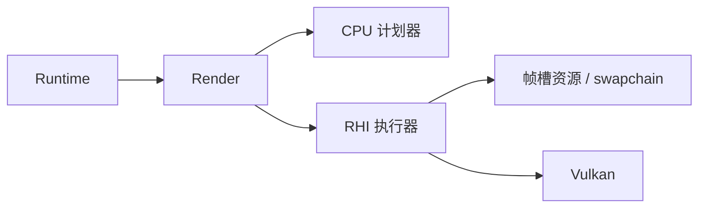
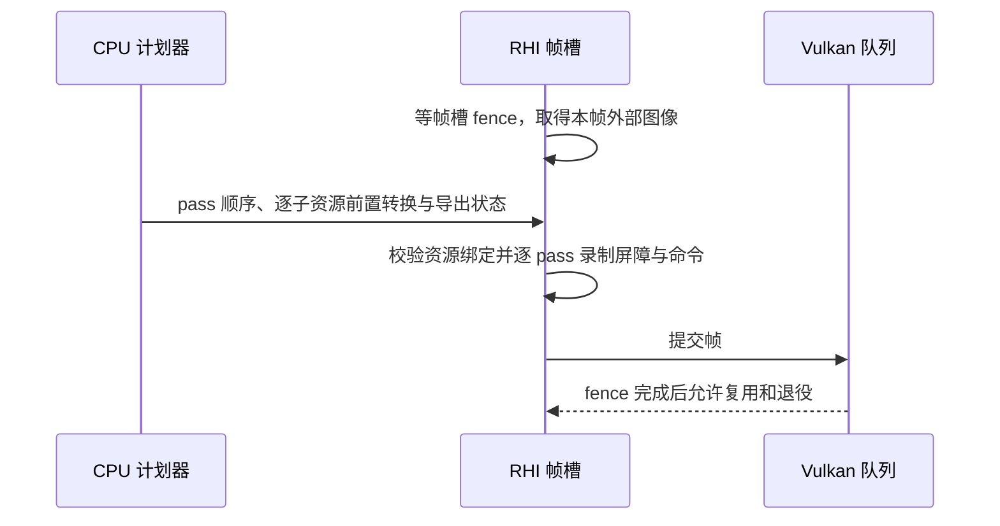

# P4a 轻量 Render Graph 设计

架构方向已确认，Vulkan 执行接口在接入前验证。沿用[模块边界](../../../docs/modules/render/README.md)和 [P3c 帧槽模型](../p3c-materials-lighting/design.md)。

## 职责与候选接口

- render 声明几何、光照、显示与诊断的资源用途，管理纯 CPU 的 `GraphDeclaration → GraphPlan`。声明用稳定 ID、aspect/mip/layer 范围和逻辑用途，不暴露 Vulkan 对象。
- RHI 的现有 Presentation 持有交换链、帧槽附件、管线和描述符。GraphDeclaration 与 GraphPlan 定义在 render；通过 RHI 公开入口传递执行需要的轻量数据，RHI 不依赖 render。执行前将计划中的 ID 绑定到对应帧槽/图像，转换 stage、access 和 layout，逐 pass 录制。应用继续使用现有 runtime 入口。
- 首版保留现有 pass 顺序，在单图形队列上由单线程录制。在每个子资源上合并读者的访问范围并计算下一次写入的依赖。兼容读使用相同布局时仍要核对生产者写入是否已对当前读阶段可见，读阶段扩大时补足同步范围。不同 mip/layer 可以独立，未初始化读需要写入或导入状态。遇到无法精确列出的 Bindless 集合，声明保守全集或返回诊断。

## RHI 接入接口

候选调用顺序为 runtime 调用现有 `presentFrame`，RHI 等待帧槽并取得实际交换链图像，然后同步调用由 render 提供的计划函数。函数使用 RHI 公开头中的轻量输入与执行描述，render 内部转换为 `GraphDeclaration`，执行 CPU 规划后把结果转换回 RHI 执行描述。计划调用和录制都在本帧的调用线程内完成，资源绑定与 Vulkan 句柄留在 RHI。

| 执行输入 | RHI 校验与处理 |
| --- | --- |
| pass 标识及每个 barrier 的资源 ID、mip、layer、源/目标用途与布局 | 按当前帧槽或已取得的交换链图像解析实际对象，校验范围后转换 stage/access/layout |
| 丢弃旧内容标志 | 允许选择 UNDEFINED 作为旧布局，但保留源范围以保护先前访问 |
| 外部呈现状态 | acquire semaphore 保护交换链图像的第一次设备访问，结束时转呈现布局并使用现有 signal/present 顺序 |
| 实际资源身份和计划导出状态 | 提交成功后按资源身份更新，计划失败或提交失败不发布新状态 |

## 生命周期与录制时序

帧槽附件保留原所有者。全幅覆盖的首次写可显式声明丢弃，历史或持久资源导入真实状态。诊断条件变化时构建对应计划，关闭诊断时没有主机读回。首版逐帧用实际交换链图像、导入状态和间接访问集合规划。resize 后等旧帧槽收敛再更新资源绑定。队列提交失败沿用 RHI 的失败处理；仅在提交成功后按实际资源身份登记导出状态，供后续帧导入。丢弃内容只改变保存旧内容的要求，仍保留先前访问所需的执行依赖。

## P3c 迁移边界

几何、光照、显示、按需 Copy 和 Present 由同一帧计划产生图像屏障。Copy 包括交换链截图和各探针的源图像。读取缓冲的同步继续由 RHI 处理，复制完成后使传输写入对主机可见。

GBuffer、Depth 和 HDR 状态随各自帧槽附件保存，交换链状态随实际获取的图像保存。新建图像初始未定义。IBL 的 37 个子资源以环境已发布为前提，按已完成上传的 shader-read 状态导入。环境换代时沿用等待旧帧槽和重写描述符的现有路径。

## 可观测性

计划诊断携带 pass、资源、子资源与失败类型。Debug 输出可检查计划顺序和屏障，真机证据沿用 CTest 结果与原像素探针。RenderDoc 用于按需定位。
