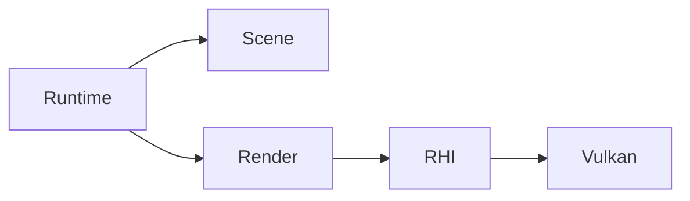
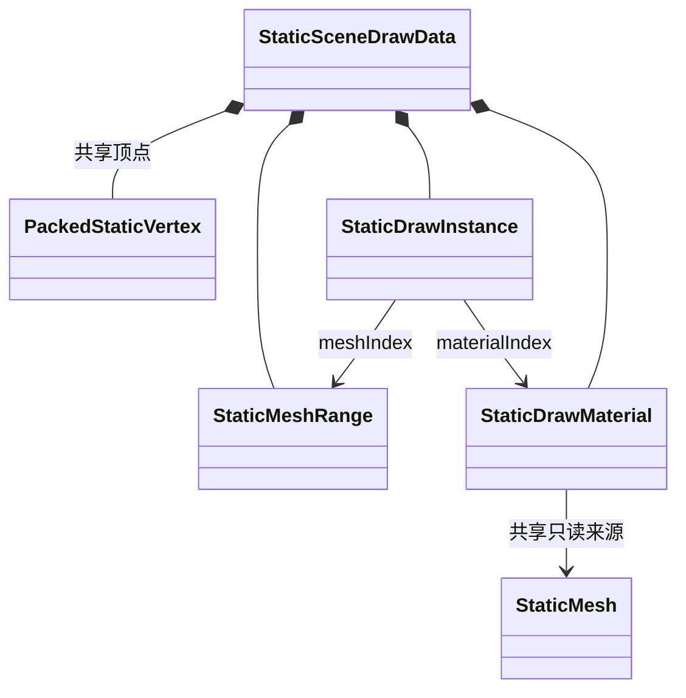
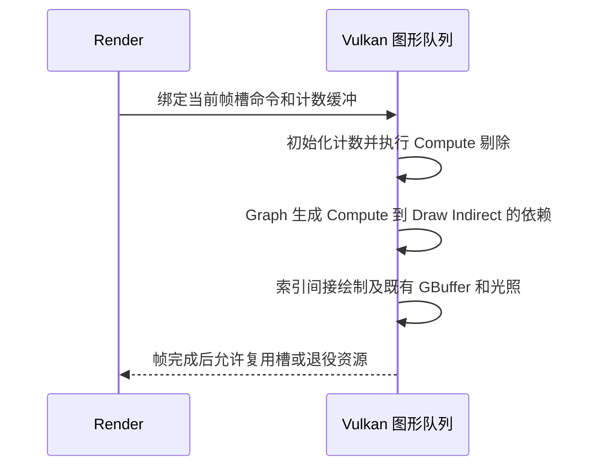

# 静态场景 GPU Driven 设计

本次迁移以 T33 验收的 P3c 画面和 P4a 图执行为基线，分 T34 数据打包、T35 纹理绑定、T36 GPU 剔除。设备队列、光照模型、资产加载格式沿用现有路径。Heap 后端和性能对比留给 P5。

## 模块关系

scene 提供实例和场景数据。render 生成共享几何、实例与材质数据及可见性声明。RHI 持有 Vulkan 缓冲和纹理表，执行上传、Compute 与绘制。runtime 连接现有场景加载与帧循环。

## 数据与生命周期

| 数据 | 布局和责任 |
| --- | --- |
| 共享几何 | 单份顶点与索引数据按网格打包。每个网格记录 `firstIndex`、`indexCount`、`vertexOffset`。保留网格局部索引，检查打包范围和整数溢出 |
| 实例与材质 | 实例表保存变换、法线矩阵、包围体和网格、材质引用。材质表保存因子和 Albedo、MetallicRoughness 纹理槽。CPU 和 Shader 用尺寸、偏移断言校验布局 |
| Bindless 纹理 | 沿用 Set 路径，分别保留颜色与数据贴图的解释。根据实际场景及设备限制选容量，只写变化槽位。更新、复用和退役遵守对应帧完成条件 |
| 间接命令 | Compute 向每帧槽写入计数和 `VkDrawIndexedIndirectCommand`，检查 20 字节命令布局与各字段。首版以 `firstInstance` 传实例索引，逻辑设备须查询并启用 `drawIndirectFirstInstance` 后才开启此路径。缺失时保留 CPU 直接绘制并记录原因 |

场景替换先准备候选资源和描述符。只有上传完成且引用旧资源的提交收敛后才发布，失败保留旧场景。T34 先编写纯 CPU 数据测试，为后续上传和 GPU 路径建立参照。精确的实例、材质 SSBO 偏移和容量随首次实现及着色器对照确定。

### T34 打包接口

`packStaticSceneDrawData` 借用 `StaticRenderInput`，返回由调用方持有的 CPU 数据。按实例输入顺序分配索引，同一个不可变网格对象只打包一次，共享网格的实例各自保留对象 ID 和变换。材质记录保留纹理来源的所有权。包围盒在模型局部空间，模型矩阵和逆转置法线矩阵用于模型到世界的变换。缺失顶点法线时按面展开，退化三角形跳过。

输入为空时返回空数据。几何越界、面法线回退后没有可绘制三角形、不可逆变换或超出容量时返回 `InvalidArguments`，本次局部结果随返回销毁。T34 不依赖设备，真实 GPU 缓冲容量与着色器布局分别在 T35、T36 建立验收。

## 执行与同步

GPU Driven 场景的 Vulkan 管线和录制放入独立内部实现，由现有呈现器调用。Graph 的 Buffer 用途在接入真实消费者时落实。首版覆盖计数初始化、Compute 写入、命令与计数读取，CPU 和 GPU 输入采用同一场景数据。GPU 写入顺序允许变化，可见集合比较按稳定实例 ID 进行。P5 通过同一画面与材质探针核实两种后端的一致性，再确认实际共享范围。
