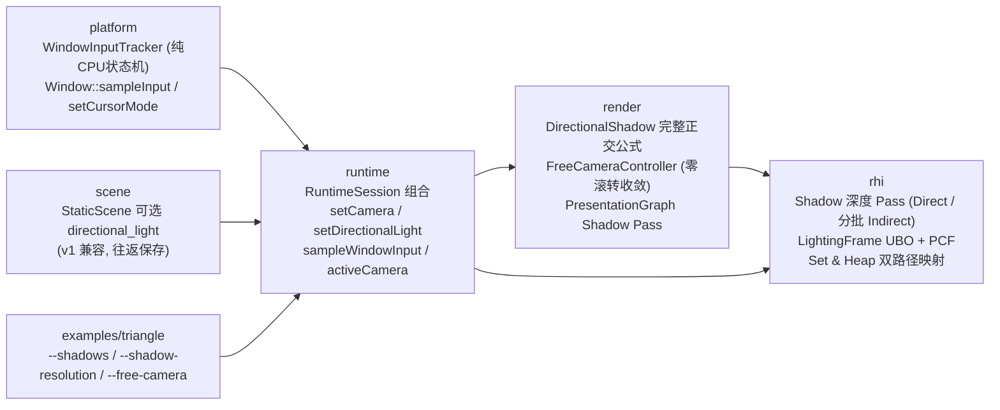
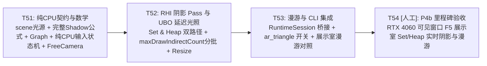
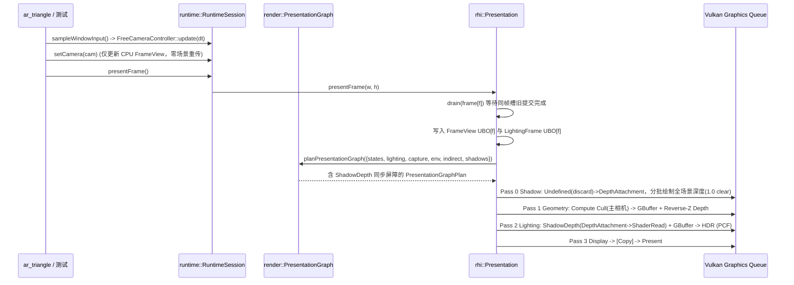
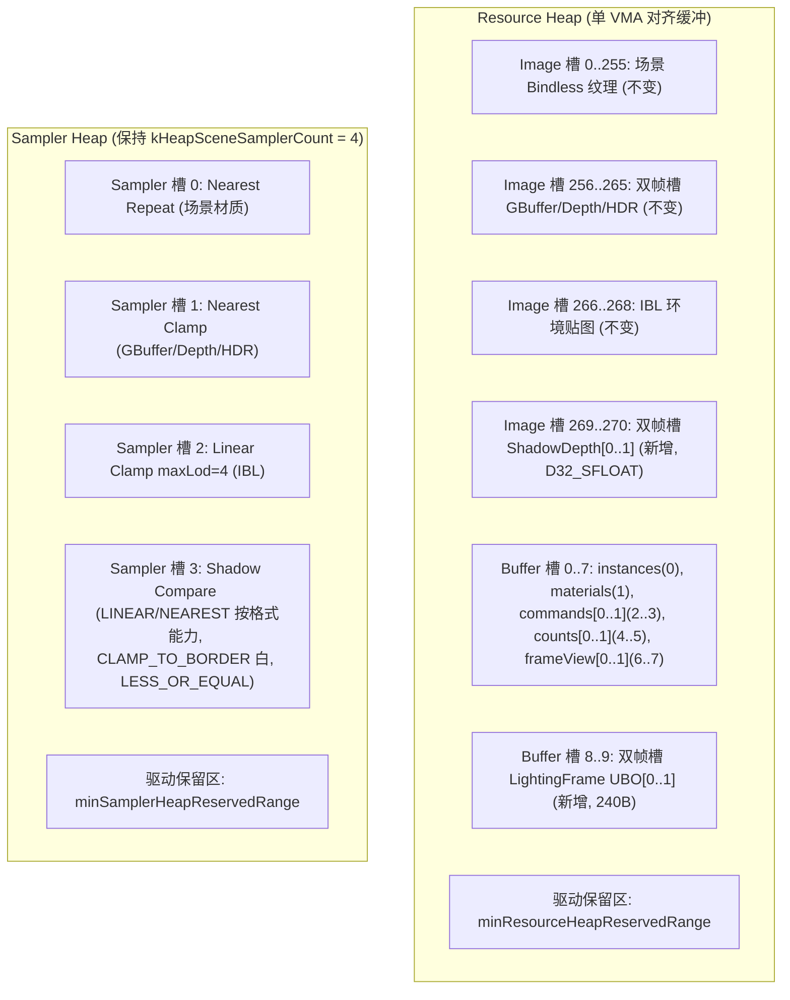

# P4b：方向光阴影与相机漫游技术方案

主责模块为 `render`、`rhi`、`platform`、`scene`、`runtime` 与 `examples/triangle`，严格维持单向依赖 `core ← rhi ← render` 与单 Vulkan 后端。所有新增渲染能力从首日起同步落地 Vulkan 1.3 Descriptor Set 与 Vulkan 1.4 `VK_EXT_descriptor_heap` 两条路径，并保持既有无阴影基线用例零退化。

## 1. 模块边界与分片演进

### 阴影范围与后续演进

P4b 建立单张正交 Shadow Map 的正确性基线，覆盖展示室与小规模静态场景。光视图根据场景包围盒和光方向生成。场景范围扩大时，同分辨率下的单位面积精度会下降，画面稳定性需由探针与真机漫游验证。

`render` 定义阴影视图的矩阵、覆盖范围和分辨率，RHI 关联当前帧槽深度附件。阴影视图与主相机视图分别产生投影物输入，光照读取阴影视图参数和深度结果。当前仅生成一个阴影视图，CSM 的数量、GPU 布局及选择规则在后续切片确定。

初版之后优先安排稳定 CSM（首个候选 4 级），补充级联分割、texel 对齐、级联过渡与逐级联剔除，再按实测决定 SDSM 或接触阴影。阶段目标见 [长期路线](../../../docs/长期发展路线图.md#方向光阴影演进)。

### 代码架构与调用入口

下表把 T51–T53 映射到实际源码位置（前置展示室 T49–T50 见 [默认展示场景方案](../p4b-showroom-launch/design.md)）：

| 切片 | 修改位置与数据流 | 验证落点 |
| --- | --- | --- |
| T51 场景与数学 | [StaticScene](../../../engine/scene/include/scene/StaticScene.h) 解析可选 `directional_light`。`runtime` 提取其值，`render` 在候选 `DirectionalShadow.h/.cpp` 中按 §2 完整公式由场景世界包围盒与光方向生成阴影视图，并落实四象限光源优先级。 | 多方向（含斜射、垂直光 `(0,-1,0)`）将 8 角点投到裁剪空间，断言落入 `[-1,1]^2 × [0,1]` 与近远序；验证主相机移动矩阵恒定及旧场景兼容。 |
| T51 输入与相机 | [Window](../../../engine/platform/include/platform/Window.h) 内置纯 CPU `WindowInputTracker` 状态机处理首帧/失焦/右键沿/模式切换/滚轮；`render` 新增纯 CPU `FreeCameraController`（接受任意合法四元数，零滚转往返一致，带滚转首次接管收敛为零滚转）。 | `platform-input-state` 纯 CPU 注入所有状态切换；`platform-window-input` 在可用桌面窗口环境下测真实 GLFW 接线；`render-free-camera` 分别测零滚转往返与带滚转收敛。 |
| T52 规划与录制 | [render 规划器](../../../engine/render/src/PresentationGraph.cpp) 声明 `ShadowDepth` 的写与读；[Presentation](../../../engine/rhi/src/vulkan/Presentation.h) 持有帧槽阴影图与 `LightingFrame` UBO；[PresentationPasses](../../../engine/rhi/src/vulkan/PresentationPasses.cpp) 与 [StaticSceneIndirect](../../../engine/rhi/src/vulkan/resources/StaticSceneIndirect.cpp) 录制 Direct 与分批 Indirect 阴影 Pass 及 Set/Heap 双路径光照。 | 覆盖 Direct/Indirect、离屏遮挡体投影、`maxDrawIndirectCount` 分批、运行期 `setDirectionalLight`、Resize 及关闭前外部槽重置。 |
| T53 应用组合 | [RuntimeSession](../../../engine/runtime/src/RuntimeSession.cpp) 暴露输入采样、光标模式、当前相机与 `setDirectionalLight`；[ar_triangle](../../../examples/triangle/main.cpp) 接通 `--shadows` / `--shadow-resolution` / `--free-camera`（与 `--showroom` 组合）。 | 在[默认展示室](../p4b-showroom-launch/design.md)上重复确定性漫游轨迹，核对固定世界点受光、Set/Heap 像素一致、零场景重传与非法开关拒绝。 |

## 2. 方向光契约、优先级与完整正交阴影公式

依据 [数学坐标与颜色规范](../../../docs/standards/数学坐标与颜色规范.md)（右手系、`+Y` 向上、列主序、Vulkan `[0, 1]` 深度，正交与阴影投影单独声明深度比较与偏置）：

### 2.1 方向光定义与四象限优先级

- `direction`：世界空间光线传播方向 `D`（由光源指向场景），校验有限且非零；表面指向光源的单位向量为 `L_world = -normalize(D)`，CPU 每帧转为视空间 `L_view = normalize(mat3(frameView.view) * L_world)`。
- `color`：线性 sRGB（有限且各分量 `>= 0`）；`intensity`：辐照度系数（有限且 `>= 0`，默认 `6.0`）；`castShadows`：布尔开关。
- **场景字段、`--shadows` 与 `cast_shadows` 优先级表**：

| `scene.json` `directional_light` | `--shadows` / `DeferredLighting::shadow` | 生效直接光照 | 阴影管线与当帧 Shadow Pass |
| --- | --- | --- | --- |
| 缺省 | 关 | 兼容历史视空间光 `L_view = (0, 0, 1)`、白光、强度 `6.0` | 不分配阴影资源、`shadows = false`（既有 96 项基线零变化） |
| 缺省 | 开 | 默认世界方向光 `D = normalize(-0.4, -0.85, -0.35)`、白光 `(1, 1, 1)`、强度 `6.0`、`castShadows = true` | 分配阴影管线，执行 Shadow Pass，`shadowEnabled = 1.0` |
| 有配置 | 关 | 使用场景世界方向光 `D/color/intensity` | 不分配阴影资源，`shadowEnabled = 0.0`（忽略 `cast_shadows`） |
| 有配置 | 开 | 使用场景世界方向光 `D/color/intensity` | 分配阴影管线；当帧是否执行 Shadow Pass 与采样服从 `light.castShadows`（`cast_shadows == false` 时跳过投影、`shadowEnabled = 0.0`，日志记录实际生效状态） |

- **运行期更新（`RuntimeSession::setDirectionalLight`）**：
  - 先校验参数合法性，非法返回 `InvalidArguments` 并保持原状态。
  - 若启动时未启用阴影管线且调用方传入 `castShadows == true`，返回明确 `InvalidState` 错误（不静默降级为无阴影）；传入 `castShadows == false` 时允许仅更新直接光照方向/颜色/强度。
  - 合法更新后，按当前活动场景包围盒重算 `DirectionalShadowView`，刷新下一帧 `LightingFrame` UBO 与当帧 `PresentationGraphInput.shadows`，且 **`staticSceneUploadCount` 保持不变**。

### 2.2 完整光相机与 `orthoRH_ZO` 近远面公式

给定场景世界空间 AABB `[bounds.min, bounds.max]`（空场景退化为 `[-1, -1, -1]..[1, 1, 1]`）与归一化光传播方向 `forward = normalize(light.direction)`：

1. **光相机位置与视图矩阵**：
   - `center = 0.5 * (bounds.min + bounds.max)`
   - `extent = bounds.max - bounds.min`，`maxExtent = max({extent.x, extent.y, extent.z})`
   - `radius = max(0.5 * length(extent), 0.5F)`
   - 防退化上轴：`upRef = (|dot(forward, (0, 1, 0))| > 0.99F) ? (0, 0, -1) : (0, 1, 0)`
   - 光相机位置：`lightEye = center - forward * (2.0F * radius)`
   - 光视图矩阵：`lightView = glm::lookAtRH(lightEye, center, upRef)`
2. **8 角点变换与正数近远面转换**：
   - 将世界包围盒 8 个角点 $p_k \in \{\min_x,\max_x\}\times\{\min_y,\max_y\}\times\{\min_z,\max_z\}$ 变换到光视空间 $v_k = \text{lightView} \cdot (p_k, 1)^T$，求精确包络 $[minX, maxX]$、$[minY, maxY]$、$[minZ, maxZ]$。
   - 因光相机位于中心反方向 $2 \cdot radius$ 处且右手视空间朝向 $-Z$，全部 8 角点严格满足 $v_k.z \le -radius < 0$；其中 $maxZ$（最不负）对应离光源最近点，$minZ$（最负）对应离光源最远点。
   - 外扩边距：`margin = max(0.25F, 0.05F * maxExtent)`。
   - 正交边界：
     - `left = minX - margin`，`right = maxX + margin`
     - `bottom = minY - margin`，`top = maxY + margin`
     - `zNear = max(0.1F, -maxZ - margin)`
     - `zFar = max(zNear + 0.1F, -minZ + margin)`
   - 正交投影：`lightProj = glm::orthoRH_ZO(left, right, bottom, top, zNear, zFar)`（不额外翻转 Y），`lightViewProj = lightProj * lightView`。
   - 推论：对任意场景角点，其光视深度 $d = -v_k.z \in [zNear, zFar]$ 映射到裁剪深度 $z_{\text{ndc}} = (d - zNear) / (zFar - zNear) \in [0, 1]$，离光源越近 $z_{\text{ndc}}$ 越小。
3. **固定投影与验证口径**：静态包围盒与光方向不变时，主相机漫游不改变 `lightViewProj`（CPU 用例直接断言矩阵逐元素相等）；边缘走样与视觉闪烁由真机多机位漫游用例验证，不在纯 CPU 阶段宣称“零闪烁”。

### 2.3 阴影深度、偏置与主相机世界坐标重建

- 阴影 Pass 使用标准 `[0, 1]` 深度：清屏 `1.0F`、`VK_COMPARE_OP_LESS_OR_EQUAL`、正高度视口 `VkViewport{0, 0, S, S, 0, 1}`。写入纹理坐标 `(ndc.x*0.5+0.5, ndc.y*0.5+0.5)` 与延迟阶段采样 `shadowUv = lightNdc.xy * 0.5 + 0.5`、`refDepth = clamp(lightNdc.z - depthBias, 0.0, 1.0)` 精确对齐。
- 双重偏置：核心硬件偏置 `depthBiasEnable = VK_TRUE`（`depthBiasClamp = 0.0F` 无需额外物理设备特性，`depthBiasConstant = 1.5F`, `depthBiasSlope = 2.0F`）+ 片元法线外移 `worldPos + worldNormal * normalBias`（默认 `0.02F`）+ `depthBias = 0.0005F`。
- 视锥外（`shadowUv ∉ (0, 1)^2` 或 `lightNdc.z ∉ (0, 1)`）返回受光 `1.0`，采样器使用 `CLAMP_TO_BORDER` + `FLOAT_OPAQUE_WHITE`。
- `rhi::FrameView::viewToWorld` 从 12 floats 扩展为完整 4×4 `inverse(view) = translate(camPos) * mat4_cast(orientation)`，满足 `view * viewToWorld == I`，左上 3×3 保持 IBL 兼容。

## 3. RenderGraph、独立全场景间接阴影与上限分批

在 `rhi::PresentationImage` 中新增 `ShadowDepth`（`Count = 7`），在 `rhi::PresentationPass` 中新增 `Shadow`（位于 `Geometry` 之前）。

- **独立于主相机剔除列表与 `maxDrawIndirectCount` 分批契约**：
  - **特性核验**：[RhiSession.cpp](../../../engine/rhi/src/vulkan/RhiSession.cpp#L1149-L1154) 在启用 `staticIndirect` 时已查询、校验并开启 `multiDrawIndirect`、`drawIndirectFirstInstance`（满足非零 `firstInstance` 读取 `instances[gl_InstanceIndex]` 的 Vulkan 要求）与 `drawIndirectCount`。
  - **Direct 模式**：`shadow_direct.vert`（仅 `location 0: vec3 position`，Push 64B `lightClipFromModel`）遍历 `m_active`。
  - **Indirect 模式**：`StaticSceneIndirect::prepare` 额外分配只读静态缓冲 `scene->shadowCommands`（`HostVisible`、`VK_BUFFER_USAGE_INDIRECT_BUFFER_BIT`，写入覆盖全部 `N` 个实例的 `VkDrawIndexedIndirectCommand{indexCount, 1, firstIndex, vertexOffset, i}` 并通过 `writeAllocation` flush）。录制阴影 Pass 时以 `m_limits.maxDrawIndirectCount` 为批次上界循环调用 `vkCmdDrawIndexedIndirect(cmd, shadowCommands, offset * 20, batchCount, 20)`，**不受主相机 `--indirect-capacity` 截断，且超过设备单次间接绘制上限时仍合法完成**。
  - **就绪、Graph 声明与释放**：
    - `shadowCommands` 在场景发布前由 Host 写入并 flush，依据 Vulkan Host Write Domain Operation 对后续 `vkQueueSubmit2` 的 `DRAW_INDIRECT_BIT / INDIRECT_COMMAND_READ_BIT` 可见；`PresentationGraph` 在 `Shadow` Pass 声明 `ShadowDepth`（`Undefined(discard) → DepthAttachment`）及间接静态投影只读阶段，与主相机 `IndirectBuffer::Commands/Counts` 相互独立。
    - `scene->shadowCommands` 随 `StaticSceneIndirect::Scene` 析构释放，仅在 `Presentation::publishStaticScene` 或 `Presentation::close` 调用 `drainFrames()` 确认无在途帧引用旧场景后触发。
- **阴影关闭时的零侵入**：`input.shadows == false` 时，`Shadow` Pass 访问列表为空，`ShadowDepth` 不产生任何屏障。

## 4. 延迟光照 UBO 化与 Set / Descriptor Heap 完整映射

将延迟光照参数统一迁入双帧槽 `LightingFrameGpu` UBO（**240B，std140 严格 16B 对齐**），使 Heap 模式下 `DeferredLighting` Push Data 由 **116B 降至仅 4B（`frameSlot`）**，Set 模式下零 Push Constant。

### 4.1 `LightingFrameGpu` 布局（`static_assert` 核验）

| 偏移（B） | 大小（B） | GLSL / C++ 字段 | 语义 |
| --- | --- | --- | --- |
| `0` | `64` | `mat4 inverseProjection` | 已乘当帧宽高比的逆投影矩阵 |
| `64` | `64` | `mat4 viewToWorld` | 完整 4×4 `inverse(view)`（左上 3×3 供 IBL，整体供世界位置重建） |
| `128` | `64` | `mat4 lightViewProj` | 方向光正交裁剪矩阵 `lightProj * lightView` |
| `192` | `16` | `vec4 lightDirView` | `xyz = L_view`（表面指向光源单位向量），`w = intensity` |
| `208` | `16` | `vec4 lightColor` | `rgb = linearColor`，`w = shadowEnabled (0.0 / 1.0)` |
| `224` | `16` | `vec4 shadowParams` | `x = normalBias`, `y = depthBias`, `z = 1/resolution`, `w = pcfRadiusTexels` |

### 4.2 Descriptor Heap 槽位分区（`271` 图像 / `10` 缓冲 / `4` 采样器）

### 4.3 新增/变更阶段 Set/Binding → Heap 完整映射表（零 Shader 分叉）

符号：`S_img = imageStride`、`S_smp = samplerStride`、`B0 = bufferBaseOffset`、`S_buf = bufferStride`、`A0 = 256`、`E0 = 266`、`SH0 = 269`。既有阶段映射不变。

| 管线 / 着色器阶段 | `set` | `binding` | `resourceMask` | `source` | `heapOffset` | `pushOffset` | `heapIndexStride` | `samplerHeapOffset` | `samplerPush/Idx/Arr` | Push Data (`vkCmdPushDataEXT`) |
| --- | --- | --- | --- | --- | --- | --- | --- | --- | --- | --- |
| Direct Shadow `shadow_direct.vert` | — | — | — | — | — | — | — | — | — | `[0..64)`: `mat4 lightClipFromModel` (64B) |
| Indirect Shadow `shadow_indirect.vert` | `0` | `0` | `READ_ONLY_STORAGE_BUFFER` | `CONSTANT_OFFSET` | `B0 + 0*S_buf` | — | `0` | — | — | `[0..64)`: `mat4 lightViewProj` (64B) |
| Deferred `deferred_*.frag` (GBuffer) | `0` | `b ∈ {0..3}` | `COMBINED_SAMPLED_IMAGE` | `PUSH_INDEX` (`useCombined=FALSE`) | `(A0 + b)*S_img` | `0` | `5*S_img` | `1*S_smp` | `0 / 0 / 0` | `[0..4)`: `uint frameSlot` (4B) |
| Deferred `deferred_ibl*.frag` (IBL) | `0` | `4 + k, k ∈ {0..2}` | `COMBINED_SAMPLED_IMAGE` | `CONSTANT_OFFSET` | `(E0 + k)*S_img` | — | `0` | `2*S_smp` | — / — / `0` | 同上 4B |
| Deferred `deferred_*shadow.frag` (Shadow) | `0` | `7` | `COMBINED_SAMPLED_IMAGE` | `PUSH_INDEX` (`useCombined=FALSE`) | `SH0 * S_img` | `0` | `1*S_img` | `3*S_smp` | `0 / 0 / 0` | 同上 4B |
| Deferred `deferred_*.frag` (UBO) | `0` | `8` | `UNIFORM_BUFFER` | `PUSH_INDEX` | `B0 + 8*S_buf` | `0` | `S_buf` | — | — | 同上 4B |

> 所有 `COMBINED_SAMPLED_IMAGE` 的 `PUSH_INDEX` 映射显式设置 `useCombinedImageSamplerIndex = VK_FALSE`、`samplerHeapIndexStride = 0`、`samplerHeapArrayStride = 0`、`pEmbeddedSampler = nullptr`。单一源文件 `shaders/deferred_direct.frag` 编译 `deferred_direct` / `deferred_ibl` / `deferred_shadow` / `deferred_ibl_shadow` 四个变体。

### 4.4 阴影附件槽 `[269..270]` 与 `LightingFrame` UBO `[8..9]` 生命周期协议

- **创建（`Presentation::open`）**：`m_shadowDepth[0..1]`（固定 `{shadowRes, shadowRes}` `D32_SFLOAT`）与 `m_lightingFrames[0..1]`（240B HostVisible UBO）归 `Presentation` 持有，不放进 `SwapchainResources`。Heap 模式写入图像槽 `269..270`（`VK_IMAGE_ASPECT_DEPTH_BIT`）与缓冲槽 `8..9`；失败先重置槽 `269..270` 回默认图再释放。
- **Swapchain Resize**：仅重建 GBuffer/Depth/HDR（槽 `256..265`），阴影图与 UBO 保持稳定；Set 模式在 `createLightingResources` 为新 `slot.directSet` 重新写入 `binding = 7` 与 `binding = 8`。
- **逐帧更新**：在 `Presentation::draw` 调用 `drain(frame)` 完成后写入 `m_lightingFrames[m_frameIndex]` 并 flush。
- **关闭（`Presentation::close`）**：`drainFrames()` 之后先将外部图像槽 `256..270` 全部重置回槽 0 默认图并 flush，再销毁全部图像与 UBO。

## 5. 平台输入状态机与自由相机漫游设计

### 5.1 两层平台输入设计（纯 CPU 状态机 + GLFW 接线）

1. **纯 CPU 输入状态机（`platform::WindowInputTracker`）**：
   - 无 GLFW / OS 窗口依赖，接受可注入事件：`setFocused(bool)`、`setCursorMode(CursorMode)`、`updateKeys(...)`、`updateLookButton(bool held)`、`updateCursorPosition(double x, double y)`、`addScroll(double dy)`、`consume() -> InputState`。
   - **防跳变契约**：首帧光标样本、窗口失焦及恢复焦点首帧、右键由松开转为按下的首帧、`setCursorMode` 切换后的首帧，均重置光标基准位置并输出 `cursorDelta = (0, 0)`；每次 `consume()` 返回并清零累计 `cursorDelta` 与 `scrollDeltaY`；失焦期间抑制移动与视角输入。
2. **窗口接线（`platform::Window`）**：
   - 新增 `CursorMode{Normal, Disabled}` 与值类型 `InputState`。
   - `Window::sampleInput()` 轮询事件、将 GLFW 焦点/键鼠/光标/滚轮状态喂入内部 `WindowInputTracker` 并调用 `consume()`；`Window::setCursorMode(mode)` 调用 `glfwSetInputMode` 并通知 `tracker.setCursorMode(mode)`。
   - 隐藏窗口与自动化测试不调用 `CursorMode::Disabled`，不抢占桌面焦点或指针。

### 5.2 `render::FreeCameraController`（纯 CPU、零滚转收敛）

- **初始姿态契约**：
  - 接受任意合法非零四元数 `StaticCamera::orientation`（内部先单位化）。
  - 提取主前向 `forward = q * (0, 0, -1)`，反解 `yaw = atan2(-forward.x, -forward.z)`、`pitch = clamp(asin(clamp(forward.y, -1, 1)), -maxPitch, +maxPitch)`（`maxPitch ≈ 89°`），构造零滚转姿态 `q_leveled = normalize(angleAxis(yaw, +Y) * angleAxis(pitch, +X))`。
  - **零滚转输入**：若初始四元数本身无滚转且俯仰在 `[-maxPitch, +maxPitch]` 内，控制器首次输出与原姿态往返一致（`q` 与 `-q` 等价）。
  - **带滚转输入**：首次启用控制器接管时明确收敛为零滚转姿态，保留主前向 `(yaw, pitch)` 且右轴水平（`dot(right, (0, 1, 0)) == 0`），不留歧义。
- **`update(const FreeCameraInput&, float deltaSeconds)`**：
  - 将 `deltaSeconds` 钳制至 `[0, maxDeltaSeconds]`（默认 `0.1s`），非有限值按 `0` 处理。
  - 滚轮：`moveSpeed = clamp(moveSpeed * exp(scroll * 0.15), minMoveSpeed, maxMoveSpeed)`（非有限滚轮忽略）。
  - `lookActive == true`：`yaw -= dx * sensitivity`（右拖右转），`pitch = clamp(pitch - dy * sensitivity, -maxPitch, +maxPitch)`（上拖抬头）。
  - 位移沿相机前向 `q*(0,0,-1)`、右向 `q*(1,0,0)` 与世界上向 `(0,1,0)` 合成，非零时归一化，再乘 `moveSpeed * (sprint ? sprintMultiplier : 1)` 与 `dt`。
  - `reset(const StaticCamera&)` 重置位姿并应用同一初始姿态规则。

### 5.3 `examples/triangle` CLI 扩展

- `--shadows`：开启方向光阴影（需配合 `--hdr-lighting` 与 `--static-scene` 或 `--showroom`，兼容 1.3 Set、1.4 `--descriptor-heap` 与 `--static-gpu-driven`）。
- `--shadow-resolution N`：可选阴影图分辨率（默认 `2048`，范围 `[64, 4096]`，需配合 `--shadows`）。
- `--free-camera`：开启可见窗口实时漫游（WASD/QE、右键拖拽、Shift 加速、滚轮调速、Esc 退出；与 `--hidden` 互斥并返回退出码 2）。

## 6. 阴影验证场景与对照口径

- **精确数值小场景（`sample-directional-shadow-parity`）**：确定性几何（接收地面 `y = 0` + 画面内悬空遮挡体 + 主相机视锥后方/外侧离屏遮挡体），核对受光区/阴影区/关闭阴影参考 HDR 探针、离屏遮挡体投影、运行期 `setDirectionalLight`、Resize 及 1.3 Set vs. 1.4 Heap 逐像素一致。
- **展示室漫游场景（`sample-free-camera-shadows`）**：复用 [默认展示室](../p4b-showroom-launch/design.md) 的地板、立柱与双机位（含立柱移出主相机画面而落影仍在可见地面上），以 `FreeCameraController` 驱动多步轨迹，核对固定世界点受光、边缘稳定性观测、Set/Heap 逐帧一致与 `staticSceneUploadCount == 1`。
