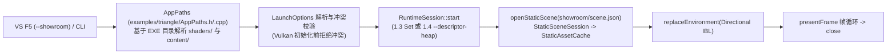

# 默认展示场景与启动技术方案

本方案将 [默认展示场景与启动](../../../docs/毕业交付/默认展示场景与启动.md) 落地为 `examples/triangle` 应用层与构建部署改动，**不修改 `core` / `assets` / `scene` / `render` / `rhi` / `runtime` 引擎库接口**，直接复用现有 `RuntimeSession::start → openStaticScene → replaceEnvironment → presentFrame → close` 全链路。

## 1. 模块关系与启动流

## 2. 路径解析与开发/安装目录统一（`AppPaths`）

为提前对齐 [独立运行包与复现](../../../docs/毕业交付/独立运行包与复现.md#代码架构)，消除开发构建与安装包的双套目录结构：

- 新增应用私有文件 `examples/triangle/AppPaths.h/.cpp`（可被 CPU 单测直接编译链接，无 Vulkan/GLFW 依赖）：
  - `struct AppPaths { std::filesystem::path shaders; std::filesystem::path content; std::filesystem::path output; };`
  - `resolveAppPaths(const std::filesystem::path& exeDir, const std::optional<std::filesystem::path>& explicitOutput, const std::filesystem::path& defaultOutput)`:
    - `shaders = exeDir / "shaders"`
    - `content = exeDir / "content"`
    - `output = explicitOutput ? *explicitOutput : defaultOutput`
    - 启动实际读取 Shader/场景前检查存在性；缺失时返回明确包含用途与展开后完整路径的错误文本并写 `stderr`。
  - Windows 入口 `wmain` 通过 `GetModuleFileNameW`（动态扩容防长路径截断）取当前 EXE 路径，传 `exePath.parent_path()` 给 `resolveAppPaths`。
  - 显式传入的 `--static-scene` / `--asset-root` / `--screenshot` / `--gbuffer-probes` / `--output` 若为相对路径，仍按调用方当前工作目录解释；随包资源（`shaders/`、`content/showroom/`）一律按 `exeDir` 解释，因此切换任意工作目录启动 `--showroom` 均可定位资产。

## 3. CLI 规则与向后兼容

将参数解析拆为纯函数 `parseLaunchOptions(std::span<const std::wstring_view> args, const AppPaths& paths)`，便于纯 CPU 单测全覆盖：

- 新增 `--showroom`：
  - 自动设置 `scene = paths.content / "showroom/scene.json"`、`assetRoot = paths.content / "showroom/assets"`、`gbuffer = true`、`bindlessMaterials = true`、`staticGpuDriven = true`、`hdrLighting = true`、`ibl = Directional`。
  - 允许与 `--descriptor-heap`、`--frames N`、`--hidden`、`--screenshot PATH`、`--gbuffer-probes PATH`、`--exposure-ev EV`、`--output DIR` 自由组合。
  - **严格冲突拒绝（退出码 2，不加载 Vulkan）**：`--showroom` 与 `--static-scene`、`--asset-root`、`--static-scene-test`、`--clear-only`、`--set-binding`、`--set-binding-retirement`、`--gpu-driven`、`--gpu-driven-empty` 任一组合均拒绝。
- **既有调用 100% 保持原语义**：无参数或其他既有显式参数行为不变（P7 再将安装版无参双击入口接到展示预设）；Visual Studio 调试通过 `VS_DEBUGGER_COMMAND_ARGUMENTS "--showroom"` 实现 F5 直接进展示室。
- **可观测日志**：启动加载成功后向标准输出/诊断输出记录实际 `scene=`、`asset_root=`、`binding=set|descriptor-heap`；首次加载或资源缺失失败时先正常 `session->close()` 再以非零退出码返回并打印具体缺失路径。

## 4. 自制确定性展示室布局（`examples/triangle/content/showroom/`）

所有网格与贴图均为随源码维护的自制小型确定性资产（附 `LICENSE.txt` 说明自有版权），严格遵循 `ar_assets` 不透明 glTF 2.0 子集（`POSITION`、`TEXCOORD_0`、`NORMAL`、`indices`、外链 `.bin`、baseColor + metallicRoughness PNG）：

| 区域 | 网格与尺寸（米，右手系 +Y 向上） | 材质与用途 |
| --- | --- | --- |
| 地板（ID `1`） | `10.0 × 0.2 × 10.0` 盒体，顶面 `y = 0` | 中性浅灰漫反射（`roughness=0.85, metallic=0.0`），作阴影与高光反射接收面 |
| 背墙（ID `2`） | `10.0 × 4.0 × 0.2` 盒体，位于 `z = -4.5` | 中性暖灰墙面（`roughness=0.8, metallic=0.0`），提供空间纵深与墙面落影接收 |
| 主立柱（ID `3`） | `0.6 × 3.2 × 0.6` 柱体，位于 `(-2.0, 1.6, -1.0)` | 高辨识度深蓝灰立柱（`roughness=0.45, metallic=0.1`），默认机位可见，且在第二机位（向右移并偏转朝向 `+X/-Z`）可完全移出主相机视锥而落影仍落在可见地面上 |
| 粗糙度材质组（ID `101..105`） | 5 个复用同一 `0.7m` 切角/多面体或盒体网格，横排于 `y = 0.55, z = -1.6, x ∈ {-1.6, -0.8, 0.0, 0.8, 1.6}` | 统一暖灰底色、`metallic = 0.0`，`roughness` 依次为 `0.10, 0.30, 0.50, 0.70, 0.90`，展示高光展宽 |
| 金属度材质组（ID `201..205`） | 5 个复用同一几何网格，横排于 `y = 0.55, z = 0.2, x ∈ {-1.6, -0.8, 0.0, 0.8, 1.6}` | 统一暖铜底色、`roughness = 0.25`，`metallic` 依次为 `0.00, 0.25, 0.50, 0.75, 1.00`，展示介电质到金属的反射过渡 |
| 默认相机 | `position = [0.0, 2.2, 5.2]`，轻微俯视朝向展示室中心 `(0.0, 1.0, -1.0)`，`fov_y = 45°`, `near = 0.1`, `far = 50.0` | 同时完整呈现地板、背墙、立柱与两排材质组，留出自由漫游通道 |

> `scene.json`、`LICENSE.txt`、全部 `.gltf` 与确定性几何/贴图生成脚本 `generate_assets.py` 均以纯 UTF-8 文本随源码维护，不向仓库提交二进制 blob；构建期由 CMake 调用 `Python3 -B generate_assets.py` 将 `unit_box.bin`、`unit_sphere.bin`、`white.png`、`floor_grid.png` 直接生成至运行目录，既保持确定性，又可由代码审查逐行核对几何法线、绕序与贴图数据。

## 5. CMake 增量部署规则（`examples/triangle/CMakeLists.txt`）

- 将 `ar_triangle_shaders` 的每个 `.spv` 同步复制到 `${CMAKE_CURRENT_BINARY_DIR}/$<CONFIG>/shaders/<name>.spv`（即 `$<TARGET_FILE_DIR:ar_triangle>/shaders/`），同时保留 `${CMAKE_BINARY_DIR}/shaders/` 供既有 `shader-build`、`ar_rhi_tests`、`ar_runtime_tests` 继续使用（零破坏既有测试！）。
- 为 `examples/triangle/content/showroom/` 中显式列出的全部纯文本文件（`scene.json`、`LICENSE.txt`、全部 `.gltf`）注册带 `DEPENDS <src>` 的复制规则，并为 `generate_assets.py` 注册带 `DEPENDS generate_assets.py` 的生成规则输出 4 个确定性 `.bin`/`.png` 到运行目录的 `content/showroom/assets/`，汇总到 `ar_triangle_content` 目标并作为 `ar_triangle` 依赖：
  - 干净构建自动完整部署，无需先跑任何测试脚本，且不向源码树写入任何二进制或 `__pycache__`；
  - 仅修改 `scene.json`、任一 `.gltf` 或 `generate_assets.py` 后增量构建会精准触发更新。
- 为 `ar_triangle` 设置目标属性：`VS_DEBUGGER_COMMAND_ARGUMENTS "--showroom"`。
