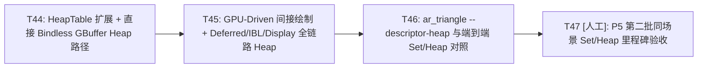
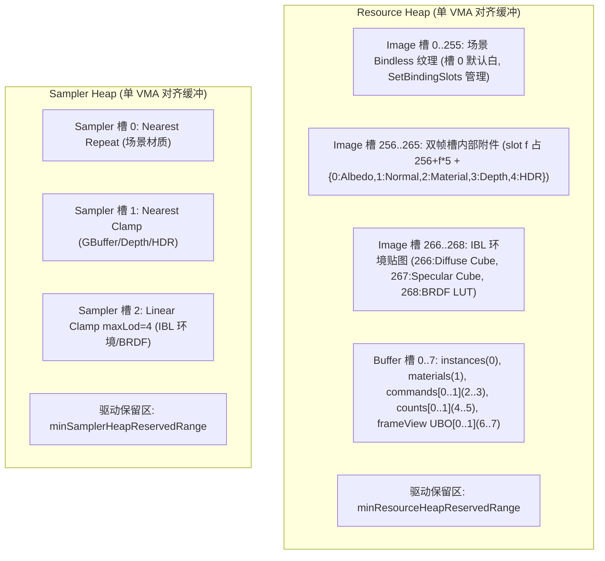

# P5 第二批：同场景 Set 与 Descriptor Heap 对照设计

主责模块为 `rhi` 与 `runtime`（以及示例 `examples/triangle`），严格保持单向依赖 `core ← rhi ← render` 与单 Vulkan 后端。本批零分叉复用既有 GLSL/SPIR-V 着色器，在 Heap 会话中彻底不创建 `VkDescriptorPool`、`VkDescriptorSet` 与 `VkPipelineLayout`。

> 说明：本批以 **1.3 Set vs. 1.4 Heap** 验证功能一致性。后续进入性能对比实验（P7）时，应在同一设备上以 **1.4 Set vs. 1.4 Heap** 在相同场景、画质与诊断开关下测量，消除 API 路径差异干扰。

## 分片演进策略

## 会话模式、失败映射与设备特性边界

- **`QueryMode::Development`** 保持 Vulkan 1.3 基线（不改动 P0 `runtime-mode-mismatch` 契约），用于 1.3 Descriptor Set 路径。
- **`QueryMode::RequireProduct`**（Vulkan 1.4）开放窗口呈现（`config.window` 允许在 `Development` 或 `RequireProduct` 且 `createGraphicsDevice == true` 时启用）。
- **版本不足 vs. Heap 能力不足的失败映射（严禁混为同一错误）**：
  1. Loader 或物理设备 API < 1.4（`!report.judgments.apiVersionSupported`）→ 返回 `ErrorCategory::ApiVersionUnsupported`（`ResultKind::Unsupported`）。
  2. 设备支持 Vulkan 1.4，但启用 `enableDescriptorHeap` 时缺少 `VK_EXT_descriptor_heap` 扩展、`descriptorHeap` / `bufferDeviceAddress` / `runtimeDescriptorArray` / `shaderSampledImageArrayNonUniformIndexing` / `maintenance5` 特性、查询限值非法或缺少设备入口 → 原样保留 `RhiSession::open` 的具体能力错误（`QueryFailed` / `LoaderSymbolMissing` / `RequestedApiUnsupported`），不改写为 `ApiVersionUnsupported`。
  3. 设备支持 1.4 且未开启 `enableDescriptorHeap`，但 `RequireProduct` 所需的 `requiredCapabilitiesSupported` 未满足 → 返回 `ErrorCategory::QueryFailed`（而非 `ApiVersionUnsupported`）。
  4. 以上任一失败分支在已打开 `platform::Window` 时，均须先完成 `rhi->close()` 再调用 `closeWindow(residualResources)`，确保窗口句柄销毁且无初始化资源残留。
- **`RhiSession::open` 设备特性**：启用 `enableDescriptorHeap` 时校验 `limits.maxPushDataSize >= 128`；叠加 `enableGBuffer` 或 `staticIndirect` 时统一通过 `VkPhysicalDeviceVulkan12Features` 启用 `bufferDeviceAddress`、`shaderSampledImageArrayNonUniformIndexing`、`runtimeDescriptorArray`（以及 `staticIndirect` 时的 `drawIndirectCount` 与核心特性 `multiDrawIndirect`），避免重复串联同族 Vulkan 1.2 特性结构体。

## Heap 槽位分区（单 Resource Heap + 单 Sampler Heap）

- `DescriptorHeapTable` 校验 `vkGetPhysicalDeviceDescriptorSizeEXT` 对 `SAMPLED_IMAGE`、`STORAGE_BUFFER`、`UNIFORM_BUFFER` 与 `SAMPLER` 均不超过规划步长。
- 新增内部写入接口：
  - `writeBufferSlot(slot, address, size, VkDescriptorType = VK_DESCRIPTOR_TYPE_STORAGE_BUFFER)`（支持 `UNIFORM_BUFFER`）。
  - `writeExternalImageSlot(slot, const VkImageViewCreateInfo& viewInfo)`（写入外部附件/环境槽 `[256..268]` 并 `vmaFlushAllocation`，不进入场景纹理 `SetBindingSlots`）。
  - `resetExternalImageSlotToDefault(slot)`（将外部槽覆写回槽 0 默认图并 flush）。

### 外部附件与环境槽 `[256..268]` 安全更新协议

场景纹理槽 `[0..255]` 沿用 `SetBindingSlots` + `DeviceResources` 在途退役保护；外部槽 `[256..268]` 绕过槽位表，必须遵守以下严格时序协议：

1. **Swapchain 创建与 Resize（槽 `256..265`）**：
   - `Presentation::presentFrame` 在重建前必须先执行 `drainFrames()`（等待两帧槽全部 `acquired`/`submitted`/`presented` fence 完成），保证无任何 GPU 提交引用旧描述符。
   - `destroySwapchain()` 在销毁旧附件前，若 Heap 存活且未 abandon，先将槽 `256..265` 覆写为槽 0 默认图并 flush，再销毁旧图像。
   - `createSwapchain()` 创建全部新 GBuffer/Depth/HDR 附件成功后再写入槽 `256..265` 并 flush；中途失败回滚已创附件而不污染活跃状态。
2. **环境替换（`Presentation::publishEnvironment`，槽 `266..268`）**：
   - 步骤 1：先完成候选环境上传（`prepareEnvironment`，失败/回滚不触碰旧环境与 Heap 槽）。
   - 步骤 2：调用 `drainFrames()` 等待所有可能引用旧环境描述符的提交完成（等待失败直接销毁候选并返回错误，不触碰槽 `266..268`）。
   - 步骤 3：向槽 `266..268` 写入 3 个新环境描述符并 `vmaFlushAllocation`；任一写入失败时回滚覆写回旧 `m_environment`（若已就绪）或默认图、销毁候选并返回错误。
   - 步骤 4：确认 3 个槽均写入并 flush 成功后，再交换 `m_environment` 与候选并销毁旧环境资源。
3. **关闭顺序**：`Presentation::close()` 在 `drainFrames()` 后先覆写外部槽回默认图，再销毁附件与环境图像；`DescriptorHeapTable` 随会话在 `Presentation` 销毁后释放。

## 逐阶段 Set/Binding 到 Heap 完整映射表（零 Shader 分叉）

设 `S_img = imageStride`、`S_smp = samplerStride`、`B0 = bufferBaseOffset`、`S_buf = bufferStride`、`A0 = 256`（内部附件基槽）、`E0 = 266`（IBL 基槽）。所有 Heap 管线均设置 `VK_PIPELINE_CREATE_2_DESCRIPTOR_HEAP_BIT_EXT` 与 `layout = VK_NULL_HANDLE`。

对于 `HEAP_WITH_PUSH_INDEX` 且 `useCombinedImageSamplerIndex = VK_FALSE` 的 `COMBINED_SAMPLED_IMAGE` 绑定，规范仍按 `samplerHeapOffset + pushData[samplerPushOffset/4] * samplerHeapIndexStride + arrayIndex * samplerHeapArrayStride` 计算采样器地址，因此**固定采样器槽必须显式置 `samplerHeapIndexStride = 0`、`samplerHeapArrayStride = 0`、`samplerPushOffset = pushOffset`、`pEmbeddedSampler = nullptr`**。

| 管线 / 着色器阶段 | `set` | `binding` (`count`) | `resourceMask` | `source` | `heapOffset` | `pushOffset` | `heapIndexStride` | `heapArrayStride` | `samplerHeapOffset` | `samplerPushOffset` / `IndexStride` / `ArrayStride` | Push Data 布局 (`vkCmdPushDataEXT`) |
| --- | --- | --- | --- | --- | --- | --- | --- | --- | --- | --- | --- |
| Direct GBuffer `gbuffer.vert` | — | — | — | — | — | — | — | — | — | — | `[0..128)`: `Draw` (128B) |
| Direct GBuffer `gbuffer_bindless.frag` | `0` | `0` (`1`) | `SAMPLED_IMAGE` | `CONSTANT_OFFSET` | `0` | — | — | `S_img` | `0` | — | 同上 128B |
| Direct GBuffer `gbuffer_bindless.frag` | `0` | `1` (`1`) | `SAMPLER` | `CONSTANT_OFFSET` | `0` | — | — | `0` | — | — | 同上 128B |
| Indirect Cull `static_indirect.comp` | `0` | `0` (`1`) | `READ_ONLY_STORAGE_BUFFER` | `CONSTANT_OFFSET` | `B0 + 0*S_buf` | — | — | `0` | — | — | `[0..8)`: `{count, capacity}`；`[8..12)`: `frameSlot` (12B) |
| Indirect Cull `static_indirect.comp` | `0` | `2` (`1`) | `READ_WRITE_STORAGE_BUFFER` | `PUSH_INDEX` | `B0 + 2*S_buf` | `8` | `S_buf` | `0` | — | — | 同上 12B |
| Indirect Cull `static_indirect.comp` | `0` | `3` (`1`) | `READ_WRITE_STORAGE_BUFFER` | `PUSH_INDEX` | `B0 + 4*S_buf` | `8` | `S_buf` | `0` | — | — | 同上 12B |
| Indirect Cull `static_indirect.comp` | `0` | `4` (`1`) | `UNIFORM_BUFFER` | `PUSH_INDEX` | `B0 + 6*S_buf` | `8` | `S_buf` | `0` | — | — | 同上 12B |
| Indirect Draw `static_indirect.vert` | `1` | `0` (`1`) | `READ_ONLY_STORAGE_BUFFER` | `CONSTANT_OFFSET` | `B0 + 0*S_buf` | — | — | `0` | — | — | `[0..4)`: `frameSlot` (4B) |
| Indirect Draw `static_indirect.vert` | `1` | `4` (`1`) | `UNIFORM_BUFFER` | `PUSH_INDEX` | `B0 + 6*S_buf` | `0` | `S_buf` | `0` | — | — | 同上 4B |
| Indirect Draw `static_indirect.frag` | `0` | `0` (`1`) | `SAMPLED_IMAGE` | `CONSTANT_OFFSET` | `0` | — | — | `S_img` | — | — | 无额外 push |
| Indirect Draw `static_indirect.frag` | `0` | `1` (`1`) | `SAMPLER` | `CONSTANT_OFFSET` | `0` | — | — | `0` | — | — | 无额外 push |
| Indirect Draw `static_indirect.frag` | `1` | `1` (`1`) | `READ_ONLY_STORAGE_BUFFER` | `CONSTANT_OFFSET` | `B0 + 1*S_buf` | — | — | `0` | — | — | 无额外 push |
| Deferred `fullscreen.vert` | — | — | — | — | — | — | — | — | — | — | 无 |
| Deferred `deferred_direct/ibl.frag` | `0` | `b ∈ {0,1,2,3}` (`1`×4) | `COMBINED_SAMPLED_IMAGE` | `PUSH_INDEX` (`useCombined=FALSE`) | `(A0 + b)*S_img` | `112` | `5*S_img` | `0` | `1*S_smp` | `112` / `0` / `0` | `[0..112)`: `{invProj, viewToWorld}`；`[112..116)`: `frameSlot` (116B) |
| Deferred IBL `deferred_ibl.frag` | `0` | `4 + k`, `k ∈ {0,1,2}` (`1`×3) | `COMBINED_SAMPLED_IMAGE` | `CONSTANT_OFFSET` | `(E0 + k)*S_img` | — | — | `0` | `2*S_smp` | — / — / `0` | 同上 116B |
| Display `display_sdr.frag` | `0` | `0` (`1`) | `COMBINED_SAMPLED_IMAGE` | `PUSH_INDEX` (`useCombined=FALSE`) | `(A0 + 4)*S_img` | `8` | `5*S_img` | `0` | `1*S_smp` | `8` / `0` / `0` | `[0..8)`: `DisplayPush`；`[8..12)`: `frameSlot` (12B) |

## 容量截断的对照口径

`static_indirect.comp` 通过 `atomicAdd(visibleCount, 1)` 抢占输出槽。当 `visible > capacity` 时，Set 与 Heap 两次独立运行在并行线程竞争下可合法保留不同子集，**不得要求溢出场景的两组输出子集或像素完全相同**：
- **非溢出场景（`visible <= capacity`）**：严格比较可见计数、排序后 `drawnIds`、GBuffer/HDR/IBL 探针与最终 SDR PNG。
- **溢出场景（`visible > capacity`）**：分别独立校验 Set 与 Heap 满足 `visible == expectedVisible`、`drawnIds.size() == capacity`、全部 ID 唯一且属于合法可见集、无越界命令与 Validation 零错误。
