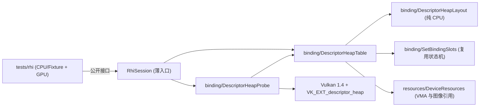
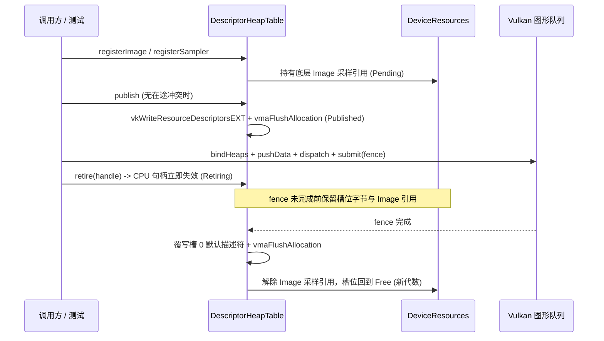

# P5 第一批：Vulkan 1.4 Descriptor Heap 独立原型设计

主责模块为 `rhi`，沿用 [RHI 长期方案](../../../docs/modules/rhi/README.md#vulkan-14-与-descriptor-heap) 与 [P2b 槽位生命周期模型](../p2b-set-bindless/design.md)。本批不改动 Vulkan 1.3 Descriptor Set 路径、P3c/P4a 渲染管线和 T34–T36 静态场景绘制，先在 `engine/rhi/src/vulkan/binding/` 独立验证 Descriptor Heap 完整闭环。

## 模块关系与文件落点

- 新增实现集中在 `engine/rhi/src/vulkan/binding/` 独立单元（`DescriptorHeapLayout.h`、`DescriptorHeapTable.h/.cpp`、`DescriptorHeapProbe.h/.cpp`），不在 `RhiSession.cpp` 或 `Presentation.cpp` 中堆积 Heap 实现。
- `RhiSession.h` 仅扩展 `DescriptorHeapLimits` 的描述符尺寸/对齐与 `maxPushDataSize` 字段，并提供受控验证入口（类比 P3a 的 `verifyGpuCull`），不暴露任何 Vulkan 句柄或类型。

## 能力扩展与设备入口

在 T08 已启用的 `VK_EXT_descriptor_heap`、`descriptorHeap`、`bufferDeviceAddress` 和 `VK_KHR_shader_untyped_pointers` 检查基础上补充：

1. 从 `VkPhysicalDeviceDescriptorHeapPropertiesEXT` 读取并校验：`samplerDescriptorSize`、`samplerDescriptorAlignment`、`imageDescriptorSize`、`imageDescriptorAlignment`、`bufferDescriptorSize`、`bufferDescriptorAlignment`、`maxPushDataSize`（均须非零，且对齐为 2 的幂）。
2. 设备入口解析增加 `vkCmdPushDataEXT`（连同既有 `vkWriteResourceDescriptorsEXT`、`vkWriteSamplerDescriptorsEXT`、`vkCmdBindResourceHeapEXT`、`vkCmdBindSamplerHeapEXT`），保存在 Heap 私有派发表中，不依赖全局 `volkLoadDevice`。

## Heap 布局、对齐与所有权

### 内存分区

- **Resource Heap**（单个 VMA host-visible 缓冲，`VK_BUFFER_USAGE_DESCRIPTOR_HEAP_BIT_EXT | VK_BUFFER_USAGE_SHADER_DEVICE_ADDRESS_BIT`，按 `resourceHeapAlignment` 对齐分配并核验 `vkGetBufferDeviceAddress % resourceHeapAlignment == 0`）：
  - `[0, imageRegionEnd)`：采样图像槽区，`imageStride = alignUp(imageDescriptorSize, imageDescriptorAlignment)`，槽 0 固定为设备持有的 1×1 默认白纹理。
  - `[bufferBaseOffset, bufferRegionEnd)`：存储缓冲槽区，`bufferBaseOffset = alignUp(imageRegionEnd, bufferDescriptorAlignment)`，`bufferStride = alignUp(bufferDescriptorSize, bufferDescriptorAlignment)`，承载原型输出 SSBO 描述符。
  - `[reservedRangeOffset, totalSize)`：驱动保留区，`reservedRangeOffset = alignUp(bufferRegionEnd, resourceHeapAlignment)`，`reservedRangeSize = minResourceHeapReservedRange`，要求 `totalSize <= maxResourceHeapSize`。
- **Sampler Heap**（单个 VMA host-visible 缓冲，相同用途标志，按 `samplerHeapAlignment` 对齐分配并核验设备地址对齐）：
  - `[0, samplerRegionEnd)`：独立 sampler 槽区，`samplerStride = alignUp(samplerDescriptorSize, samplerDescriptorAlignment)`，槽 0 固定为默认 nearest clamp sampler。
  - `[reservedRangeOffset, totalSize)`：驱动保留区，`reservedRangeOffset = alignUp(samplerRegionEnd, samplerHeapAlignment)`，`reservedRangeSize = minSamplerHeapReservedRange`，要求 `totalSize <= maxSamplerHeapSize`。

### 所有权

- `DescriptorHeapTable` 独占两块 Heap VMA 缓冲、映射指针、默认纹理句柄及槽位表；借用 `VkDevice`、派发表与 `DeviceResources`。
- 写入采样图像描述符时使用 `VkImageDescriptorInfoEXT`（携带 `VkImageViewCreateInfo` 与 `VK_IMAGE_LAYOUT_SHADER_READ_ONLY_OPTIMAL`），并继续通过 `DeviceResources` 持有底层 `VkImage` 的采样引用计数，确保退役完成前禁止销毁、上传或读回该图像。
- 写入 sampler 描述符直接向 `vkWriteSamplerDescriptorsEXT` 传入 `VkSamplerCreateInfo`，无需额外创建 `VkSampler` 句柄。

## Shader 与管线映射策略

沿用已确认原则“优先复用 set/binding 映射，与 Descriptor Set 共享着色逻辑”：

- 原型 Compute Shader `shaders/heap_probe.comp` 使用标准 GLSL `set = 0`（binding 0：`texture2D` 数组；binding 1：`sampler` 数组；binding 2：输出 `buffer` SSBO；push constant 块保存 `{textureSlot, samplerSlot, u, v}`），经 `glslc --target-env=vulkan1.4` 编译并通过 `spirv-val`。
- 管线创建时设置 `VkPipelineCreateFlags2CreateInfo{flags = VK_PIPELINE_CREATE_2_DESCRIPTOR_HEAP_BIT_EXT}`、`layout = VK_NULL_HANDLE`，并在 `VkPipelineShaderStageCreateInfo.pNext` 挂接 `VkShaderDescriptorSetAndBindingMappingInfoEXT`：
  - binding 0（`VK_SPIRV_RESOURCE_TYPE_SAMPLED_IMAGE_BIT_EXT`）→ `VK_DESCRIPTOR_MAPPING_SOURCE_HEAP_WITH_CONSTANT_OFFSET_EXT`（`heapOffset = 0`，`heapArrayStride = imageStride`）
  - binding 1（独立 sampler 数组，`VK_SPIRV_RESOURCE_TYPE_SAMPLER_BIT_EXT`）→ `VK_DESCRIPTOR_MAPPING_SOURCE_HEAP_WITH_CONSTANT_OFFSET_EXT`（`heapOffset = 0`，`heapArrayStride = samplerStride`；`samplerHeapOffset`/`samplerHeapArrayStride` 仅用于 combined image sampler）
  - binding 2（`VK_SPIRV_RESOURCE_TYPE_READ_WRITE_STORAGE_BUFFER_BIT_EXT`）→ `VK_DESCRIPTOR_MAPPING_SOURCE_HEAP_WITH_CONSTANT_OFFSET_EXT`（`heapOffset = bufferBaseOffset`，`heapArrayStride = bufferStride`）
- 录制命令依次执行：`vkCmdBindResourceHeapEXT` → `vkCmdBindSamplerHeapEXT` → `vkCmdBindPipeline` → `vkCmdPushDataEXT` → `vkCmdDispatch(1, 1, 1)` → Compute 写到 Host 读屏障。

## 更新、退役时序与失败处理

- **非一致内存可见性**：每次向 Heap 缓冲写入描述符后调用 `vmaFlushAllocation`，确保 GPU 在下一次提交前可见。
- **失败与回滚**：
  - 设备不支持 1.4 / `VK_EXT_descriptor_heap` / `bufferDeviceAddress` / `VK_KHR_shader_untyped_pointers`、缺少任意设备入口、限制无效、整数溢出或超容量：直接返回明确 `core::Error`，不静默回退 Set 路径。
  - 初始化或分配中途失败按逆序销毁已创建的管线、缓冲与引用；关闭时先等待在途 fence，再按管线 → Heap 缓冲 → 引用解除 → `DeviceResources` → `VkDevice` 顺序释放。

## 后续第二批演进边界

第一批验收后，第二批将把同一 `DescriptorHeapTable`（含扩容和静态场景材质/SSBO 映射）接入 T34–T36 静态场景与 GPU 剔除流程，在同一场景、同一相机和同一材质下与 Descriptor Set 路径对照像素与探针。
