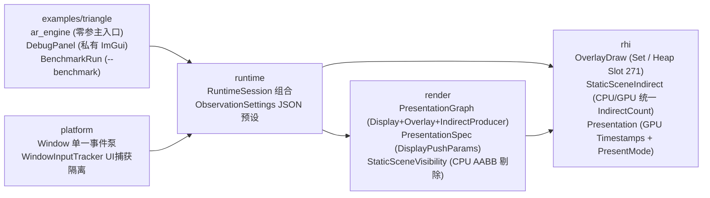

# P6：零参 `ar_engine`、6 通道调试视图、ImGui 面板与四配置性能基准技术方案

主责模块为 `examples/triangle`、`platform`、`render`、`rhi`、`runtime` 与 `scene`，严格维持单向依赖 `core ← rhi ← render`（`runtime` 组合）与单 Vulkan 后端，Vulkan 1.3 Descriptor Set 与 Vulkan 1.4 `VK_EXT_descriptor_heap` 两条路径全量对齐。

## 1. 模块边界与数据流

## 2. 四项关键设计

### 2.1 主程序零参收口与测试驱动解耦
- 产品主程序更名为 `ar_engine`（`VS_STARTUP_PROJECT`），默认启动参数为空，直接加载同级 `shaders/` 与 `content/showroom/` 并开启完整延迟 PBR + IBL + 2048 阴影 + 自由相机 + `[F1]` ImGui 调试面板。
- `AppPaths` 删除 P1–P5 历史模式开关，仅保留 `--descriptor-heap`、`--scene/--asset-root`、`--hidden --frames`、`--screenshot`/`--gbuffer-probes`、`--output` 与独立的 `--benchmark <SPEC_JSON>`。
- 历史 P1–P5 专项回归移至 `TestSupport / ar_sample_harness`（`tests/triangle/sample_harness.cpp`），不进入产品主程序。

### 2.2 6 通道调试视图与 Set/Heap `OverlayDraw`
- `display_sdr.frag` 统一接收 20B `DisplayPushParams`（`exposureScale`、`encodeSrgb`、`viewMode`、`cameraNear`、`cameraFar`；Heap 路径紧随 4B `frameSlot` 共 24B），支持 `Final / BaseColor / ViewNormal / MetallicRoughness / MainDepth / ShadowDepth` 六通道。`PresentationGraph` 在 `Display` Pass 固定声明所有静态绑定附件的 `FragmentSample`，满足 Vulkan `VUID-vkCmdDraw-imageLayout-00344`；关闭阴影时自动禁选并回退 `Final`。
- `vcpkg.json` 仅引入纯 `"imgui"` 并只由 `ar_engine` 私有链接；`DebugPanel` 将 `ImDrawData` 转为绑定无关的 `rhi::OverlayDrawList`（20B `OverlayVertex` 匹配 `ImDrawVert`）。
- `rhi::detail::OverlayDraw` 在 Set 路径使用单 binding 描述符集，在 Heap 路径写入 Resource Heap 外部槽 `kHeapOverlayFontImage = 271`（总槽位 `kHeapTotalSceneImages = 272`）并复用 Sampler Heap 线性钳位槽 `2`，全程零 `VkDescriptorPool`/`VkDescriptorSet`/`VkPipelineLayout`；`PresentationGraph` 为 `Overlay` Pass 声明 `discard = false` 与 `COLOR_ATTACHMENT_READ | WRITE`，`overlay.frag` 对 sRGB swapchain 解码顶点色。

### 2.3 `ObservationSettings` 预设与单一事件泵
- `platform::Window` 收拢 GLFW 回调事件队列（`takeUiEvents`）与 `setUiCapture(keyboard, mouse)`；右键漫游进入 `CursorMode::Disabled` 时，`DebugPanel` 屏蔽 ImGui 鼠标/键盘捕获并将虚拟鼠标移出视口，保证漫游与 UI 互不抢占且无首帧跳变。
- `runtime::ObservationSettings` 以原子临时文件替换写入 JSON v1（相机、曝光、方向光含 `cast_shadows`、视图通道），加载前做版本、场景引用与参数范围校验，失败时零副作用保留当前生效状态。

### 2.4 GPU 时间戳、CPU AABB 剔除与四配置基准
- `Presentation` 为每帧槽创建 14 槽 `VkQueryPool`，在 fence 完成后非阻塞回收各 Pass 耗时（`Shadow / Cull / Geometry / Lighting / Display / Overlay / Total`），并通过 `takeCompletedGpuTimings()` + `drainCompletedGpuTimings()` 按 `frameNumber` 交付；不支持时间戳时显式写明 `unavailableReason`，不伪造 0。
- `render::cullStaticSceneCpu` 精确复现 `shaders/static_indirect.comp` 的 `inverseAspect` 缩放 `viewProj * modelMatrix` 六半空间裁剪，经 `CpuFrustumCullFn` 回调由 `StaticSceneIndirect::cullCpu` 在提交前写入已完成 fence 的 `HostVisible` 帧槽 `commands`/`counts`，与 GPU compute 路径共享同一 `vkCmdDrawIndexedIndirectCount` 消费路径；GPU 基准轮启用 `readIndirectCounts` 仅同步 8 字节 `Counts` 缓冲用于异步可见数记录。
- `Presentation` 查询 `vkGetPhysicalDeviceSurfacePresentModesKHR` 支持 `Fifo / Mailbox / Immediate`（确定性回退），基准轮关闭 UI/截图/读回并隔离容量溢出样本，输出可独立重算中位数与 P95 的 `frames.csv` 与 `summary.json`。
