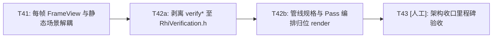

# 架构适度收口设计

主责模块为 `render`、`rhi` 与 `runtime`，严格保持单向依赖 `core ← rhi ← render`，`runtime` 负责组合。保持单 Vulkan 后端，不引入通用多后端抽象层。

## 分片演进策略

## T41：每帧相机视图与静态场景解耦

### 数据所有权与帧槽隔离

1. **静态实例数据（仅在 `replaceStaticScene` 上传一次）**：
   - `rhi::StaticInstanceDraw` 存储世界空间 `modelMatrix`（16 float）、世界空间法线矩阵 `normalFromModel`（`transpose(inverse(mat3(model)))`，3×vec4，w 分量沿用金属度/粗糙度因子）与 `baseColorFactor`，不再携带任何相机矩阵。
   - `StaticSceneIndirect::Instance`（160 字节 std430，字段偏移不变）首 64 字节改为 `modelMatrix`，后 48 字节改为世界空间 `normalColumn0..2`。
2. **每帧视图数据（`rhi::FrameView`，不重传静态资源）**：
   - `render::buildFrameView(const StaticCamera& camera, bool enableGBuffer)` 校验有限数值、正 `nearPlane`、`farPlane > nearPlane`、`0 < verticalFovRadians < pi` 与非零四元数，构造：
     - `view`（world → view，左上 3×3 为正交旋转矩阵，故 `mat3(view) * worldNormalMatrix == transpose(inverse(mat3(view * model)))`）
     - `clipFromWorld`（aspect=1 的 `projection * view`，沿用 `!enableGBuffer` 时的 Y 翻转约定）
     - `inverseProjection`（aspect=1 的 `inverse(projection)`）
     - `viewToWorld`（3×vec4 相机旋转）
   - `RhiSession::setFrameView(const FrameView&)` 与 `RuntimeSession::setCamera(const render::StaticCamera&)` 仅更新主机侧当前视图与 `activeCamera`，不调用 `drainFrames()`，不触碰静态网格/贴图/SSBO，不递增 `staticSceneUploadCount`。
3. **GPU 每帧 UBO 与 Shader 契约**：
   - `StaticSceneIndirect::Scene::Frame`（双帧槽，每槽独立）新增 128 字节 host-visible UBO `view`（`binding = 4`，`VK_DESCRIPTOR_TYPE_UNIFORM_BUFFER`，`COMPUTE | VERTEX`），含 `{mat4 viewProj; mat4 view;}`。
   - `Presentation::record()` 在等待当前帧槽 `submitted` fence 之后、录制 Compute 剔除前，把带当前 `inverseAspect` 的 `FrameViewGpu` 写入当前帧槽 UBO 并 `vmaFlushAllocation`；两帧在途各自读写独立 UBO，无跨帧竞争。
   - `static_indirect.comp` 在 GPU 内计算 `clipFromModel = frameView.viewProj * instance.modelMatrix` 并执行 6 平面局部 AABB 裁剪；`static_indirect.vert` 计算 `gl_Position = (frameView.viewProj * instance.modelMatrix) * vec4(position, 1.0)` 与 `viewNormal = (mat3(frameView.view) * worldNormalMatrix) * normal`；直接绘制路径 `StaticSceneDraw::record` 按相同乘法顺序在 CPU 计算 push constant，保证直接与间接路径字节一致。

## T42a：验证入口与产品主头分离

- 新增公开验证头 `engine/rhi/include/rhi/RhiVerification.h`，承接 `DescriptorHeapSampleQuery`、`DescriptorHeapProbeResult`、`DescriptorHeapRetirementResult` 及自由函数 `verifyGpuCull(RhiSession&, ...)`、`verifyDescriptorHeap(RhiSession&, ...)`、`verifyDescriptorHeapRetirement(RhiSession&, ...)`。
- 从 `engine/rhi/include/rhi/RhiSession.h` 移除上述测试专用成员与类型，`RhiSession` 内部仅通过私有友元/内部辅助转发到 `DeviceResources` 与 `DescriptorHeapProbe`。
- 新增独立公开头编译探针覆盖 `RhiVerification.h`，保证主头与验证头均可独立编译且不泄露 Vulkan 类型。

## T42b：渲染管线规格与 Pass 编排归位 `render`

- `engine/render` 负责描述具体渲染管线配方（GBuffer 附件格式与清屏值、延迟光照/IBL/Display 管线配置、曝光常量、探针采样坐标与半精度/深度解码）以及 `RenderGraph` 动态资源/Pass 声明。
- `engine/rhi` 退回为底层执行原语：Swapchain 与双帧同步、VMA 资源/上传/退役、Set/Heap 绑定表，以及按 `render` 传入的管线/Pass 规格与 `GraphPlan` 屏障执行 Dynamic Rendering 与 Sync2 录制；拆小 `Presentation.cpp`，消除 `rhi` 中硬编码的 PBR 曝光、探针坐标与业务 Pass 语义。
- 为后续 P5 第二批（同一静态场景在 Set 与 Heap 绑定后端间切换）和 P4b（新增方向光阴影 Pass 与多视图）提供清晰挂点。
